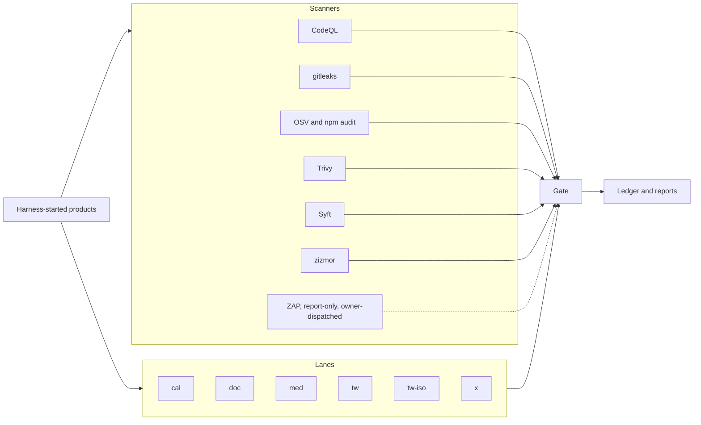

# I test the security of products and of the pipeline around them

QA engineer with 4 years in industry, open to remote roles and contract work.

This repository is the application-security and DevSecOps part of my QA portfolio. A typical security run is a scanner report. I write tests for specific abuse cases, run those tests and the scanners together, and fail the build when a new issue appears. Authorization between two accounts. A signed webhook sent twice. A one-time token used at the same moment. A spreadsheet formula in an exported file. The same checks run on this repository, so a secret cannot slip into an artefact unnoticed and a known-vulnerable dependency cannot land without a review.

To prove the method carries over, I pointed it at four open-source products that work like four different businesses. Medusa is an online store, Cal.com is a booking tool, Documenso handles e-signatures and Twenty is a CRM. The public findings ledger records 5 product findings, 1 confirmed and 4 suspected. Further entries are held for disclosure. If your product has sign-in, webhooks, exports or a CI pipeline, I can test it the same way.

## What that looks like in practice

- **A confirmed concurrency defect in a password-reset token.** On Cal.com, P5-CAL-TOK-001 is a confirmed product bug. Detail is held by the owner.
- **A signed webhook accepted a second time.** On Cal.com, a replay of a valid signed request was accepted (P5-CAL-WH-002, suspected).
- **A signed webhook accepted after it was stale.** On Cal.com, a stale timestamp with a valid signature was accepted (P5-CAL-WH-003, suspected).
- **P5-MED-AUTHZ-001 (suspected, High).** An authorization finding on Medusa customer cart routes. Detail is held by the owner.
- **P5-TW-MASS-001 (suspected, Medium).** A mass-assignment finding on Twenty. Detail is held by the owner.
- **A sign-in control that held.** On Documenso, a consumed OAuth state was refused and created no session (P5-DOC-OIDC-001, verified).

## Why the numbers hold up

Every recorded result comes from GitHub Actions, against product stacks started by a pinned harness, never from a laptop run. A confirmed product bug is encoded as an expected failure, so if the product changes the build turns red and the count cannot go stale. Counts come only from the findings ledger. Scanners gate this repository on every change.

## How the pipeline is arranged

ZAP is report-only and is not part of the pull-request gate. The other scanners follow the committed registry.

## Next step

- **To see how it works,** read the [technical guide](docs/technical-guide.md), the [findings ledger](docs/findings/ledger.json) and the [threat models](docs/threat-models/).
- **To talk about a role,** I'm open to remote QA roles.
- **To get your product tested,** I take contract work for startups before a launch or a security review.

**[LinkedIn](https://www.linkedin.com/in/jayamihettigoda/)** · **[Email](mailto:jayami2114@gmail.com)** · [GitHub](https://github.com/Jayami123)

Built with TypeScript, Playwright, Node.js, Docker and GitHub Actions.
