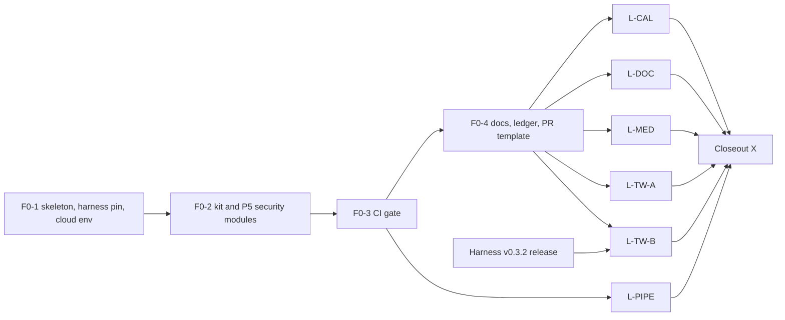

# P5 AppSec and DevSecOps master plan

Status: PLAN ONLY. No package, source, workflow, config or test is changed by this plan's PR.
Date: 2026-11-08 (Asia/Colombo). Author role: planner. Build: a smaller model or junior engineer, PR by PR.
Read with: `docs/probes/2026-11-08-p5-code-reads.md` (every fact below, with repo, ref, file:line, read method and status).

## 0. Header

| Item | Value |
|---|---|
| Base commit | `06ac98808964854b62e2e7699783bc86c9b23e20` ("Initial project structure"), `origin/main` at planning time |
| Plan branch | `plan/2026-11-08-p5-master-plan` (this PR, head recorded in the planner report) |
| Designated session branch | `claude/compassionate-ride-641gj0` (fast-forwarded to the same plan commits, see the planner report) |
| Lane branches | `feat/<YYYY-MM-DD>-p5-<lane>-<topic>`, dated with the build day in Asia/Colombo (`date +%F`). Examples: `feat/2026-11-12-p5-f0-1-skeleton`, `feat/2026-11-18-p5-cal-webhook-replay`. |
| Foundation branches | `feat/<YYYY-MM-DD>-p5-f0-<n>-<topic>` (F0-1 to F0-4) |
| Who merges | The owner only, by merge commit. No squash, no rebase merge. No builder merges. |
| Who runs CodeRabbit | Nobody in this plan. The owner runs it later. |
| Plan lane branches | Lane plan branches never merge. This master plan merges to `main` because every lane cites it. |

## 1. Goal and scope

**What P5 proves.** Security behaviour of four pinned product forks (Cal, Documenso, Medusa starter with core 2.21.2, Twenty) on local harness stacks, plus the security of this repository's own pipeline. Each proof is a test with a positive control, a named budget and a verdict: PASS, PRODUCT BUG (SUSPECTED), deployment finding, or design verdict. P5 also owns the findings ledger, the threat-model one-pagers, the scanner gate, and the evidence release.

**What P5 does not prove.** Anything on a third-party or production target; load or capacity (P6 owns it); a complete audit of any product; payload-level detail for private-first items; anything that needs a human attacker model beyond the one-pagers. Scope rules: `docs/SECURITY-SCOPE.md` (created in F0-4) limits targets to local forks and pinned images, with payloads at test-design level.

**Repository rules that apply to every PR** (also in `AGENTS.md`, F0-1): section 7 below.

## 2. Facts used

Each fact is re-checked in the code-read record. Status is from that record. Line numbers are at the pinned ref named in the record.

| # | Fact | Pinned evidence (file:line) | Status |
|---|---|---|---|
| 1 | Documenso bypass forwarded only when caller env `DANGEROUS_BYPASS_RATE_LIMITS` is the string `"true"`; default limits ON; P2 roadmap "v0.3.0 turns limits off" is stale | harness `v0.3.1` `src/adapters/documenso-env.ts:297-298`; P2 `docs/plans/2026-10-20-p2-phase1-roadmap.md:211` (stale line) | CONFIRMED |
| 2 | Documenso per-route limits measured by P6 (authorize 10, forgot 3, reset 5, verify 5, upload 20); cited, not re-run | P6 `0533e61` `src/load/spike/limiter-contract.ts:19-57`. Also present and not in the plan's first budget row: resend-verify-email 3 (`:36-42`), P6 `ai` 3 (`:20`). | CONFIRMED (plan adds the two extra values, OD-3) |
| 3 | Documenso upstream e2e covers session invalidation on reset and on password update | Documenso `f4105e4` `packages/app-tests/e2e/user/password.spec.ts:113`, `:171` | CONFIRMED |
| 4 | P6-DOC-RACE-002: one token sent 10× in parallel; all 200; one SIGNED, nine ALREADY_SIGNED, one seal, one audit row, one email, one webhook | P6 `0533e61` `tests/documenso/races/doc-race-002-double-submit.spec.ts:40-48`; P6 task-7 plan row for race 002 | CONFIRMED |
| 5 | Twenty harness passes only listed env names (includes `IS_MULTIWORKSPACE_ENABLED`, `OUTBOUND_HTTP_ALLOWED_INTERNAL_HOSTS`) and six limiter names; `LOGIC_FUNCTION_TYPE` NOT passed | harness `v0.3.1` `src/adapters/twenty-passthrough.ts:5-12`; `src/adapters/twenty-rate-limits.ts:7-14`; grep for `LOGIC_FUNCTION_TYPE` in harness: none | CONFIRMED |
| 6 | Twenty captcha returns success when no driver is configured; harness sets none | Twenty `7cbdfec6` `packages/twenty-server/src/engine/core-modules/captcha/captcha.service.ts:12-18`; harness grep for CAPTCHA: none | CONFIRMED on source; image `v2.44.0` UNPROBED |
| 7 | Twenty logic functions: default timeout 300 s; per-function `timeoutSeconds` 1 to 900; local driver default 900 000 ms | Twenty `logic-function.entity.ts:23`, `:64-65`; `create-logic-function-from-source.input.ts:51-52`; `local.driver.ts:114` | CONFIRMED (900 000 is a default parameter, not a named cap; cap behaviour UNPROBED) |
| 8 | Twenty API key cannot create or activate a workflow version (P2 probe B-P21), so workflow SSRF rows need a user session | P2 `99a2fde` `docs/probes/2026-11-03-p2-lane-tw-probes.md:42` | CONFIRMED (doc evidence) |
| 9 | Cal OAuth: `createClient` is `authedAdminProcedure`; ADMIN without strong password and 2FA becomes INACTIVE_ADMIN in production; seed creates an OAuth client (PKCE off) only with env vars; token route `POST /api/v2/auth/oauth2/token` | Cal `c2b7ac44` `packages/trpc/server/routers/viewer/oAuth/_router.tsx:23`, `:32`; `packages/features/auth/lib/next-auth-options.ts:254`, `:264`, `:270`; `scripts/seed.ts:1015-1026`; `apps/api/v2/.../oauth2.controller.e2e-spec.ts:52` | CONFIRMED |
| 10 | Cal CSV export is a client-side download in the organisation members table | Cal `apps/web/modules/users/components/UserTable/UserListTable.tsx:657`, `:760`; `packages/lib/csvUtils.ts:1`, `:33`, `:40`, `:49` | CONFIRMED |
| 11 | Cal API v2 throttle: 120 requests per 60 s per API key by default; public-booking Unkey no-op | Cal `apps/api/v2/src/lib/throttler-guard.ts:36` (default 120; TTL default 60 s); P2 `docs/probes/2026-11-02-p2-lane-cal-probes.md:254-259` (P13) | CONFIRMED for the throttler; Unkey no-op path UNREAD |
| 12 | Medusa RBAC flag `rbac`, default false, env `MEDUSA_FF_RBAC`; the harness gives the backend only its `.env` plus fixed switches; no RBAC switch exists | Medusa core `v2.21.2` `packages/medusa/src/feature-flags/rbac.ts:3-7`; harness `v0.3.1` `src/adapters/medusa.adapter.ts:276-282` | CONFIRMED (harness `medusa-env.ts` UNREAD) |
| 13 | Medusa `GET /store/orders/:id` has no authenticate step; the route documents the order id as the authentication mechanism | Medusa core `v2.21.2` `packages/medusa/src/api/store/orders/middlewares.ts:30-37` (no `authenticate`); `:19-21` (list route has it); `orders/[id]/route.ts` doc comment | CONFIRMED (design choice; capability verdict, MI-5) |
| 14 | Stripe default tolerance is 5 minutes; stripe-node default is 300 s | docs.stripe.com/webhooks text "Our libraries have a default tolerance of 5 minutes"; stripe-node `v23.0.1` `src/Webhooks.ts:142` (`DEFAULT_TOLERANCE: 300`) | CONFIRMED |
| 15 | P2 reuse: Cal Daily signer and verifier, outbound schemes, receiver reach (`host.docker.internal`), `qa_ro` and `qa_fixture` roles | P2 `99a2fde` `src/webhooks/sign.ts:87`, `:105`; `src/webhooks/verify.ts:102`; `src/webhooks/reach.ts:25`, `:29`; `src/db/roles.ts:12-13` | CONFIRMED (reuse by vendoring, section 7 F0-2) |
| 16 | This repo: public rulesets API returns `[]`; secret scanning and push protection stated on; code scanning and Actions permissions not readable without auth | `GET https://api.github.com/repos/Jayami123/appsec-devsecops-pipeline/rulesets` returned `[]` | Rulesets CONFIRMED; the rest UNREAD (owner steps, section 9) |

Extra facts used by this plan (all in the code-read record, section 3): the harness `PRODUCTS_ROOT` default is `HARNESS_ROOT/../products` (`src/config.ts:151`), which points inside `node_modules` when installed as a dependency, so `PRODUCTS_ROOT` must be set. P2 pins: `.nvmrc` = `22`, `package.json` engines `>=22.22.0`, Documenso needs Node 24 (`$NODE24`), Medusa uses pnpm 10.11.1. P2 action pins to reuse: `actions/checkout@3d3c42e5aac5ba805825da76410c181273ba90b1 # v7.0.1`, `actions/setup-node@949feb2413d6458794dcd2491c4babbbce0c15c1 # v7.1.0`. P2 `main` at study was `ffa9fd3`; it differs from `99a2fde` only in three files.

## 3. Decisions (taken; do not reopen)

| ID | Decision |
|---|---|
| D1 | Lane shape: product lanes (L-CAL, L-DOC, L-MED, L-TW-A, L-TW-B) plus one DevSecOps lane (L-PIPE), after a serial foundation F0, plus a closeout X. Same file-ownership rule as P2. |
| D2 | Reuse of P2 code: vendor a SMALL copy into `src/kit/` with a provenance header on every file (source repo, path, commit `99a2fde`, "vendored; change here only with a reason in the PR"), plus the matching P2 unit tests. A shared testkit extraction into the harness is a backlog item, not P5 work. |
| D3 | Private-first findings: ID and status only (section 4). Enforced by a PR checklist item, NOT a keyword CI check (a keyword list would itself disclose). |
| D4 | Scanner gate: BLOCK only on (a) leaked secrets in this repo, (b) NEW High or Critical findings that have a fix available in dependencies or code P5 owns, (c) workflow-hardening errors. Product images and forks: report-only (SARIF) against a committed baseline. Every accepted-risk entry has an owner reason and expires after `ACCEPTED_RISK_TTL_DAYS` = 90. |
| D5 | Dependency scanner: OSV-Scanner plus `npm audit`. No SaaS account. Not Snyk. |
| D6 | IDs already satisfied in P2 or P6 stay as ALIAS rows ("satisfied by ..."), so the P7 traceability table resolves. |
| D7 | P5-CAL-RL-001 dropped to a documented deployment note (no Unkey dependency in CI). |
| D8 | Twenty sandbox rows (L-TW-B): wait for a harness opt-in `LOGIC_FUNCTION_TYPE` pass-through; run only in a dedicated job with no repository secrets on a disposable stack; gated skip with the blocker named. |
| D9 | Documenso OIDC rows: second wave inside L-DOC, gated on a mock IdP container and env reach. |
| D10 | Non-security items that the P2 charter tagged "P5" go back to the owner's filing track (not P5 scope). |
| D11 | DAST: ZAP authenticated passive baseline nightly; active scan only by manual dispatch on a throwaway stack. Never a PR gate. |
| D12 | One deterministic header row per product; ZAP adds breadth. MED-HDR-001 (P3) may be cut later. |
| D13 | `docs/SECURITY-SCOPE.md` in F0-4: local forks and pinned images only; payloads at test-design level; no third-party targets. |
| D14 | P5-MED-RBAC-001: gated skip with the blocker named until a harness opt-in `MEDUSA_FF_RBAC` switch ships. Never edit the fork `.env`. |

### 3.1 Open decisions (this plan's own)

Each has options, evidence, and the recommended default. The builder uses the default unless the owner has answered. **BLOCKING** means a builder must not proceed on the default. Only OD-7 is BLOCKING, and only for its own rows.

| ID | Decision | Options | Evidence | Recommended default | Blocking |
|---|---|---|---|---|---|
| OD-1 | Which private item MI-6 names | (a) owner names the ID; (b) leave the row as status-only | The charter lists "MI-6 status only (section 4)" but does not name its ID | (b): record MI-6 as "held-private; see owner" with no ID mapping in this repo | No |
| OD-2 | Coverage-link targets for MI-18, MI-19, MI-23 | (a) owner names the alias row each supports; (b) assign by the alias table | The charter calls them "coverage links behind the aliases" without naming the row | (b): a coverage link supports the alias row of the same product; the owner confirms at review | No |
| OD-3 | Documenso route budget set | (a) P5 cites only the five values in the charter; (b) add `resend-verify-email` 3 and P6 `ai` 3 | P6 `limiter-contract.ts:20`, `:36-42` | (b): cite all seven values from the P6 table; P5 re-runs none | No |
| OD-4 | Medusa core source at build time | (a) sparse read of tag `v2.21.2` (commit `020565398e436a2bc65777a3b1ad347b4735d6df`); (b) no core read, starter only | Starter pins `@medusajs/medusa` 2.21.2 (`apps/backend/package.json:32`) | (a): record the commit in each lane's code-read record | No |
| OD-5 | `PRODUCTS_ROOT` in CI | (a) `${{ github.workspace }}/../products` (P2 precedent in `p2-tw.yml`); (b) a fixed path | Harness default resolves inside `node_modules` (`src/config.ts:151`) | (a) in CI; `/home/user/products` set by hand in cloud environments (P2 precedent) | No |
| OD-6 | Claude attribution keys | (a) P2 form: `"attribution": {"commit": "", "pr": ""}` and `"includeCoAuthoredBy": false`; (b) add `"sessionUrl": false` | P2 `.claude/settings.json`; the `sessionUrl` key is not in P2 and its schema support is UNREAD | (a). Add `sessionUrl` only after a probe in F0-1 shows the effective setting accepts it | No |
| OD-7 | Cal OAuth setup path for P5-CAL-OAUTH-001 and -002 | (a) seed-env OAuth client (fork seed, `enablePkce: false`), needs harness to pass `SEED_OAUTH2_*`; (b) admin UI client through `createClient`, needs a 2FA admin in production mode | Seed env names at `scripts/seed.ts:1015-1016`; `createClient` is admin-only; INACTIVE_ADMIN rule at `next-auth-options.ts:264` | (a), probe first. Never a DB insert. | **BLOCKING for P5-CAL-OAUTH-001 and -002 only** |
| OD-8 | Node version for P5 | (a) copy P2: `.nvmrc` = `22`, engines `>=22.22.0`, CI on the cloud image Node 22.23; (b) pin a patch version | P2 `.nvmrc`, `package.json:5-7`, `.cursor/Dockerfile` | (a). Documenso runs on Node 24 via `$NODE24` only. | No |
| OD-9 | Severity rubric in `docs/SEVERITY.md` | (a) simple High/Medium/Low by impact and exploitability, with a CVSS v4 score recorded per finding as reference; (b) CVSS v4 base score as the rubric | Charter allows either | (a) | No |
| OD-10 | Node 24 for Documenso in CI | (a) the `doc-api` and `doc-serial` jobs install Node 24.22.0 with `actions/setup-node` (SHA-pinned, version comment); (b) rely on a cloud image only | Cloud image sets `$NODE24` (`.cursor/Dockerfile`); P2 CI job setup for Documenso NOT read in this session (UNREAD) | (a). Recorded as UNPROBED until the first lane run. | No |
| OD-11 | CodeQL (PN-4) timing | (a) add in L-PIPE after F0-3; (b) add in F0-3 | Charter: "blocking on new High" | (a) | No |
| OD-12 | Numbering of new rows (PN, MI unnumbered) | (a) owner numbers later; (b) builders assign | Charter: P5 IDs are never assigned by builders | (a). Builders use the PN and MI labels only. | No |
| OD-13 | Disclosure settled for private areas | (a) no (default); (b) yes | Charter section 4 | (a): no new public test or fixture in private areas. Existing P2 and P6 tests stay. | No |
| OD-14 | Evidence release permissions | (a) reuse P6 workflow but move `contents: write` to the release job only, with `workflow` `contents: read`; (b) reuse as is | P6 `evidence-release.yml:19-30` (job-level write) | (a) | No |
| OD-15 | Browser in CI for the UI rows (P5-CAL-XSS-001, -XSS-002, -RED-001, -CSV-001) | (a) install Chromium only in the `cal-ui` job with `npx playwright install --with-deps chromium`, version = `@playwright/test`; (b) browser cache | P2 forbids browser downloads in its lanes (`api.yml` check); P5 needs UI rows | (a). P2's `PLAYWRIGHT_SKIP_BROWSER_DOWNLOAD` stays set in all other jobs. | No |
| OD-16 | Gated rows wait | (a) gated skip with blocker name (D8, D9, D14); (b) delete rows | Charter | (a) | No |

Other open items (not decisions, handled as probes or owner steps): see section 10 (probe-first) and section 9 (owner steps).

## 4. Inventory

Legend: KEEP = build in this plan. ALIAS = satisfied elsewhere; the ID stays as a row. DROP = row kept with the reason. Priority in brackets. Lane is the owning lane.

### 4.1 KEEP rows (64)

| ID | Pri | Title | Lane |
|---|---|---|---|
| P5-CAL-AUTHZ-001 | P0 | Other user cannot GET/PUT/DELETE owner booking (matrix row) | L-CAL |
| P5-CAL-AUTHZ-002 | P1 | Anonymous cannot mutate; UID read fields documented | L-CAL |
| P5-CAL-CAP-001 | P1 | Anonymous UID response field allowlist (capability-id write-up with MI-5) | L-CAL |
| P5-CAL-TEAM-001 | P1 | Member of team A cannot edit team B event type | L-CAL |
| P5-CAL-WH-002 | P0 | Replay of a captured valid request (vendored Daily signer; crafted timestamp, no wall-clock wait) | L-CAL |
| P5-CAL-WH-003 | P0 | Stale timestamp with recomputed signature (`WEBHOOK_STALE_AGE_S`) | L-CAL |
| P5-CAL-CRON-001 | P1 | Cron without key rejected: one row per cron route (absorbs MI-9 and the remaining routes of CRON-002) | L-CAL |
| P5-CAL-OAUTH-001 | P1 | Authorization code is single-use (setup path: probe first, OD-7) | L-CAL |
| P5-CAL-OAUTH-002 | P1 | PKCE: wrong `code_verifier` rejected (same setup) | L-CAL |
| P5-CAL-2FA-001 | P1 | Burst of wrong TOTP codes (`TOTP_BURST`; throwaway user only) | L-CAL |
| P5-CAL-TOK-001 | P1 | Reset token concurrent redemption | L-CAL |
| P5-CAL-RL-002 | P2 | API key over quota returns 429 (`CAL_V2_KEY_LIMIT`) | L-CAL |
| P5-CAL-XSS-001 | P0 | Script tags in event description not executed | L-CAL |
| P5-CAL-XSS-002 | P2 | Description in confirmation email sanitised (harness mail catcher) | L-CAL |
| P5-CAL-RED-001 | P1 | External `successRedirectUrl` rejected or warned | L-CAL |
| P5-CAL-CSV-001 | P0 | Export prefixes formula-like cells (UI download, organisation members table) | L-CAL |
| P5-CAL-HDR-001 | P2 | Booker response security headers | L-CAL |
| P5-DOC-AUTHZ-001 | P0 | Other user GET/DELETE envelope returns 403 or 404 | L-DOC |
| P5-DOC-AUTHZ-002 | P1 | Cross-organisation template access denied | L-DOC |
| P5-DOC-RBAC-001 | P2 | EVERYONE role sees document; lower visibility hides (sample cells) | L-DOC |
| P5-DOC-HDR-001 | P2 | Signing page headers | L-DOC |
| P5-DOC-OIDC-001 | P1 | Replay of OAuth state rejected (second wave, D9) | L-DOC |
| P5-DOC-OIDC-002 | P1 | `email_verified=false` not auto-linked (second wave, D9) | L-DOC |
| P5-MED-WH-001 | P0 | Missing signature: payment unchanged (safe property only) | L-MED |
| P5-MED-WH-002 | P0 | Invalid signature: payment unchanged (DB-unchanged oracle) | L-MED |
| P5-MED-AUTHZ-001 | P0 | Customer B cannot read customer A cart | L-MED |
| P5-MED-AUTHZ-002 | P0 | Publishable key alone cannot act as admin | L-MED |
| P5-MED-AUTHZ-003 | P1 | Customer B cannot update customer A address | L-MED |
| P5-MED-RBAC-001 | P2 | Role without order write cannot cancel (GATED, D14) | L-MED |
| P5-MED-FIELD-001 | P1 | `fields=` rejects restricted customer PII on store (includes the order-by-id row, fact 13) | L-MED |
| P5-MED-RL-001 | P0 | Admin login wrong-password burst (`BRUTE_FORCE_ATTEMPTS`; expected: deployment finding unless a 429 appears) | L-MED |
| P5-MED-CORS-001 | P2 | Disallowed origin gets no `Access-Control-Allow-Origin` | L-MED |
| P5-MED-FUZZ-001 | P2 | Schemathesis store API: no 5xx on valid schema extras (P2's committed store OAS) | L-MED |
| P5-MED-HDR-001 | P3 | Admin `/app` and store API headers | L-MED |
| P5-TW-MT-001 | P0 | Apple user cannot read YC company (second-workspace helper and `tw-multiws` job shape from P2) | L-TW-A |
| P5-TW-MT-002 | P1 | Signed file URL from Apple not readable in a YC session | L-TW-A |
| P5-TW-RBAC-001 | P1 | Guest cannot create webhook | L-TW-A |
| P5-TW-RLS-001 | P0 | Hidden record absent from search (plus soft-deleted variant, MI-17) | L-TW-A |
| P5-TW-RLS-002 | P1 | Hidden record absent from CSV export | L-TW-A |
| P5-TW-RLS-003 | P1 | Hidden field absent from GraphQL selection | L-TW-A |
| P5-TW-MASS-001 | P0 | Client-supplied `id`, `createdBy`, `deletedAt` ignored | L-TW-A |
| P5-TW-SSRF-001 | P1 | Logic or workflow HTTP to link-local blocked (user session; own profile with an EMPTY outbound allowlist) | L-TW-A |
| P5-TW-INJ-001 | P1 | Filter corpus does not 500 or leak SQL | L-TW-A |
| P5-TW-RL-001 | P0 | Wrong-password burst on one account (`BRUTE_FORCE_ATTEMPTS`) | L-TW-A |
| P5-TW-RL-002 | P1 | Password spray across THROWAWAY users (never seed users) | L-TW-A |
| P5-TW-SEC-001 | P2 | API key secret not stored in plaintext (read-only DB check via `qa_ro`) | L-TW-A |
| P5-TW-FUZZ-001 | P2 | Schemathesis `/rest/open-api/core` | L-TW-A |
| P5-TW-HDR-001 | P2 | Frontend CSP and `frame-ancestors` present | L-TW-A |
| P5-TW-SND-001 | P0 | Sandbox cannot read `process.env` secrets | L-TW-B |
| P5-TW-SND-002 | P0 | Sandbox egress to an internal IP blocked | L-TW-B |
| P5-TW-SND-003 | P1 | Infinite loop hits timeout (`SND_FN_TIMEOUT_S` plus `SND_TIMEOUT_MARGIN_S`) | L-TW-B |
| P5-TW-SND-004 | P2 | Memory bomb hits limit (bounded allocation only) | L-TW-B |
| P5-TW-GQL-001 | P1 | Deeply nested query is rejected | L-TW-B |
| P5-TW-GQL-002 | P1 | Query cost or complexity limit | L-TW-B |
| P5-TW-GQL-003 | P1 | Alias flooding amplification | L-TW-B |
| P5-TW-GQL-004 | P2 | Batched operations bypass the rate limit (`TW_LIMITER_PROFILE`) | L-TW-B |
| P5-TW-GQL-005 | P1 | Introspection exposure | L-TW-B |
| P5-TW-GQL-006 | P2 | Field suggestions leak schema | L-TW-B |
| P5-SCAN-001 | P0 | Trivy image and filesystem (gate per D4) | L-PIPE |
| P5-SCAN-002 | P0 | gitleaks: blocking on this repo; forks report-only | L-PIPE |
| P5-SCAN-003 | P1 | OSV-Scanner and `npm audit` (D5; the old title said Snyk, the ID is kept) | L-PIPE |
| P5-SCAN-004 | P1 | ZAP baseline per product (nightly, D11; starts unauthenticated, switches to authenticated as each login helper merges) | L-PIPE |
| P5-SCAN-005 | P2 | Auto summary markdown on every scan job (reuse P2 run-summary pattern) | L-PIPE |
| P5-CAL-CSV-002 | P2 | Medusa and Twenty control: same corpus safe (reads the exported corpus; section 7 closeout) | X |

Counts by lane: L-CAL 17, L-DOC 6, L-MED 11, L-TW-A 14, L-TW-B 10, L-PIPE 5, X 1. Total 64.

### 4.2 ALIAS rows (10)

| ID | Covered by | Repo at pin | File |
|---|---|---|---|
| P5-CAL-WH-001 | P2-CAL-DLY-002 | api-webhook-db-test-suite `99a2fde` | `tests/webhooks/cal/cal-dly.spec.ts` |
| P5-CAL-WH-004 | P2-CAL-DLY-002 | same | same |
| P5-CAL-CRON-002 | P2 framework check FC-1 | same | `tests/integration/cal/cal-framework.spec.ts` |
| P5-DOC-TOK-001 | P6-DOC-RACE-002 (fact 4) | k6-load-concurrency-suite `0533e61` | `tests/documenso/races/doc-race-002-double-submit.spec.ts` |
| P5-DOC-RL-001 | P6-DOC-LOAD-009 (fact 2) | k6-load-concurrency-suite `0533e61` | `src/load/spike/limiter-contract.ts` |
| P5-DOC-RL-002 | P6-DOC-LOAD-009 | same | same |
| P5-DOC-RL-003 | P6-DOC-LOAD-009 | same | same |
| P5-DOC-TOK-002 | held-private; see owner (section 4.7) | n/a | n/a |
| P5-MED-WH-003 | P2-MED-WH-001 | api-webhook-db-test-suite `99a2fde` | `tests/webhooks/med/signed-event.spec.ts` |
| P5-TW-TOK-001 | held-private; see owner (section 4.7) | n/a | n/a |

Count: 10.

### 4.3 DROP rows (2)

| ID | Reason |
|---|---|
| P5-CAL-RL-001 | D7: documented deployment note; no Unkey dependency in CI. |
| P5-DOC-SESS-001 | Fact 3: Documenso's own e2e covers session invalidation (`password.spec.ts:113`, `:171`). |

Count: 2.

### 4.4 Moved-in rows (MI-1 to MI-24)

MI rows are not in the 76 mapped IDs. A row with its own test is marked TEST. Rows marked "verdict" are documents or decisions. Private rows show status only.

| MI | Content | Lane | Type |
|---|---|---|---|
| MI-1 | P5-DOC-DEL-001: deletion verdict; no test until a deterministic trigger exists | L-DOC | verdict |
| MI-2 | P5-DOC-CONV-001: error-code verdict; the test lives in P2 | L-DOC | verdict |
| MI-3 | Medusa webhook design finding, held for P5 | L-MED | held-private; see owner |
| MI-4 | P2-MED-WH-006 owner decision | L-MED | held-private; see owner |
| MI-5 | Guest-cart capability verdict: one capability-id write-up with P5-CAL-CAP-001 and fact 13 (file `docs/capabilities/guest-cart-and-uid.md`) | L-MED | verdict |
| MI-6 | Status only (ID not stated in the inputs, OD-1) | L-TW-A | held-private; see owner |
| MI-7 | P2-TW-BUG-003 security verdict | L-TW-A | verdict |
| MI-8 | P2-TW-WH-009 cited as tenant-isolation evidence | L-TW-A | evidence link |
| MI-9 | Cal cron-secret handling: a row inside P5-CAL-CRON-001 | L-CAL | inside KEEP row |
| MI-10 | Cal Daily test-request path (proposed row, unnumbered) | L-CAL | TEST (`tests/webhooks/cal/daily-test-request.spec.ts`) |
| MI-11 | Webhook authenticity design note (unnumbered) | X | verdict (`docs/design/webhook-authenticity.md`) |
| MI-12 | P2-DOC-STR-001 and P2-DOC-SM-001 error-code verdicts | L-DOC | verdict |
| MI-13 | P2 zero-byte upload marker verdict | L-DOC | verdict |
| MI-14 | P5-TW-2FA-001: already named in the P1 master plan; adopted as is; `TOTP_BURST`. Not counted in the 64. | L-TW-A | TEST (`tests/integration/tw/totp-burst.spec.ts`) |
| MI-15 | Documenso 2FA brute force (proposed, unnumbered; `TOTP_BURST`) | L-DOC | TEST (`tests/integration/doc/totp-burst.spec.ts`) |
| MI-16 | Twenty API-key revocation and expiry abuse rows (proposed, unnumbered) | L-TW-A | TEST (`tests/integration/tw/api-key-revoked.spec.ts`) |
| MI-17 | Soft-deleted variant (inside P5-TW-RLS-001) | L-TW-A | inside KEEP row |
| MI-18 | Coverage link behind an alias row (OD-2) | per OD-2 | coverage link |
| MI-19 | Coverage link behind an alias row (OD-2) | per OD-2 | coverage link |
| MI-20 | P6-OBS-DOC-003: status only | L-DOC | held-private; see owner |
| MI-21 | Status only; payload detail is left to the L-TW-B lane plan under owner review | L-TW-B | held-private; see owner |
| MI-22 | Confirms fuzzing ownership: Schemathesis rows belong to their lane (P5-CAL via PN-2, P5-DOC via PN-3, P5-MED-FUZZ-001, P5-TW-FUZZ-001) | all | verdict |
| MI-23 | Coverage link behind an alias row (OD-2) | per OD-2 | coverage link |
| MI-24 | The six GQL rows (P5-TW-GQL-001 to -006) | L-TW-B | inside KEEP rows |

Count: 24 (MI-1 to MI-24). Rows with their own test: MI-10, MI-14, MI-15, MI-16. Held-private: MI-3, MI-4, MI-6, MI-20, MI-21.

### 4.5 Proposed rows (PN-1 to PN-7, unnumbered)

| PN | Content | Lane | File | Notes |
|---|---|---|---|---|
| PN-1 | Webhook URL guard corpus: encodings of loopback, private and link-local targets are refused at create | L-DOC | `tests/webhooks/doc/url-guard-corpus.spec.ts` | Runs in the SSRF profile with an empty outbound allowlist. Positive control: a public-looking HTTPS URL is accepted. |
| PN-2 | Schemathesis over the Cal API v2 committed OAS | L-CAL | `tests/contracts/cal/schemathesis.spec.ts` | OAS source: P2 `contracts/cal/openapi-v2.json` (copied with `contracts/cal/SOURCE.md`). |
| PN-3 | Schemathesis over the Documenso v2 OAS | L-DOC | `tests/contracts/doc/schemathesis.spec.ts` | OAS source: P2 `contracts/doc/openapi.json`. |
| PN-4 | SAST (CodeQL) on this repo, blocking on new High | L-PIPE | `.github/workflows/codeql.yml` | OD-11. Needs owner step 1 (code scanning on). |
| PN-5 | SBOM (CycloneDX via Syft) per pinned product image, attached to the evidence release | L-PIPE | `scripts/scan/sbom.sh` | Report-only. |
| PN-6 | Workflow hardening: actionlint and zizmor; SHA-pinned actions; least privilege; no `pull_request_target` | L-PIPE | `.github/workflows/p5-scans.yml` (jobs `actionlint`, `zizmor`) | Blocking on errors (D4 c). |
| PN-7 | Artefact secret scan: reuse P6 `scripts/evidence-token-scan.mjs` | L-PIPE and X | `scripts/evidence-token-scan.mjs` (vendored with provenance) | Prints file and line only; never the match. |

Count: 7.

### 4.6 Count check

| Check | Result |
|---|---|
| Mapped IDs = KEEP + ALIAS + DROP | 64 + 10 + 2 = **76** (matches the charter) |
| KEEP by lane | L-CAL 17 + L-DOC 6 + L-MED 11 + L-TW-A 14 + L-TW-B 10 + L-PIPE 5 + X 1 = 64 (matches) |
| ALIAS by lane | L-CAL 3, L-DOC 5, L-MED 1, L-TW-A 1 = 10 (matches) |
| DROP by lane | L-CAL 1, L-DOC 1 = 2 (matches) |
| Mapped per lane | L-CAL 21, L-DOC 12, L-MED 12, L-TW (A and B) 25, L-PIPE 5, X 1 = 76 (matches) |
| MI rows | 24 (matches) |
| PN rows | 7 (matches) |

### 4.7 Private rows (section 4 of the charter)

Only ID, product, status and "see owner" appear in this repository. No title, mechanism, route, payload, literal, test name, fixture, corpus or commit text. This applies to: P5-DOC-TOK-002 (product Documenso), P5-TW-TOK-001 (product Twenty), P2-TW-BUG-004 (Twenty), MI-3 and MI-4 (Medusa), P6-OBS-DOC-003 (Documenso, MI-20), P6-OBS-TW-001 (Twenty), and MI-6 and MI-21 (status only).

Private rows, as they may appear in the ledger (F0-4 schema, section 7):

| id | product | status | note |
|---|---|---|---|
| P5-DOC-TOK-002 | documenso | held-private | see owner |
| P5-TW-TOK-001 | twenty | held-private | see owner |
| P2-TW-BUG-004 | twenty | held-private | see owner |
| MI-3 | medusa | held-private | see owner |
| MI-4 | medusa | held-private | see owner |
| P6-OBS-DOC-003 | documenso | held-private | see owner |
| P6-OBS-TW-001 | twenty | held-private | see owner |

## 5. Order and dependencies



| Step | Waits on | May start without | Gated rows |
|---|---|---|---|
| F0-1 | this plan merged | nothing | none |
| F0-2 | F0-1 merged | nothing | none |
| F0-3 | F0-2 merged; owner step 1 (code scanning and Actions permissions) before merge | nothing | none |
| F0-4 | F0-3 merged | nothing | none |
| L-CAL | F0-4 merged | L-DOC, L-MED, L-TW-A, L-PIPE | P5-CAL-OAUTH-001, -002 (OD-7 BLOCKING); P5-CAL-CSV-001 needs an organisation (probe) |
| L-DOC | F0-4 merged | L-CAL, L-MED, L-TW-A, L-PIPE | P5-DOC-OIDC-001, -002 (D9, mock IdP); MI-15 needs its probe |
| L-MED | F0-4 merged | L-CAL, L-DOC, L-TW-A, L-PIPE | P5-MED-RBAC-001 (D14, harness `MEDUSA_FF_RBAC`) |
| L-TW-A | F0-4 merged | L-CAL, L-DOC, L-MED, L-PIPE | none (probes first) |
| L-PIPE | F0-3 merged (needs the ci.yml and stubs, not F0-4) | all product lanes | P5-SCAN-004 starts unauthenticated; authenticated switch as each login helper merges |
| L-TW-B | F0-4 merged AND harness v0.3.2 released (section 8) | L-PIPE | every row: P5-TW-SND-001..004 need `LOGIC_FUNCTION_TYPE` (D8); every GQL row waits for the harness release |
| X | all lanes merged (L-TW-B may be gated; X runs its own rows without it and records the gate) | nothing | P5-CAL-CSV-002 needs L-CAL's corpus module merged |

Parallel rule: lanes L-CAL, L-DOC, L-MED, L-TW-A and L-PIPE are independent once F0-4 is merged. Lane PRs never edit a shared file; a shared change goes through a foundation PR (section 6).

## 6. Parallel safety

| Rule | Detail |
|---|---|
| File ownership | Each lane owns `src/lanes/<code>/`, `tests/<kind>/<code>/` (kinds: `contracts`, `webhooks`, `integration`, `serial`, `ui`, `iso`), `tests/unit/lanes/<code>/`, and `.github/workflows/p5-<code>.yml`. L-TW-B owns `src/lanes/tw-iso/`, `tests/iso/tw/`, `.github/workflows/p5-tw-iso.yml`. L-PIPE owns `scripts/scan/`, `.github/workflows/p5-scans.yml`, `.github/workflows/p5-zap-nightly.yml`, `.github/workflows/codeql.yml`, `config/scan/`. X owns `docs/` (closeout files) and `tests/unit/closeout/`. |
| Foundation owns | `src/kit/`, `src/security/`, `scripts/` (except `scripts/scan/`), `package.json`, `package-lock.json`, `tsconfig.json`, `playwright.config.ts`, `eslint.config.mjs`, `.github/workflows/ci.yml`, `.github/workflows/foundation.yml`, `docs/SECURITY-SCOPE.md`, `docs/SEVERITY.md`, `docs/lane-ownership.md`, `docs/findings/`, `.github/pull_request_template.md`. Changes here go through a foundation PR. |
| One product stack per CI job | Every lane job starts at most one product stack. Stacks are always ended with `down`. |
| Limiter-changing rows | Rows that set a limiter profile (P5-TW-GQL-004) run in a serial project that runs LAST, on a fresh volume. Their results never affect other rows. |
| Brute-force rows | P5-MED-RL-001, P5-TW-RL-001, P5-TW-RL-002, P5-CAL-2FA-001, MI-14, MI-15: throwaway users only, created per run with the run prefix. Never a seed user. |
| SSRF rows | P5-TW-SSRF-001 and PN-1 run in a profile with an EMPTY outbound allowlist. |
| Sandbox rows | L-TW-B runs in its own job (`tw-iso`) with no `secrets: inherit` and no repository secrets. |
| Data isolation | Every created record carries the run prefix. A sweep after each test checks for leftovers (`src/invariants/`). |

## 7. Foundation PRs (F0-1 to F0-4)

Rules for every F0 PR: branch from `main` after the previous PR merged; commits are lowercase Conventional Commits with explicit paths (never `git add -A`); run every "build steps" command in order; a failing command stops the PR (STOP conditions, section 12).

Provenance rule for config copied verbatim from P2: `git -C <p2> show 99a2fde:<path> > <path>` (JSON and mjs files have no provenance header; the PR body lists every verbatim copy with its P2 sha). For shell and TypeScript files, add a provenance header on line 2 (after the shebang): `# Vendored from Jayami123/api-webhook-db-test-suite @99a2fde <path>. Change here only with a reason in the PR.`

### 7.1 F0-1: skeleton, harness pin, cloud environment

**Branch:** `feat/<build-date>-p5-f0-1-skeleton`. **Base:** `main`.

**Files and responsibility**

| Path | How | Responsibility |
|---|---|---|
| `package.json` | new | Scripts and pins (below). Owns the harness pin. |
| `package-lock.json` | generated by `npm install` | Lock. Built with `npm install`, then committed. |
| `tsconfig.json` | verbatim P2 99a2fde | Compiler settings. |
| `eslint.config.mjs` | verbatim P2 99a2fde | Lint rules. |
| `.prettierrc.json`, `.prettierignore` | verbatim P2 99a2fde | Format rules. |
| `.nvmrc` | verbatim P2 99a2fde (content `22`) | Node major. |
| `.gitignore` | verbatim P2 99a2fde | Ignores `node_modules`, `.env`, `results/`, logs. |
| `.gitattributes` | verbatim P2 99a2fde | Line endings. |
| `.env.example` | new | Names only. `PRODUCTS_ROOT=` and `P5_RUN_ID=` (empty values). Lanes add names in their PRs. |
| `playwright.config.ts` | new (below) | Projects, workers, timeouts. |
| `AGENTS.md` | new (below) | Repository rules for agents and humans. No personal name. |
| `scripts/bootstrap.sh` | verbatim P2 99a2fde plus a provenance header | Clones the four forks at the pinned SHAs into `PRODUCTS_ROOT`. |
| `scripts/cloud-install.sh` | verbatim P2 99a2fde plus a provenance header | One install entry point for cloud environments. |
| `.cursor/environment.json` | verbatim P2 99a2fde | Cursor cloud config. |
| `.cursor/Dockerfile` | verbatim P2 99a2fde | Cursor base image (Node 22.23.3, Node 24.22.0 at `$NODE24`, pnpm 10.11.1, Docker). |
| `.claude/settings.json` | new (below) | SessionStart hook and attribution (OD-6 default). |
| `.claude/hooks/session-start.sh` | new (below) | Cloud-only PATH, Docker, `$NODE24`. |
| `docs/cloud-environments.md` | new (section 11) | The owner's manual steps. |
| `tests/unit/foundation.test.ts` | new (below) | Two tests that pin the foundation. |

**Code skeletons**

`package.json` (exact content; devDependency versions copied from P2 `package.json` at 99a2fde):

```json
{
  "name": "appsec-devsecops-pipeline",
  "private": true,
  "type": "module",
  "engines": { "node": ">=22.22.0" },
  "scripts": {
    "format": "prettier --write .",
    "format:check": "prettier --check .",
    "lint": "eslint .",
    "typecheck": "tsc -p tsconfig.json",
    "unit": "node --test \"tests/unit/**/*.test.ts\"",
    "unit:ci": "node --test --test-reporter=spec --test-reporter-destination=stdout --test-reporter=junit --test-reporter-destination=results/unit-junit.xml \"tests/unit/**/*.test.ts\"",
    "check:static": "npm run format:check && npm run lint && npm run typecheck",
    "check": "npm run check:static && npm run unit",
    "list:lanes": "playwright test --list --pass-with-no-tests",
    "test:api": "playwright test"
  },
  "dependencies": {
    "qa-portfolio-harness": "github:Jayami123/qa-portfolio-harness#v0.3.1"
  },
  "devDependencies": {
    "@apidevtools/swagger-parser": "13.1.0",
    "@eslint/js": "10.0.1",
    "@noble/ciphers": "0.6.0",
    "@noble/hashes": "1.8.0",
    "@playwright/test": "1.64.0",
    "@types/node": "22.20.5",
    "@types/pg": "8.23.1",
    "ajv": "8.20.0",
    "ajv-formats": "3.0.1",
    "eslint": "10.12.0",
    "eslint-config-prettier": "10.1.8",
    "globals": "17.13.0",
    "openapi-types": "12.1.3",
    "pg": "8.23.1",
    "prettier": "3.9.10",
    "stripe": "23.0.1",
    "typescript": "6.0.3",
    "typescript-eslint": "8.71.2",
    "zod": "4.6.7"
  }
}
```

Note: `qa-portfolio-harness` is in `dependencies` (P2 precedent). The `unit` and `unit:ci` scripts are P2's. `test:api` is the Playwright entry.

`playwright.config.ts` (new). Values and their basis:

```ts
import { existsSync } from "node:fs";
import { loadEnvFile } from "node:process";
import { defineConfig, type Project } from "@playwright/test";

// Local convenience only: values already in the shell (CI) win over .env.
if (existsSync(".env")) loadEnvFile(".env");

const isCI = Boolean(process.env["CI"]);

/** API projects: no browser, no page fixture (P2 precedent). */
function apiProject(name: string, code: string): Project {
  return {
    name,
    testMatch: [`{contracts,webhooks,integration}/${code}/**/*.spec.ts`],
  };
}

/** UI projects: the only projects with a browser (OD-15). */
function uiProject(name: string, code: string): Project {
  return {
    name,
    testMatch: [`ui/${code}/**/*.spec.ts`],
    use: { browserName: "chromium" },
  };
}

/** Serial projects run after their API project, with one worker (cron, sweeps, limiter-changing rows). */
function serialProject(name: string, code: string, after: string): Project {
  return { name, testMatch: [`serial/${code}/**/*.spec.ts`], dependencies: [after] };
}

export default defineConfig({
  testDir: "tests",
  fullyParallel: false,
  workers: 1,            // basis: P2 playwright.config.ts (exact DB and mail counts)
  retries: 0,            // basis: P2; a retry would hide a flaky oracle
  forbidOnly: isCI,
  timeout: 60_000,       // basis: P2 (same value)
  expect: { timeout: 10_000 }, // basis: P2 (same value); async waits use expect.poll with a named deadline
  outputDir: "test-results",
  reporter: isCI
    ? [
        ["list"],
        ["junit", { outputFile: process.env["P5_JUNIT_FILE"] ?? "results/junit.xml" }],
        ["json", { outputFile: process.env["P5_JSON_FILE"] ?? "results/playwright.json" }],
        ["html", { open: "never", outputFolder: process.env["P5_HTML_DIR"] ?? "playwright-report" }],
      ]
    : [["list"]],
  use: {
    extraHTTPHeaders: { accept: "application/json" },
    trace: "off",        // traces record Authorization headers; diagnose from scrubbed errors
  },
  projects: [
    apiProject("cal", "cal"),
    uiProject("cal-ui", "cal"),
    apiProject("doc", "doc"),
    apiProject("med", "med"),
    apiProject("tw", "tw"),
    serialProject("cal-serial", "cal", "cal"),
    serialProject("doc-serial", "doc", "doc"),
    serialProject("med-serial", "med", "med"),
    serialProject("tw-serial", "tw", "tw"),
    { name: "tw-iso", testMatch: ["iso/tw/**/*.spec.ts"] },
  ],
});
```

Notes: `tw-iso` is declared in F0-1 so the list is stable; it has no tests until L-TW-B. The UI project `cal-ui` is declared now; it has no tests until L-CAL.

`AGENTS.md` (new). It must contain these rules, verbatim in substance: P5 tests security behaviour of local pinned forks; never edit a product fork, `node_modules` or the harness; one product stack at a time, always ended with `down`; root-cause every failure before changing anything; never weaken an assertion, widen a tolerance, add a retry or skip to get green, or raise a timeout; no sleeps, use `expect.poll` with a named deadline; labels: PRODUCT BUG (SUSPECTED) or TEST BUG with evidence; `test.fail` only for a proven product bug, immediately before the product assertion, with setup asserted first and the bug ID in the annotation; data isolation by run prefix; throwaway users for every abuse row; lowercase Conventional Commits; explicit paths in `git add`; no force-push; merge commits only; no commit trailers and no PR footers (no Co-Authored-By, no Claude-Session, no "Generated with/by"); no personal name in any repo text (use "the owner" or "the maintainer"); never print, log, commit or upload secrets; redact artefacts; do not run CodeRabbit; never use the GitHub account `Bridge-bss`; never use a GitHub account the owner has excluded (the owner names it in their instructions; it is not written in repo text); open a PR only when the plan or the owner says so. Also: "Blocked host (proxy 403, ENOTFOUND) is an ENV finding: stop and report; no workaround."

`.claude/settings.json` (new; the P2 form with OD-6 default):

```json
{
  "hooks": {
    "SessionStart": [
      { "hooks": [ { "type": "command", "command": "bash \"$CLAUDE_PROJECT_DIR/.claude/hooks/session-start.sh\"" } ] }
    ]
  },
  "attribution": { "commit": "", "pr": "" },
  "includeCoAuthoredBy": false
}
```

`.claude/hooks/session-start.sh` (new). Based on P2 `99a2fde` with the `qa:passwords` block removed (P5 does not vendor `scripts/qa-passwords.sh`). Keep: the cloud-only guard; PATH and `NODE24` exports through `$CLAUDE_ENV_FILE`; the Docker start with a 30-second wait; the WARNING lines. Add: `if [ -f "${CLAUDE_PROJECT_DIR:-.}/scripts/ensure-receiver-hostname.sh" ]` before calling it (the file arrives in L-DOC, not here).

`tests/unit/foundation.test.ts` (new):

```ts
import assert from "node:assert/strict";
import { readFileSync } from "node:fs";
import { test } from "node:test";

test("package.json pins qa-portfolio-harness to v0.3.1", () => {
  const pkg = JSON.parse(readFileSync("package.json", "utf8"));
  assert.equal(pkg.dependencies["qa-portfolio-harness"], "github:Jayami123/qa-portfolio-harness#v0.3.1");
});

test("scripts/bootstrap.sh pins the four product refs to the P2 values", () => {
  const text = readFileSync("scripts/bootstrap.sh", "utf8");
  assert.match(text, /MEDUSA_REF="f677db438f27294fc50e4c7c6612e71ff38eeff5"/);
  assert.match(text, /DOCUMENSO_REF="f4105e47eba56f5d8d7e70dd516a8fcc0c870d7c"/);
  assert.match(text, /TWENTY_REF="7cbdfec6f346b43715bc2056932f4fad5886f733"/);
  assert.match(text, /CAL_REF="c2b7ac44c66f24ffef1662b276f0653988a609a3"/);
});
```

Exactly 2 tests in this file.

**Build steps (run in order)**

1. `git checkout -b feat/$(TZ=Asia/Colombo date +%F)-p5-f0-1-skeleton origin/main`
2. Create every file above (verbatim copies: `git -C <p2-clone> show 99a2fde:<path> > <path>`, where `<p2-clone>` is a clone of `Jayami123/api-webhook-db-test-suite` checked out at `99a2fde`).
3. `npm install` (creates `package-lock.json`). Expected: exit 0.
4. `npm ci`. Expected: exit 0.
5. `npm run check:static`. Expected: exit 0, prettier reports "All matched files use Prettier code style!" (or the file list is formatted with `npm run format` first).
6. `npm run unit`. Expected: exit 0; output contains `# tests 2`, `# pass 2`, `# fail 0`.
7. `npx playwright test --list --project=__list_projects__ 2>&1 || true` then grep for `Available projects: "cal", "cal-ui", "doc", "med", "tw", "cal-serial", "doc-serial", "med-serial", "tw-serial", "tw-iso"`. Expected: the line is present.
8. Probe (record the result in the PR body): `claude` attribution: confirm the effective setting. UNVERIFIED until probed; if the probe fails, leave the file as written (OD-6 default).
9. Commit and push (section 7.1 commit plan).

**Done criteria (machine-checkable):** `npm ci` exit 0; `npm run check:static` exit 0; `npm run unit` prints `# fail 0` and `# pass 2`; `package.json` has exactly the scripts listed above (checked by the foundation test by eye in the PR, no extra test needed); no file outside the table above is changed (`git diff --name-only origin/main` equals the table).

**Commit plan:**
1. `chore(f0): add package and lockfile with the harness pin` (`package.json`, `package-lock.json`)
2. `chore(f0): add vendored P2 config files` (`tsconfig.json`, `eslint.config.mjs`, `.prettierrc.json`, `.prettierignore`, `.nvmrc`, `.gitignore`, `.gitattributes`)
3. `chore(f0): add playwright config and env names` (`playwright.config.ts`, `.env.example`)
4. `chore(f0): add agent rules` (`AGENTS.md`)
5. `chore(f0): add vendored bootstrap and cloud install scripts` (`scripts/bootstrap.sh`, `scripts/cloud-install.sh`)
6. `chore(f0): add cursor and claude cloud configuration` (`.cursor/environment.json`, `.cursor/Dockerfile`, `.claude/settings.json`, `.claude/hooks/session-start.sh`)
7. `docs(f0): add cloud environment steps` (`docs/cloud-environments.md`)
8. `test(f0): pin the harness and the P2 product refs` (`tests/unit/foundation.test.ts`)

**Will NOT do:** no `src/` files; no CI workflow (F0-3); no security scanner; no harness edit; no product fork edit; no `scripts/qa-passwords.sh` or `scripts/ensure-receiver-hostname.sh` (lanes add them when needed); no README change.

### 7.2 F0-2: kit (vendored P2 code) and P5 security modules

**Branch:** `feat/<build-date>-p5-f0-2-kit`. **Base:** `main` after F0-1 merged.

**Vendoring table (D2).** Every row: source path at P2 `99a2fde`, destination, the lane row that needs it, and the unit tests carried over (same names as P2, with the P5 run-prefix rename where noted).

| Source (P2 99a2fde) | Destination | Needed by (row) | Unit tests carried over (P2 path → P5 path) |
|---|---|---|---|
| `src/webhooks/sign.ts` | `src/kit/webhooks/sign.ts` | P5-CAL-WH-002, -003, MI-10, P5-DOC-*, P5-MED-WH-001 (signed fixtures) | `tests/unit/webhooks/sign.test.ts` → `tests/unit/kit/webhooks/sign.test.ts` |
| `src/webhooks/verify.ts` | `src/kit/webhooks/verify.ts` | P5-CAL-WH-002, -003 (`verifyDaily` oracle) | `tests/unit/webhooks/verify.test.ts` → `tests/unit/kit/webhooks/verify.test.ts` |
| `src/webhooks/receiver.ts` | `src/kit/webhooks/receiver.ts` | P5-CAL-WH-002 (captured delivery), MI-10 | `tests/unit/webhooks/receiver.test.ts` → `tests/unit/kit/webhooks/receiver.test.ts` |
| `src/webhooks/redact.ts` | `src/kit/webhooks/redact.ts` | every webhook artefact (header redaction) | `tests/unit/webhooks/redact.test.ts` → `tests/unit/kit/webhooks/redact.test.ts` |
| `src/webhooks/reach.ts` | `src/kit/webhooks/reach.ts` | receiver reach from product containers (`host.docker.internal`) | `tests/unit/webhooks/reach.test.ts` → `tests/unit/kit/webhooks/reach.test.ts` |
| `src/webhooks/docker-net.ts` | `src/kit/webhooks/docker-net.ts` | `reach.ts` dependency | `tests/unit/webhooks/docker-net.test.ts` → `tests/unit/kit/webhooks/docker-net.test.ts` |
| `src/db/pg.ts` | `src/kit/db/pg.ts` | every leak check and P5-TW-SEC-001 (read-only) | `tests/unit/db/pg.test.ts` → `tests/unit/kit/db/pg.test.ts` |
| `src/db/select-guard.ts` | `src/kit/db/select-guard.ts` | every read-only query (refuses non-SELECT) | `tests/unit/db/select-guard.test.ts` → `tests/unit/kit/db/select-guard.test.ts` |
| `src/db/roles.ts` | `src/kit/db/roles.ts` | `qa_ro` role for P5-TW-SEC-001 | `tests/unit/db/roles.test.ts` → `tests/unit/kit/db/roles.test.ts` |
| `src/db/roles-admin.ts` | `src/kit/db/roles-admin.ts` | role provisioning (with `scripts/db-roles.ts`) | none (P2 tests are DB-level; P5 adds its own, see new modules) |
| `scripts/db-roles.ts` | `scripts/db-roles.ts` | `npm run db:roles:provision` and `teardown` | none |
| `src/run/prefix.ts` | `src/kit/run/prefix.ts` | run-prefix naming. CHANGE: the pattern is `p5-qa-<YYYYMMDDtHHMMSSz>-<8 hex>` and the env name is `P5_RUN_ID` (reason: P5 is a separate suite). | `tests/unit/run/prefix.test.ts` → `tests/unit/kit/run/prefix.test.ts` (updated for the P5 pattern) |
| `src/shared/cleanup.ts` | `src/kit/shared/cleanup.ts` | run-all-then-rethrow cleanup in every lane | `tests/unit/shared/cleanup.test.ts` → `tests/unit/kit/shared/cleanup.test.ts` |
| `src/ci/known-defect.ts` | `src/kit/ci/known-defect.ts` | `expectedDefect(...)` annotation helper for `test.fail` | `tests/unit/ci/known-defect.test.ts` → `tests/unit/kit/ci/known-defect.test.ts` |
| `src/ci/known-defect-guard.ts` | `src/kit/ci/known-defect-guard.ts` | blocks misuse of `test.fail` outside its rule | none (its exemption path is `src/kit/ci/known-defect.ts`) |
| `src/ci/playwright-json-summary.ts` | `src/kit/ci/playwright-json-summary.ts` | job summary (P5-SCAN-005 and every lane) | `tests/unit/ci/job-summary.test.ts` → `tests/unit/kit/ci/job-summary.test.ts` |
| `scripts/write-ci-job-summary.ts` | `scripts/write-ci-job-summary.ts` | job summary writer | none |
| `src/readiness/checks.ts` | `src/kit/readiness/checks.ts` | `connectedRole`, `randomSecret`, `recordIdOf` | `tests/unit/readiness/checks.test.ts` → `tests/unit/kit/readiness/checks.test.ts` |
| `src/readiness/canary.ts` | `src/kit/readiness/canary.ts` | canary precondition | `tests/unit/readiness/canary.test.ts` → `tests/unit/kit/readiness/canary.test.ts` |
| `src/auth/secret.ts` | `src/kit/auth/secret.ts` | `SecretString`, `scrubSecrets`, `addSecret` (artefact scrubbing) | `tests/unit/auth/secret.test.ts` → `tests/unit/kit/auth/secret.test.ts` |
| `src/auth/reaper.ts` | `src/kit/auth/reaper.ts` | `selectStaleLeftovers` (leak sweep) | `tests/unit/auth/reaper.test.ts` → `tests/unit/kit/auth/reaper.test.ts` |
| `src/invariants/engine.ts` | `src/kit/invariants/engine.ts` | sweep engine (rules are lane-owned) | `tests/unit/invariants/engine.test.ts` → `tests/unit/kit/invariants/engine.test.ts` |
| `src/invariants/after-test.ts` | `src/kit/invariants/after-test.ts` | sweep after each test | `tests/unit/invariants/sweep-annotation.test.ts` → `tests/unit/kit/invariants/sweep-annotation.test.ts` |

Not vendored (and why): `src/webhooks/*` lane-specific files (Cal, Documenso, Twenty adapters inside `src/lanes/*` in P2), `src/clients/*` (product clients: each lane writes its own client, rows differ), `src/auth/reaper-run.ts` and `reaper-revoke.ts` (they revoke P2 product keys; P5 has its own revocation rows in MI-16), `src/env.ts` (P2 env schema is product-specific; F0-2 writes a new `src/kit/env.ts`), `src/db/fixture*.ts` (P2 fixture allow-list), `src/lanes/**`, `src/slo/**`, `src/contracts/**` (lanes write their own), `src/fixtures/**`.

Note: F0-2 must re-check every vendored source at `99a2fde` with `git show 99a2fde:<path> | diff - <destination>` after the provenance header is removed. Only the header and the P5 renames may differ.

**New P5 modules**

`src/kit/env.ts` (new; names only). Skeleton:

```ts
export interface P5Env {
  readonly runId: string;        // P5_RUN_ID, must match RUN_PREFIX pattern
  readonly productsRoot: string; // PRODUCTS_ROOT
}
export class EnvError extends Error {}  // message: "ENV_MISSING: <NAME>" or "ENV_INVALID: <NAME>"
export function loadEnv(env?: NodeJS.ProcessEnv): P5Env;
```

`src/security/budgets.ts` (new). Every constant has its basis as a comment. Skeleton:

```ts
/** Named budgets. A builder never writes a bare number in a test; they import a name from here. */
export const BUDGETS = {
  BRUTE_FORCE_ATTEMPTS: 101,  // NIST SP 800-63B-4 §3.2.2: at most 100 consecutive failed attempts; attempt 101 proves or disproves a limit
  TOTP_BURST: 20,             // wrong codes inside one 30 s step; RFC 6238 default step 30 s; revisit after the first probe
  CAL_V2_KEY_LIMIT: 121,      // 121 requests in 60 s per key; P2 probe P13: 120 / 60 s
  DOC_ROUTE_LIMITS: { authorize: 10, forgot_password: 3, resend_verify_email: 3, verify_email: 5, reset_password: 5, upload: 20 }, // P6-DOC-LOAD-009 (cited, not re-run)
  TW_LIMITER_PROFILE: { functional: { shortLimit: 100, shortTtlMs: 1000, longLimit: 3600, longTtlMs: 60000, applicationLimit: 500, applicationTtlMs: 60000 }, productionLike: "image-defaults" }, // P6 limiter-profile.ts
  WEBHOOK_STALE_AGE_S: 3600,  // 12x Stripe's documented default tolerance of 300 s
  SND_FN_TIMEOUT_S: 5,        // Twenty allows 1-900 s per function; short run, above cold start
  SND_TIMEOUT_MARGIN_S: 10,   // driver spawn margin; rule after the first probe: max(10, ceil(1.5 x observed spawn overhead))
  LANE_JOB_TIMEOUT_MIN: { cal: 30, doc: 60, med: 30, tw: 30, tw_iso: 30, scans: 20 }, // P2 lanes are 30 (p2-cal.yml:31, p2-tw.yml tw-api); doc at 60 for Documenso start-up; after the first 3 runs: 2 x p95 (P2 rule, PR #25)
  ZAP_NIGHTLY_TIMEOUT_MIN: 30, // estimate: 4 products x passive baseline (1 min spider each) plus stack start; revisit after the first run
  ACCEPTED_RISK_TTL_DAYS: 90,  // review interval for accepted scanner risks (D4), not a disclosure deadline
} as const;
export type BudgetName = keyof typeof BUDGETS;
```

Note on `TW_LIMITER_PROFILE`: the `applicationLimit` 500 per 60 s comes from P6 `limiter-profile.ts:15-16` and is not in the charter's row; OD-3 style addition, recorded in the code-read record.

`src/security/burst.ts` (new). Refuses raw numbers:

```ts
import { BUDGETS } from "./budgets.ts";
export type BurstBudget = "BRUTE_FORCE_ATTEMPTS" | "TOTP_BURST" | "CAL_V2_KEY_LIMIT";
export class BudgetNotNamedError extends Error {}   // message: "BUDGET_NOT_NAMED: <value>"
export function burstCount(name: unknown): number;  // throws BudgetNotNamedError unless name is a BurstBudget
export interface BurstResult { readonly attempts: number; readonly statuses: readonly number[]; }
export function runBurst(opts: {
  readonly budget: BurstBudget;
  readonly attempt: (index: number) => Promise<number>; // returns the HTTP status
}): Promise<BurstResult>;   // calls attempt(0..burstCount(budget)-1) in order; never waits
```

`src/security/matrix.ts` (new). The actor × resource × verb table and its evidence CSV:

```ts
export type Verb = "GET" | "PUT" | "POST" | "PATCH" | "DELETE";
export type Expected = "allow" | "deny-403" | "deny-404" | "deny-4xx" | "deny-any";
export interface MatrixRow { readonly actor: string; readonly resource: string; readonly verb: Verb; readonly expected: Expected; readonly caseId: string; }
export class MatrixCoverageError extends Error {}   // message: "MATRIX_UNCOVERED: <actor> <verb> <resource>"
export function assertCovered(rows: readonly MatrixRow[], actors: readonly string[], resources: readonly string[], verbs: readonly Verb[]): void;
export function toCsv(rows: readonly MatrixRow[]): string;  // header: actor,resource,verb,expected,caseId
```

`src/security/findings.ts` (new). The ledger row type. Private rows have no room for detail by type:

```ts
export type LedgerStatus = "open" | "accepted-risk" | "fixed" | "pass" | "alias" | "dropped" | "gated" | "deployment-finding" | "design-verdict" | "held-private";
export interface PublicRow { readonly id: string; readonly product: "cal" | "documenso" | "medusa" | "twenty" | "repo" | "cross"; readonly status: Exclude<LedgerStatus, "held-private">; readonly title: string; readonly severity: "High" | "Medium" | "Low" | "Info" | null; }
export interface HeldPrivateRow { readonly id: string; readonly product: PublicRow["product"]; readonly status: "held-private"; readonly note: "see owner"; }
export type LedgerRow = PublicRow | HeldPrivateRow;
export function isHeldPrivate(row: LedgerRow): row is HeldPrivateRow;
```

`src/security/redact.ts` (new). Artefact and trace redaction; the patterns mirror P6 `scripts/evidence-token-scan.mjs` (lines 14-27):

```ts
export const REDACTED = "[REDACTED]";
export function redactArtefact(text: string): string;   // replaces: Bearer tokens, api_ keys, gh[pousr]_ and github_pat_ tokens, JWT-shaped strings, values after password=, secret=, token=, Authorization: and Set-Cookie headers
export function redactTraceJson(value: unknown): unknown; // deep copy; redacts string values under keys authorization, cookie, set-cookie, password, secret, token, api_key, apiKey
```

**Exact unit test names (new modules)**

`tests/unit/security/budgets.test.ts`:
1. "every budget value is a number or a named object"
2. "BRUTE_FORCE_ATTEMPTS is 101"
3. "TOTP_BURST is 20"
4. "CAL_V2_KEY_LIMIT is 121"
5. "WEBHOOK_STALE_AGE_S is 3600"
6. "SND_TIMEOUT_MARGIN_S is 10"

`tests/unit/security/burst.test.ts`:
1. "burstCount returns the named value"
2. "burstCount refuses a raw number with BUDGET_NOT_NAMED"
3. "burstCount refuses an unknown name with BUDGET_NOT_NAMED"
4. "runBurst calls attempt exactly BRUTE_FORCE_ATTEMPTS times"
5. "runBurst returns the statuses in order"

`tests/unit/security/matrix.test.ts`:
1. "assertCovered passes when every actor, resource and verb has a row"
2. "assertCovered names the first uncovered cell with MATRIX_UNCOVERED"
3. "toCsv writes the header actor,resource,verb,expected,caseId"
4. "toCsv quotes a field that contains a comma"

`tests/unit/security/findings.test.ts`:
1. "isHeldPrivate is true for a held-private row"
2. "isHeldPrivate is false for a public row"
3. "a held-private row has exactly id, product, status and note"

`tests/unit/security/redact.test.ts`:
1. "redactArtefact replaces a Bearer token"
2. "redactArtefact replaces an api_ key"
3. "redactArtefact replaces a GitHub token"
4. "redactArtefact replaces a password= value"
5. "redactArtefact leaves ordinary text unchanged"
6. "redactTraceJson redacts an authorization key"
7. "redactTraceJson does not mutate its input"

`tests/unit/kit/env.test.ts`:
1. "loadEnv throws ENV_MISSING for an unset P5_RUN_ID"
2. "loadEnv throws ENV_INVALID for a run id that does not match the pattern"

**Build steps**

1. Branch from `main` after F0-1 merged.
2. Vendor each row of the table with `git -C <p2> show 99a2fde:<src> > <dest>`, then add the provenance header (line 2) and apply only the listed P5 renames.
3. Add the new modules and tests above.
4. `npm ci` exit 0.
5. `npm run check:static` exit 0.
6. `npm run unit` exit 0; `# fail 0`. The `# pass` count equals the number of tests in `tests/unit/kit/**` (carried over) plus the 27 new tests listed above (6 budgets + 5 burst + 4 matrix + 3 findings + 7 redact + 2 env), plus the 2 foundation tests from F0-1. Record the exact count in the PR body.
7. Probe-first (F0-2): re-verify every fact in plan section 2 at its pinned ref with the same commands recorded in the code-read record. Record in the PR body: CONFIRMED or CONTRADICTS (expected, observed, file:line). Stop on CONTRADICTS (section 12).
8. `npm run db:roles:provision` is NOT run here (no database in F0). Its tests are the P2 ones only.

**Done criteria:** `npm run check:static` exit 0; `npm run unit` `# fail 0`; each vendored file has the provenance header on line 2; the diff from P2 shows only the listed renames; no `src/lanes/**`; no change outside `src/kit/`, `src/security/`, `scripts/db-roles.ts`, `scripts/write-ci-job-summary.ts`, `tests/unit/kit/`, `tests/unit/security/`, `package.json` (only the `db:roles:*` scripts added).

**Commit plan:**
1. `feat(f0): vendor the p2 webhook and receiver kit` (`src/kit/webhooks/*`, `tests/unit/kit/webhooks/*`)
2. `feat(f0): vendor the p2 read-only database kit` (`src/kit/db/*`, `scripts/db-roles.ts`, `tests/unit/kit/db/*`, `package.json` scripts)
3. `feat(f0): vendor run prefix, cleanup, known-defect and summary helpers` (`src/kit/run/*`, `src/kit/shared/*`, `src/kit/ci/*`, `scripts/write-ci-job-summary.ts`, `tests/unit/kit/{run,shared,ci}/*`)
4. `feat(f0): vendor readiness, secret, reaper and sweep helpers` (`src/kit/readiness/*`, `src/kit/auth/*`, `src/kit/invariants/*`, `tests/unit/kit/{readiness,auth,invariants}/*`)
5. `feat(f0): add env loader and p5 security modules` (`src/kit/env.ts`, `src/security/*`, `tests/unit/kit/env.test.ts`, `tests/unit/security/*`)

**Will NOT do:** no lane code; no product client; no CI workflow; no fixture writer; no `scripts/qa-passwords.sh`.

### 7.3 F0-3: CI gate

**Branch:** `feat/<build-date>-p5-f0-3-ci`. **Base:** `main` after F0-2 merged.

**Owner step before merge:** owner step 1 (code scanning and Actions permissions, section 9). F0-3 includes the SARIF upload only in L-PIPE, so F0-3 itself does not need code scanning, but it changes Actions defaults; the owner confirms read-only default token first.

**Files and responsibility**

| Path | How | Responsibility |
|---|---|---|
| `.github/workflows/ci.yml` | new (shape below) | The one caller on `pull_request`, `push` to `main`, and `workflow_dispatch`. Calls every lane and foundation workflow. Owns the required `gate` job. |
| `.github/workflows/foundation.yml` | new | `workflow_call` and `workflow_dispatch`: lint, typecheck, unit tests. Jobs: `check`, `unit`. |
| `.github/workflows/p5-cal.yml` | new stub | Lane stub (marker below). |
| `.github/workflows/p5-doc.yml` | new stub | Lane stub. |
| `.github/workflows/p5-med.yml` | new stub | Lane stub. |
| `.github/workflows/p5-tw.yml` | new stub | Lane stub. |
| `.github/workflows/p5-tw-iso.yml` | new stub | Lane stub; no secrets. |
| `.github/workflows/p5-scans.yml` | new stub | Lane stub (L-PIPE replaces it). |
| `.github/workflows/security.yml` | DELETE | The empty file on `main` (0 bytes, verified at planning). |
| `scripts/ci-changes.sh` | new (rules below) | Writes one flag per lane (`cal`, `doc`, `med`, `tw`, `tw_iso`, `scans`) to `$GITHUB_OUTPUT`. |
| `tests/unit/ci/workflow.test.ts` | new (rules below) | Enforces the workflow shape. |
| `tests/unit/ci/ci-changes.test.ts` | new (below) | Tests the classifier. |

**Stub shape (each lane stub).** The stub passes when its flag is true, so the gate does not fail on F0-3 itself:

```yaml
# P5-STUB: remove this line when the first real job lands (tests/unit/ci/workflow.test.ts checks it)
name: p5-cal
on:
  workflow_call:
  workflow_dispatch:
permissions:
  contents: read
jobs:
  stub:
    name: stub
    runs-on: ubuntu-24.04
    timeout-minutes: 5
    steps:
      - name: No lane jobs yet
        run: echo "P5-STUB: lane cal has no jobs yet"
```

**`.github/workflows/ci.yml` shape (exact jobs and rules).** Mirrors P2 `ci.yml` (99a2fde):

- `on:` `pull_request`, `push` with `branches: [main]`, `workflow_dispatch`.
- `permissions: contents: read` at the top. No job raises it, except SARIF upload in L-PIPE (job-level `security-events: write` only on that job).
- `concurrency: group: ci-${{ github.ref }}`, `cancel-in-progress: true`.
- Job `changes` (`timeout-minutes: 5`): checkout with `fetch-depth: 0` and `persist-credentials: false` (SHA-pinned), then `git diff --name-only "$BASE_SHA...$HEAD_SHA"` on pull requests (empty otherwise), then `bash scripts/ci-changes.sh`. Outputs: `p5_cal`, `p5_doc`, `p5_med`, `p5_tw`, `p5_tw_iso`, `p5_scans`.
- Job `foundation`: `uses: ./.github/workflows/foundation.yml`.
- Jobs `p5-cal`, `p5-doc`, `p5-med`, `p5-tw`, `p5-tw-iso`, `p5-scans`: each `needs: [changes]`, `if: ${{ needs.changes.outputs.p5_<code> == 'true' && (github.event_name == 'workflow_dispatch' || github.event.pull_request.head.repo.full_name == github.repository) }}`, `uses: ./.github/workflows/p5-<code>.yml`, `secrets: inherit` (except `p5-tw-iso`, which has no `secrets` key at all).
- Job `gate` (`needs: [changes, foundation, p5-cal, p5-doc, p5-med, p5-tw, p5-tw-iso, p5-scans]`, `if: ${{ always() }}`, `timeout-minutes: 5`): jq script identical in logic to P2 `ci.yml` `gate`: `changes` and `foundation` must be `success`; each lane must be `success`, or `skipped` only when its flag is `false`. A skipped lane with flag `true` fails.
- Fork PRs: lanes do not run on fork PRs (the `if:` above); a fork PR that changes a lane path is red at the gate by design.

**Classifier rules (`scripts/ci-changes.sh`).** Copy the P2 structure (`ci-changes.sh` at 99a2fde): stdin lines are changed paths; `EVENT_NAME` decides. Rules:

| Path regex | Lane |
|---|---|
| `^(src/lanes/cal/\|tests/unit/lanes/cal/\|tests/(contracts\|webhooks\|integration\|serial\|ui)/cal/\|\.github/workflows/p5-cal\.yml$)` | cal |
| `^(src/lanes/doc/\|tests/unit/lanes/doc/\|tests/(contracts\|webhooks\|integration\|serial)/doc/\|\.github/workflows/p5-doc\.yml$)` | doc |
| `^(src/lanes/med/\|tests/unit/lanes/med/\|tests/(contracts\|webhooks\|integration\|serial)/med/\|\.github/workflows/p5-med\.yml$)` | med |
| `^(src/lanes/tw/\|tests/unit/lanes/tw/\|tests/(contracts\|webhooks\|integration\|serial)/tw/\|\.github/workflows/p5-tw\.yml$)` | tw |
| `^(src/lanes/tw-iso/\|tests/iso/\|\.github/workflows/p5-tw-iso\.yml$)` | tw_iso |
| `^(scripts/scan/\|config/scan/\|\.github/workflows/p5-scans\.yml$\|\.github/workflows/p5-zap-nightly\.yml$\|\.github/workflows/codeql\.yml$)` | scans |
| `^(docs/\|README\.md$\|AGENTS\.md$)` | neutral (no lane) |
| anything else, including `src/kit/`, `src/security/`, `scripts/` (other than `scripts/scan/`), `package.json`, `package-lock.json`, `playwright.config.ts`, `tsconfig.json`, `.github/workflows/ci.yml`, `.github/workflows/foundation.yml` | ALL lanes (shared) |

Rules: `pull_request` with an empty list runs every lane. `workflow_dispatch` runs every lane. Other events run no lane. Output lines: `p5_cal=`, `p5_doc=`, `p5_med=`, `p5_tw=`, `p5_tw_iso=`, `p5_scans=` (true or false). Note: the output key uses `p5_tw_iso` (underscore), and `ci.yml` uses the same key.

**`tests/unit/ci/ci-changes.test.ts` (exact names):**
1. "a cal lane path flags cal only"
2. "a doc lane path flags doc only"
3. "a tw-iso path flags tw_iso only, not tw"
4. "a docs-only change flags no lane"
5. "a shared src/kit path flags every lane"
6. "an unknown path flags every lane"
7. "an empty list on pull_request flags every lane"
8. "workflow_dispatch flags every lane"
9. "push flags no lane"
10. "a scans path flags scans only"

**`tests/unit/ci/workflow.test.ts` (exact names; no YAML parser, line checks like P2):**
1. "ci.yml triggers are exactly pull_request, push to main and workflow_dispatch"
2. "ci.yml permissions are contents: read at the top"
3. "gate needs every job and runs always()"
4. "every lane job's if: requires the same-repo check"
5. "no workflow uses pull_request_target, workflow_run or continue-on-error"
6. "every uses: line is pinned by a full 40-hex SHA with a version comment"
7. "each lane workflow is a workflow_call and workflow_dispatch file with no pull_request or push trigger"
8. "each lane stub carries the P5-STUB marker only while its lane directory has no test files"
9. "no workflow sets a rate-limit bypass (DANGEROUS_BYPASS_RATE_LIMITS absent from .github and src/lanes)"
10. "p5-tw-iso.yml has no secrets: inherit and no secrets: key"
11. "security-events: write appears only in a job that uploads SARIF"
12. "no workflow has a schedule trigger, except p5-zap-nightly.yml, which ci.yml never calls"
13. "every timeout-minutes is at most 120"
14. "the allowed secret names per workflow are exactly the lane's list (empty in F0-3)"

**`.github/workflows/foundation.yml` jobs and timeouts:** `check` (`timeout-minutes: 10`: `npm ci`, `npm run check:static`), `unit` (`timeout-minutes: 10`: `npm run unit:ci`). Both `actions/checkout` and `actions/setup-node` use the P2 SHAs (section 2), `node-version-file: .nvmrc`, `cache: npm`, `persist-credentials: false`, `PLAYWRIGHT_SKIP_BROWSER_DOWNLOAD: "1"`.

**Build steps**

1. Branch from `main` after F0-2 merged.
2. Create the files above. Copy the SHA-pinned `uses:` lines from section 2.
3. `npm ci` exit 0.
4. `npm run check:static` exit 0.
5. `npm run unit` exit 0; `# fail 0`.
6. Run the classifier by hand: `printf 'docs/x.md\n' | EVENT_NAME=pull_request bash scripts/ci-changes.sh` prints `p5_cal=false`, `p5_doc=false`, `p5_med=false`, `p5_tw=false`, `p5_tw_iso=false`, `p5_scans=false`.
7. `printf 'src/kit/x.ts\n' | EVENT_NAME=pull_request bash scripts/ci-changes.sh` prints all six keys as `true`.
8. Validate YAML by `npx --yes actionlint@1.7.7` is NOT used (not pinned in P5 yet; L-PIPE adds it). Instead run `node -e 'require("fs").readFileSync(".github/workflows/ci.yml","utf8")'` and the unit tests above. UNPROBED: a live Actions run; the owner merges after the run is green.
9. Delete `.github/workflows/security.yml` with `git rm` (it is empty; `git show origin/main:.github/workflows/security.yml | wc -c` prints `0` before deletion).

**Done criteria:** `npm run unit` `# fail 0`; the two classifier commands in steps 6 and 7 give the stated output; `git diff --name-only origin/main` equals the file list above; `gate` `needs:` lists exactly `changes`, `foundation`, and the six lanes.

**Commit plan:**
1. `ci(f0): add foundation workflow` (`.github/workflows/foundation.yml`)
2. `ci(f0): add lane stub workflows` (`.github/workflows/p5-cal.yml`, `p5-doc.yml`, `p5-med.yml`, `p5-tw.yml`, `p5-tw-iso.yml`, `p5-scans.yml`)
3. `ci(f0): add change classifier` (`scripts/ci-changes.sh`, `tests/unit/ci/ci-changes.test.ts`)
4. `ci(f0): add the caller workflow and the required gate` (`.github/workflows/ci.yml`, `tests/unit/ci/workflow.test.ts`)
5. `ci(f0): remove the empty security workflow` (`.github/workflows/security.yml`, deleted)

**Will NOT do:** no scanners (L-PIPE); no product stack; no SARIF upload; no schedule; no `secrets:` values; no ruleset change (owner step 2).

### 7.4 F0-4: docs, ledger, PR template

**Branch:** `feat/<build-date>-p5-f0-4-docs`. **Base:** `main` after F0-3 merged.

**Files and responsibility**

| Path | Responsibility |
|---|---|
| `docs/SECURITY-SCOPE.md` | D13 scope: local forks and pinned images only; payloads at test-design level; no third-party target; no production; the private-first rule summary (section 4 of the charter: IDs and status only). |
| `docs/SEVERITY.md` | OD-9 rubric: High, Medium, Low, Info by impact and exploitability, with a CVSS v4 score recorded as reference. A "fix available" flag for D4(b). |
| `docs/threat-models/TEMPLATE.md` | One-pager template: asset, actor, trust boundary, abuse cases (IDs only), controls, rows that cover them. No payloads. |
| `docs/lane-ownership.md` | The file-ownership map from section 6 of this plan, one row per lane, plus the gate rules. |
| `docs/findings/ledger.schema.json` | JSON Schema (draft-07) for the ledger (below). |
| `docs/findings/ledger.json` | The ledger. Holds the seven held-private rows (section 4.7), ALIAS, DROP rows, and KEEP rows with status `open`. Schema-valid. |
| `.github/pull_request_template.md` | The PR template (below). |
| `tests/unit/docs/ledger.test.ts` | Validates the ledger against the schema and the held-private rule. |

**Ledger schema (`docs/findings/ledger.schema.json`).** Rules, in words and as structure: top level `{ "schema": 1, "rows": [...] }`. Each row `required: ["id","product","status"]`, `additionalProperties: false`. For `status: "held-private"`: `required: ["id","product","status","note"]`, `note` must equal `"see owner"`, and NO other keys (no `title`, no `severity`). For every other status: `title` (string, max 200), `severity` (`High`, `Medium`, `Low`, `Info` or `null`). `product` enum: `cal`, `documenso`, `medusa`, `twenty`, `repo`, `cross`. `status` enum: `open`, `accepted-risk`, `fixed`, `pass`, `alias`, `dropped`, `gated`, `deployment-finding`, `design-verdict`, `held-private`.

**`.github/pull_request_template.md` (exact checklist items; the heading names are the layout):**

```markdown
## Summary

## Lane and row IDs

## Verification
- [ ] Commands and their exit codes are in this PR body

## Checklist
- [ ] No private-first item detail is added (IDs and status only; charter section 4)
- [ ] No personal name appears in any text (use "the owner" or "the maintainer")
- [ ] No commit trailers and no PR footers (no Co-Authored-By, no Claude-Session, no "Generated with" or "Generated by")
- [ ] Every negative check has a positive control first
- [ ] No timeout was raised, no assertion weakened, no retry or skip added
- [ ] No secret, token or credential is printed, logged or committed; artefacts are redacted
- [ ] Shared files changed only in a foundation PR
- [ ] Limiter-changing rows run only in the last serial project on a fresh volume
- [ ] git add used explicit paths
```

**`tests/unit/docs/ledger.test.ts` (exact names):**
1. "the ledger validates against the schema"
2. "every held-private row has exactly id, product, status and note"
3. "every held-private row has note see owner"
4. "no ledger row for a private ID carries a title"
5. "the ledger holds the seven held-private rows from section 4.7 of the plan" (IDs only)

**Build steps**

1. Branch from `main` after F0-3 merged.
2. Write the ledger rows. F0-4 writes: 64 KEEP rows with status `open`; 8 public ALIAS rows with status `alias` and `title` = "covered by <case>"; 2 DROP rows with status `dropped` and `title` = the reason from section 4.3; and the 7 held-private rows from section 4.7 (these include the two private aliases, so no private alias is written twice). The MI and PN rows are not ledger rows. MI-10, MI-14, MI-15 and MI-16 get `open` rows when their lane builds them.
3. Use the `ajv` 8 default export (draft-07), which is already in `devDependencies` (F0-1).
4. `npm ci` exit 0; `npm run check:static` exit 0; `npm run unit` `# fail 0`.
5. `npm run unit` count equals the F0-3 count plus 5.

**Done criteria:** the ledger test passes and the ledger has exactly **81** rows: 64 KEEP (`open`) + 8 public ALIAS (`alias`) + 2 DROP (`dropped`) + 7 held-private (`held-private`). The two private aliases (P5-DOC-TOK-002, P5-TW-TOK-001) appear only inside the 7 held-private rows.

Note on the count: the seven held-private rows (section 4.7) are the same IDs as the two private aliases (P5-DOC-TOK-002 and P5-TW-TOK-001) plus five other private items. So the ledger has 64 KEEP + 8 public ALIAS + 2 DROP + 7 held-private = 81 rows. The builder checks 81.

**Commit plan:**
1. `docs(f0): add security scope and severity rubric` (`docs/SECURITY-SCOPE.md`, `docs/SEVERITY.md`)
2. `docs(f0): add threat model template and lane ownership map` (`docs/threat-models/TEMPLATE.md`, `docs/lane-ownership.md`)
3. `feat(f0): add findings ledger schema and rows` (`docs/findings/ledger.schema.json`, `docs/findings/ledger.json`, `tests/unit/docs/ledger.test.ts`)
4. `docs(f0): add pull request template with private-first checklist` (`.github/pull_request_template.md`)

**Will NOT do:** no README landing (closeout X); no public drafts index (X); no ruleset change (owner step 2); no keyword check for private IDs (D3).

## 8. Named budgets and timeouts

| Name | Value | Basis | Used by |
|---|---|---|---|
| BRUTE_FORCE_ATTEMPTS | 101 | NIST SP 800-63B-4 §3.2.2: at most 100 consecutive failed attempts; attempt 101 proves or disproves a limit | P5-MED-RL-001, P5-TW-RL-001 |
| TOTP_BURST | 20 wrong codes inside one 30 s step | RFC 6238 default step 30 s; revisit after the first probe | P5-CAL-2FA-001, MI-14, MI-15 |
| CAL_V2_KEY_LIMIT | 121 requests in 60 s per key | P2 probe P13: 120 per 60 s (`throttler-guard.ts:36`) | P5-CAL-RL-002 |
| DOC_ROUTE_LIMITS | authorize 10, forgot-password 3, resend-verify-email 3, verify-email 5, reset-password 5, upload 20 | P6-DOC-LOAD-009 (`limiter-contract.ts:19-57`, cited, not re-run) | cited by P5-DOC-RL-001..003 aliases; no P5 test re-runs them |
| TW_LIMITER_PROFILE | functional: short 100 / 1 s, long 3600 / 60 s, application 500 / 60 s; productionLike = image defaults | P6 `src/twenty/limiter-profile.ts:10-20` | P5-TW-GQL-004 (functional only) |
| WEBHOOK_STALE_AGE_S | 3600 | 12× Stripe's documented default tolerance of 300 s (fact 14) | P5-CAL-WH-003 |
| SND_FN_TIMEOUT_S | 5 | Twenty allows 1 to 900 s per function (fact 7); short run, above cold start | P5-TW-SND-003 |
| SND_TIMEOUT_MARGIN_S | 10 | Driver spawn margin. Rule after the first probe: max(10, ceil(1.5 × observed spawn overhead)). Record the probe in the lane plan. | P5-TW-SND-003 |
| LANE_JOB_TIMEOUT_MIN | cal 30, doc 60, med 30, tw 30, tw-iso 30, scans 20 | P2 lanes at 30 (`p2-cal.yml:31`, `p2-tw.yml` tw-api). Doc at 60 for Documenso start-up. After the first 3 runs: 2 × p95 (P2 rule, PR #25 "tw-study timeout basis"). Never raised to get green. | every lane job |
| ZAP_NIGHTLY_TIMEOUT_MIN | 30 | Estimate: 4 products × passive baseline (1 min spider each) plus stack start. Revisit after the first run. | P5-SCAN-004 |
| ACCEPTED_RISK_TTL_DAYS | 90 | D4: review interval for accepted scanner risks, not a disclosure deadline | ledger `accepted-risk` rows |
| Async waits | `expect.poll` with a named deadline; no sleeps; no fixed waits | P2 rule | every lane |

Budget rule: a test imports the name from `src/security/budgets.ts`. A test that writes a bare number for a budget fails review.

## 9. CI gate design, cloud environments, harness request, owner steps

### 9.1 CI gate

- `ci.yml`: caller on `pull_request`, `push` to `main`, `workflow_dispatch`. `permissions: contents: read`. Concurrency per ref. Jobs and their rules: section 7.3.
- Reusable lane workflows, each `workflow_call` and `workflow_dispatch`, each job with its own `timeout-minutes` and a comment naming its basis: `p5-cal.yml` (jobs `cal-api`, `cal-ui` (Chromium install, OD-15), `cal-serial`), `p5-doc.yml` (`doc-api`, `doc-serial`), `p5-med.yml` (`med-api`), `p5-tw.yml` (`tw-api`, `tw-multiws`, `tw-serial`), `p5-tw-iso.yml` (`tw-iso`, no secrets), `p5-scans.yml` (L-PIPE jobs).
- One required check: `gate` (`if: always()`). A skipped lane passes only when its flag is false.
- Fork PRs fail closed: lanes run only when the head repo is this repo.
- Never `pull_request_target`, `workflow_run`, `continue-on-error`, or `secrets: inherit` into `p5-tw-iso`.
- Documenso jobs set Node 24.22.0 through `actions/setup-node` (OD-10).
- Actions pinned by full SHA with a version comment. The two SHAs from P2 are reused. Every other SHA (scanners, Playwright browser action if used, CodeQL, SBOM) is resolved at build time and recorded; UNPROBED until resolved.
- `security-events: write` only on a SARIF upload job.
- Scheduled workflows (`p5-zap-nightly.yml`, scheduled scans) are never called by `ci.yml`.
- `tests/unit/ci/workflow.test.ts` enforces the shape (section 7.3 list).
- The check name the owner adds to the ruleset: `gate` only (section 9.4 step 2).
- Lane flags and workflow files: section 7.3 classifier table.
- `PRODUCTS_ROOT` in CI: `${{ github.workspace }}/../products` (OD-5, P2 precedent). Lanes set it in their `env:` block.
- `OUTBOUND_HTTP_ALLOWED_INTERNAL_HOSTS: host.docker.internal,172.17.0.1` where a Twenty stack needs it (P2 precedent in `p2-tw.yml`). Only the tw jobs set it.

### 9.2 Cloud environments

Both environments, every time. "Automatic from the repo" means it happens with no manual step. "Pasted by hand" means the owner sets it in the environment settings; it is never committed.

**Cursor cloud**

| Item | Where | Kind |
|---|---|---|
| `install`: `bash scripts/cloud-install.sh` | `.cursor/environment.json` | automatic |
| `start`: Docker service start | `.cursor/environment.json` | automatic |
| `build`: `.cursor/Dockerfile` | `.cursor/environment.json` | automatic |
| `PRODUCTS_ROOT=/home/user/products` | Cursor environment settings, environment variables | pasted by hand |
| Secrets (names only): `STRIPE_API_KEY`, `STRIPE_WEBHOOK_SECRET` (only for the lanes that need them, per the lane plan) | Cursor environment settings, secrets | pasted by hand |
| Commit identity and attribution | verify in the environment; must produce no trailer (AGENTS.md) | verify |

**Claude Code cloud**

| Item | Where | Kind |
|---|---|---|
| Setup script (exact): `bash scripts/cloud-install.sh` | Claude Code cloud environment settings, setup script | pasted by hand |
| `PRODUCTS_ROOT=/home/user/products` | same environment, variables | pasted by hand |
| Secrets (names only, same as Cursor) | same environment, secrets | pasted by hand |
| SessionStart hook: PATH, `$NODE24`, Docker start | `.claude/settings.json` and `.claude/hooks/session-start.sh` | automatic (cloud sessions only) |
| Attribution: `"attribution": {"commit": "", "pr": ""}`, `"includeCoAuthoredBy": false` | `.claude/settings.json` | automatic; verify effective settings (managed settings can override) |

Rules: a blocked host (proxy 403, `ENOTFOUND`) is an ENV finding: stop and report. No workaround. Never commit a secret value.

### 9.3 Harness v0.3.2 request (to the harness owner; P5 never edits the harness)

Four items. Each has an acceptance check the harness owner can run.

1. **Opt-in `LOGIC_FUNCTION_TYPE` pass-through for Twenty.** Add `LOGIC_FUNCTION_TYPE` to `src/adapters/twenty-passthrough.ts`. Acceptance: with `LOGIC_FUNCTION_TYPE=local` set in the caller env, the Twenty server container env has `LOGIC_FUNCTION_TYPE=local`; unset means the harness passes nothing (upstream default: `LOCAL` when `NODE_ENV` is development, otherwise `DISABLED`, `config-variables.ts:732-735`). Blocks: P5-TW-SND-001..004.
2. **Opt-in `MEDUSA_FF_RBAC` switch for the Medusa backend.** Pass `MEDUSA_FF_RBAC` into `backendProcessEnv()` (`medusa.adapter.ts:276-282`) when set; default unchanged (flag default false, `rbac.ts:5`). Acceptance: with `MEDUSA_FF_RBAC=true` the backend reports the rbac flag on. Blocks: P5-MED-RBAC-001.
3. **Per-product state reset.** Limiter counters survive a down and up today. Add a reset that clears Redis or the limiter store for a product, or a volume reset option. Acceptance: after reset, the first request of a limited route returns a non-429 status. Blocks: any row that depends on a fresh limiter (limiter-changing rows, P5-TW-GQL-004).
4. **`PRODUCTS_ROOT` default.** Make the default resolve to a path outside `node_modules` (for example the caller's working directory parent) or document the required variable. Acceptance: `config.ts:151` default resolves outside the installed package when installed as a dependency. Removes the manual step in section 9.2 when shipped.

Until each item ships, the rows that need it are gated skips with the blocker named in the test (`test.skip(true, "BLOCKED: <item> not in harness <version>")`). Never silent skips.

### 9.4 Owner steps (the builder cannot do these)

| # | When | Exact step |
|---|---|---|
| 1 | Before F0-3 merges | Settings → Code security → Code scanning: enable default setup (or leave off and add the SARIF upload later in L-PIPE). Settings → Actions → General → Workflow permissions: "Read repository contents permission". Confirm secret scanning and push protection are on (Settings → Code security). |
| 2 | After F0-3 merges | Settings → Rules → Rulesets → New branch ruleset: target the default branch; require status check `gate` (the only required check). Do not require `changes`, `foundation` or lane names. |
| 3 | Before the first lane run | Set `PRODUCTS_ROOT=/home/user/products` in each cloud environment (section 9.2); paste the Claude setup script `bash scripts/cloud-install.sh`. |
| 4 | Every PR | Merge with a merge commit only (repo setting: allow merge commits; squash and rebase off for this repo). |
| 5 | When answering the open decisions | Answer OD-1, OD-2, OD-7 (BLOCKING for the Cal OAuth rows only), and the others with "use default" if no answer. |

## 10. Probe-first list

Each item is run by the F0 task or lane named. Results go into that task's code-read or probe record. Anything not probed is written as "UNPROBED: confirm at build time" with the reason. Nothing is guessed.

| # | Probe | Owner (F0 task or lane) | Stop condition |
|---|---|---|---|
| P-1 | Re-read every section-2 fact at its pinned ref with the commands in the code-read record | F0-2 (step 7) | CONTRADICTS: stop (section 12) |
| P-2 | Claude attribution keys take effect (`sessionUrl` accepted or not; OD-6) | F0-1 (step 8) | none; default stays |
| P-3 | Node 24 for Documenso on the cloud image (`$NODE24` resolves) | F0-1 (verify with `"$NODE24" --version`) | none; L-DOC blocked until fixed |
| P-4 | Twenty image `v2.44.0`: captcha off, limiter defaults, workspace sign-up for throwaway users, `IS_MULTIWORKSPACE_ENABLED` behaviour | L-TW-A (first step) | none; rows waiting on it are marked UNPROBED |
| P-5 | Cal: can the seeded admin enable 2FA and then create an OAuth client in production mode, or is the seed-env client path better (both through the harness and product routes, never a DB insert); is an organisation available for the CSV export; does the harness set `NEXT_PUBLIC_IS_E2E` (it must not) | L-CAL (first step) | OD-7 BLOCKING for OAUTH rows |
| P-6 | Cal public-booking Unkey path (`packages/lib/rateLimit.ts`): confirm the no-op claim | L-CAL | none; if it is not a no-op, D7 stays and the note is updated |
| P-7 | Twenty logic-function termination timing once the harness opt-in ships (sets `SND_TIMEOUT_MARGIN_S`) | L-TW-B | none; margin rule from section 8 |
| P-8 | Documenso OIDC: can a mock IdP's env reach the app through the harness (second wave) | L-DOC | D9: rows gated |
| P-9 | Exact limiter counts per product at runtime in the functional profile | L-TW-A (Twenty) and L-DOC (Documenso) | none |
| P-10 | Medusa: which admin and customer creation paths work per run (P2 clients first); anything not probed is "UNPROBED: confirm at build time" | L-MED (first step) | none |
| P-11 | Harness `src/adapters/medusa-env.ts`: what the backend env contains (UNREAD in this plan) | L-MED | feeds D14 |
| P-12 | `scripts/qa-passwords.sh` in P2: content and whether P5 needs it (not vendored in F0-1) | L-DOC or L-TW-A, whichever first needs throwaway passwords | none |
| P-13 | Mail catcher for Cal (confirmation email) | L-CAL (P5-CAL-XSS-002) | UNPROBED until shown |

## 11. Risks

| Risk | Level | Mitigation |
|---|---|---|
| Harness pass-through missing blocks L-TW-B | High | Gated skips named (D8), harness request (section 9.3), L-TW-B waits |
| Cal OAuth setup path unclear in production mode | High | OD-7 BLOCKING for those two rows only; probe first; never a DB insert |
| Private-first detail leaks through a test name or a row | High | D3 checklist item (section 7.4), ID-only ledger schema, reviewer review, no keyword check |
| Limiter state carries across runs | High | Limiter-changing rows last on a fresh volume (section 6); harness item 3 |
| Documenso bypass set by mistake | High | F0-3 workflow unit test (section 7.3, test 9) and P2 FC-2 precedent |
| Scanner noise blocks PRs | Medium | D4: block only on the three classes; SARIF baseline for product images |
| Timeouts too short on first runs | Medium | Start from P2 values; 2 × p95 rule after 3 runs; never raised to get green |
| Actions SHA pins drift | Medium | Full SHA plus version comment; workflow test 6 |
| Browser install in CI slows `cal-ui` | Medium | Only that job installs; timeout 30 with a basis; measure first 3 runs |
| Evidence release grants write too broadly (P6 precedent) | Medium | OD-14: write on the release job only |
| `PRODUCTS_ROOT` mis-set in a cloud environment | Medium | Section 9.2 steps; `bootstrap.sh` aborts on a non-writable path (P2 behaviour) |
| Code scanning or Actions defaults unknown | Medium | Owner step 1 before F0-3 merge; UNREAD flagged |
| Plan facts drift (forks move) | Low | Pins are SHAs; F0-2 probe P-1 re-reads them |
| A builder assigns P5 IDs to PN or MI rows | Low | OD-12; PR checklist |

## 12. Builder STOP conditions

Copied from the charter section 8. Stop and report; never improvise.

1. A done criterion still fails after one root-caused fix attempt.
2. Any need to edit a product fork, `node_modules` or the harness, or to use an untagged harness.
3. A needed secret is missing, or a secret would be printed or committed.
4. A build-time fact contradicts the plan (route, header, env name, flag, version): report expected vs observed with file:line.
5. Any need to weaken an assertion, add a sleep or retry, skip a check, cut scope or raise a timeout.
6. Anything would add detail about a private-first item (section 4 of the charter; section 4.7 here).
7. A security step is refused by the agent's own safety checks: stop and report; no rewording to get past it.
8. Blocked host, Docker unavailable, or a harness stack that will not start after one root-caused retry.
9. A BLOCKING open decision is reached (OD-7 for its rows). Any scope cut without approval makes the task PARTIAL; report it as such.

## 13. Will NOT do in P5

- No product fork edit, no `node_modules` edit, no harness edit, no fork `.env` edit.
- No tags, no force-push, no rebase of pushed work, no history rewrite.
- No merge by a builder; the owner merges by merge commit.
- No CodeRabbit run.
- No personal name in any repo text; no commit trailers; no PR footers.
- No payloads, literals or test names for private-first items (section 4.7).
- No keyword-matching CI check for private IDs (D3).
- No active DAST on PRs (D11); no third-party target; no production target.
- No timeout raised, no assertion weakened, no retry or skip added to get green.
- No seed credential copied from any fork into this repo.
- No `git add -A`.
- No P5 IDs assigned to PN or MI rows by a builder (OD-12).
- No Schemathesis or fuzzing against products other than local pinned forks.
- No edit to `.github/workflows/security.yml` other than the F0-3 deletion.

## 14. Junior-engineer standard

Every step in this plan is numbered or tabled. Every path is exact. Every command has an expected exit code or output. Where a choice was needed it is in section 3.1 with a default. If a step seems to need a judgement the plan does not make, stop and use the STOP rule (section 12, item 9 or 4), do not improvise.

## 15. Lane plans (plan depth; each lane gets a build-depth plan after its probe)

Each lane table: ID, priority, technique and oracle (positive control first for negative checks), actors and data (throwaway, run-prefixed), budget name, automation (API, Playwright UI, scanner), file, expected verdict type (PASS, PRODUCT BUG (SUSPECTED), deployment finding, design verdict), size.

Verdict types: PASS; PRODUCT BUG (SUSPECTED) (with evidence: status, body, file:line); deployment finding; design verdict.

Sizes: S, M, L.

### 15.1 L-CAL (17 KEEP, 3 ALIAS, 1 DROP; size L)

Waits on F0-4. Gated: OAUTH-001, OAUTH-002 (OD-7 BLOCKING), CSV-001 needs an organisation (P-5). First step: probe P-5, P-6, P-13.

CI job shape: `p5-cal.yml`: `cal-api` (timeout `LANE_JOB_TIMEOUT_MIN.cal` = 30, basis P2 `p2-cal.yml:31`), `cal-ui` (30; Chromium installed in this job only, OD-15), `cal-serial` (30). `secrets:` names per the lane list (empty until the probe confirms).

| ID | Pri | Technique and oracle | Actors and data | Budget | Automation | File | Verdict | Size |
|---|---|---|---|---|---|---|---|---|
| P5-CAL-AUTHZ-001 | P0 | Other user GET, PUT, DELETE the owner's booking. Oracle: 403 or 404 on each verb; control: owner gets 200 first | owner (throwaway), other user (throwaway), run prefix | none | API | `tests/integration/cal/authz-owner-booking.spec.ts` | PASS or PRODUCT BUG (SUSPECTED) | M |
| P5-CAL-AUTHZ-002 | P1 | Anonymous mutations (POST, PATCH, DELETE) on bookings. Oracle: 401 or 403; control: the same request with a key returns 2xx first. UID read fields documented. | anonymous; one throwaway booking | none | API | `tests/contracts/cal/anon-mutation.spec.ts` | PASS | S |
| P5-CAL-CAP-001 | P1 | Anonymous UID response field allowlist. Oracle: response keys subset of the allowlist written in `docs/capabilities/guest-cart-and-uid.md` (the MI-5 write-up); control: the owner's response includes the full key set. Capability-id write-up with MI-5. | anonymous; throwaway booking | none | API | `tests/contracts/cal/uid-field-allowlist.spec.ts` | design verdict | S |
| P5-CAL-TEAM-001 | P1 | Member of team A edits team B event type. Oracle: 403 or 404; control: team A member edits team A event type → 200 first. | two teams, throwaway users | none | API | `tests/integration/cal/team-edit-denied.spec.ts` | PASS or PRODUCT BUG (SUSPECTED) | M |
| P5-CAL-WH-002 | P0 | Replay a captured valid signed request (vendored `signDaily`). Oracle: the second delivery is not processed (the DB row count unchanged; status recorded). Control: the first delivery is processed. Crafted timestamp, no wall-clock wait. | receiver from kit; throwaway booking | none | API (webhook) | `tests/webhooks/cal/replay.spec.ts` | PASS or PRODUCT BUG (SUSPECTED) | M |
| P5-CAL-WH-003 | P0 | Stale timestamp with a recomputed valid signature. Oracle: rejected; control: a fresh timestamp with the same body accepted. | receiver; crafted timestamp = now minus `WEBHOOK_STALE_AGE_S` + 1 | `WEBHOOK_STALE_AGE_S` | API (webhook) | `tests/webhooks/cal/stale-timestamp.spec.ts` | PASS or PRODUCT BUG (SUSPECTED) | S |
| P5-CAL-CRON-001 | P1 | Each cron route without the cron key. Oracle: 401 or 403 per route; control: the route with the key returns 2xx (a no-op run). One row per route; MI-9 inside. | cron keys from env names only | none | API | `tests/serial/cal/cron-no-key.spec.ts` | PASS or PRODUCT BUG (SUSPECTED) | M |
| P5-CAL-OAUTH-001 | P1 | Authorization code redeemed twice. Oracle: second redemption refused; control: first redemption 200. Setup path per OD-7 (BLOCKING). | OAuth client from seed env (OD-7 a) | none | API | `tests/integration/cal/oauth-code-single-use.spec.ts` | PASS or PRODUCT BUG (SUSPECTED) | M |
| P5-CAL-OAUTH-002 | P1 | Wrong `code_verifier` with PKCE. Oracle: rejected; control: right verifier accepted. PKCE is OFF in the seed client, so this row needs a PKCE client (probe P-5). | as above | none | API | `tests/integration/cal/oauth-pkce-wrong-verifier.spec.ts` | PASS or gated | M |
| P5-CAL-2FA-001 | P1 | Burst of wrong TOTP codes on a throwaway user. Oracle: lockout or 429 at or before the budget end; control: the right code before the burst. | throwaway admin user; `TOTP_BURST` | `TOTP_BURST` | API | `tests/integration/cal/totp-burst.spec.ts` | deployment finding unless 429 appears; else PASS | M |
| P5-CAL-TOK-001 | P1 | Reset token redeemed in parallel (N=5). Oracle: exactly one 2xx; control: one redemption alone succeeds. | throwaway user | none | API | `tests/integration/cal/reset-token-concurrent.spec.ts` | PASS or PRODUCT BUG (SUSPECTED) | M |
| P5-CAL-RL-002 | P2 | API key over quota. Oracle: the 121st request in 60 s is 429; control: the first 120 are not 429. | one throwaway API key | `CAL_V2_KEY_LIMIT` | API | `tests/contracts/cal/api-key-quota.spec.ts` | PASS | S |
| P5-CAL-XSS-001 | P0 | Script in event description. Oracle: no script runs (a page flag stays unset) and the text is escaped; control: a plain-text description renders. | throwaway event type; marker value | none | Playwright UI | `tests/ui/cal/event-description-xss.spec.ts` | PASS or PRODUCT BUG (SUSPECTED) | M |
| P5-CAL-XSS-002 | P2 | Description in the confirmation email. Oracle: the mail body has no executable markup (escaped); control: plain text in the body. Mail catcher from harness (P-13). | throwaway booking | none | Playwright UI and mail catcher | `tests/ui/cal/confirmation-email-sanitised.spec.ts` | PASS or gated (P-13) | M |
| P5-CAL-RED-001 | P1 | External `successRedirectUrl`. Oracle: rejected or a warning shown; control: an internal URL accepted. | throwaway event type | none | Playwright UI | `tests/ui/cal/success-redirect.spec.ts` | PASS or PRODUCT BUG (SUSPECTED) | S |
| P5-CAL-CSV-001 | P0 | Members CSV export (organisation members table, `export-members-button`) with a formula-like cell (fixed marker value). Oracle: the cell is prefixed (for example with an apostrophe) in the downloaded file; control: a plain cell unchanged. Needs an organisation (P-5). | throwaway organisation, throwaway members | none | Playwright UI (download) | `tests/ui/cal/members-csv-export.spec.ts` | PASS or PRODUCT BUG (SUSPECTED) | M |
| P5-CAL-HDR-001 | P2 | Booker response security headers. Oracle: named headers present; control: a 200 response. | throwaway booking | none | API | `tests/contracts/cal/booker-headers.spec.ts` | PASS or PRODUCT BUG (SUSPECTED) | S |
| P5-CAL-CRON-002 | ALIAS | Covered by P2 framework check FC-1 (`tests/integration/cal/cal-framework.spec.ts`). | n/a | n/a | n/a | n/a | n/a | n/a |
| P5-CAL-WH-001 | ALIAS | Covered by P2-CAL-DLY-002 (`tests/webhooks/cal/cal-dly.spec.ts`). | n/a | n/a | n/a | n/a | n/a | n/a |
| P5-CAL-WH-004 | ALIAS | Covered by P2-CAL-DLY-002. | n/a | n/a | n/a | n/a | n/a | n/a |
| P5-CAL-RL-001 | DROP | D7: documented deployment note (no Unkey dependency in CI). | n/a | n/a | n/a | n/a | n/a | n/a |

Tests this lane adds beyond the 17: MI-9 (inside CRON-001), MI-10 (`tests/webhooks/cal/daily-test-request.spec.ts`, unnumbered), PN-2 (`tests/contracts/cal/schemathesis.spec.ts`, unnumbered), P5-CAL-CSV-002 corpus (`src/lanes/cal/csv-corpus.ts`, read by X).

### 15.2 L-DOC (6 KEEP, 5 ALIAS, 1 DROP; size M)

Waits on F0-4. Gated: OIDC-001 and OIDC-002 (D9, probe P-8). Probes: P-9 (limiter counts), P-12.

CI job shape: `p5-doc.yml`: `doc-api` (60), `doc-serial` (60). Documenso needs Node 24 (`$NODE24`); the job sets it.

| ID | Pri | Technique and oracle | Actors and data | Budget | Automation | File | Verdict | Size |
|---|---|---|---|---|---|---|---|---|
| P5-DOC-AUTHZ-001 | P0 | Other user GETs or DELETEs an envelope. Oracle: 403 or 404; control: the owner gets 200 first. Thin matrix row. | throwaway users, one envelope | none | API | `tests/integration/doc/envelope-other-user.spec.ts` | PASS or PRODUCT BUG (SUSPECTED) | M |
| P5-DOC-AUTHZ-002 | P1 | Cross-organisation template access. Oracle: 403 or 404; control: same-organisation access 200. | two throwaway organisations | none | API | `tests/integration/doc/cross-org-template.spec.ts` | PASS or PRODUCT BUG (SUSPECTED) | M |
| P5-DOC-RBAC-001 | P2 | EVERYONE role sees the document; lower visibility hides it (sample cells). Oracle: the matrix cells match; control: the owner sees all cells. | throwaway users | none | API | `tests/integration/doc/everyone-role-visibility.spec.ts` | PASS or design verdict | M |
| P5-DOC-HDR-001 | P2 | Signing page headers. Oracle: named headers present; control: a 200 page. | one throwaway envelope | none | API | `tests/contracts/doc/signing-headers.spec.ts` | PASS or PRODUCT BUG (SUSPECTED) | S |
| P5-DOC-OIDC-001 | P1 | Replay of an OAuth `state`. Oracle: second use refused; control: first use succeeds. Gated (D9). | mock IdP (second wave) | none | API | `tests/integration/doc/oidc-state-replay.spec.ts` | gated (D9) | M |
| P5-DOC-OIDC-002 | P1 | `email_verified=false` is not auto-linked to an existing account. Oracle: no link; control: verified email links. Gated (D9). | mock IdP, throwaway users | none | API | `tests/integration/doc/oidc-unverified-email.spec.ts` | gated (D9) | M |
| P5-DOC-TOK-001 | ALIAS | Covered by P6-DOC-RACE-002 (k6-load-concurrency-suite `0533e61`). Oracle there: one SIGNED, nine ALREADY_SIGNED, all 200. An idempotent 200 is correct. | n/a | n/a | n/a | n/a | n/a | n/a |
| P5-DOC-RL-001 | ALIAS | Covered by P6-DOC-LOAD-009 (`limiter-contract.ts`). Not re-run. | n/a | n/a | n/a | n/a | n/a | n/a |
| P5-DOC-RL-002 | ALIAS | Covered by P6-DOC-LOAD-009. | n/a | n/a | n/a | n/a | n/a | n/a |
| P5-DOC-RL-003 | ALIAS | Covered by P6-DOC-LOAD-009. | n/a | n/a | n/a | n/a | n/a | n/a |
| P5-DOC-TOK-002 | ALIAS (private) | held-private; see owner (ledger row only, section 4.7). | n/a | n/a | n/a | n/a | n/a | n/a |
| P5-DOC-SESS-001 | DROP | Fact 3: Documenso's own e2e covers session invalidation. | n/a | n/a | n/a | n/a | n/a | n/a |

Tests this lane adds: MI-1 and MI-2 and MI-12 and MI-13 are verdicts (documents in `docs/verdicts/doc/`); MI-15 (`tests/integration/doc/totp-burst.spec.ts`, `TOTP_BURST`); PN-1 (`tests/webhooks/doc/url-guard-corpus.spec.ts`, empty outbound allowlist profile); PN-3 (`tests/contracts/doc/schemathesis.spec.ts`, OAS from P2 `contracts/doc/openapi.json`); MI-20 is held-private (ledger only).

Limiter rule: this lane never sets `DANGEROUS_BYPASS_RATE_LIMITS` (F0-3 test 9; fact 1). Limiter-changing rows: none in this lane.

### 15.3 L-MED (11 KEEP, 1 ALIAS; size M)

Waits on F0-4. Gated: RBAC-001 (D14). Probes: P-10, P-11.

CI job shape: `p5-med.yml`: `med-api` (30), `med-serial` (30 if the lane adds serial rows). No browser.

| ID | Pri | Technique and oracle | Actors and data | Budget | Automation | File | Verdict | Size |
|---|---|---|---|---|---|---|---|---|
| P5-MED-WH-001 | P0 | Stripe-style webhook with no signature. Oracle: payment state unchanged (DB-unchanged oracle; safe property only); control: the same event with a valid signature changes state. | throwaway cart and order | none | API (webhook) | `tests/webhooks/med/missing-signature.spec.ts` | PASS or PRODUCT BUG (SUSPECTED) | M |
| P5-MED-WH-002 | P0 | Invalid signature. Oracle: payment unchanged; control: valid signature changes state. | as above | none | API (webhook) | `tests/webhooks/med/invalid-signature.spec.ts` | PASS or PRODUCT BUG (SUSPECTED) | M |
| P5-MED-AUTHZ-001 | P0 | Customer B reads customer A's cart. Oracle: 403 or 404; control: customer A reads own cart 200. | two throwaway customers | none | API | `tests/integration/med/cart-other-customer.spec.ts` | PASS or PRODUCT BUG (SUSPECTED) | M |
| P5-MED-AUTHZ-002 | P0 | Publishable key alone calls an admin route. Oracle: 401 or 403; control: admin token call 200. | publishable key from env name | none | API | `tests/contracts/med/publishable-key-admin.spec.ts` | PASS or PRODUCT BUG (SUSPECTED) | S |
| P5-MED-AUTHZ-003 | P1 | Customer B updates customer A's address. Oracle: 403 or 404, address unchanged; control: A updates own address 200. | two throwaway customers | none | API | `tests/integration/med/address-other-customer.spec.ts` | PASS or PRODUCT BUG (SUSPECTED) | M |
| P5-MED-RBAC-001 | P2 | Role without order write cancels an order. Oracle: refused; control: role with write succeeds. GATED (D14). | throwaway roles | none | API | `tests/integration/med/rbac-order-cancel.spec.ts` | gated (D14) | M |
| P5-MED-FIELD-001 | P1 | `fields=` requests for customer PII on the store API, including `GET /store/orders/:id` (fact 13). Oracle: restricted fields absent; control: allowed fields present. Capability verdict (MI-5) for the order-by-id row. | throwaway order | none | API | `tests/contracts/med/fields-pii.spec.ts` | PASS or design verdict | M |
| P5-MED-RL-001 | P0 | Admin login wrong-password burst. Oracle: a 429 at or before the budget end is PASS; no 429 is a deployment finding (documented). Control: the right password before the burst. Throwaway admin user only. | throwaway admin; `BRUTE_FORCE_ATTEMPTS` | `BRUTE_FORCE_ATTEMPTS` | API | `tests/integration/med/admin-login-burst.spec.ts` | deployment finding unless 429 appears | M |
| P5-MED-CORS-001 | P2 | Disallowed origin. Oracle: no `Access-Control-Allow-Origin` for it; control: an allowed origin gets its header. | origin values from test data | none | API | `tests/contracts/med/cors-origin.spec.ts` | PASS or PRODUCT BUG (SUSPECTED) | S |
| P5-MED-FUZZ-001 | P2 | Schemathesis store API (P2 committed OAS `contracts/med/upstream/store.openapi.full.yaml`): valid schema extras never give 5xx. Oracle: no 5xx; control: the valid request set returns 2xx. | run prefix | none | API (fuzz) | `tests/contracts/med/schemathesis-store.spec.ts` | PASS or PRODUCT BUG (SUSPECTED) | M |
| P5-MED-HDR-001 | P3 | Admin `/app` and store API headers. Oracle: named headers present; control: 200 response. | none | none | API | `tests/contracts/med/admin-headers.spec.ts` | PASS or PRODUCT BUG (SUSPECTED) | S |
| P5-MED-WH-003 | ALIAS | Covered by P2-MED-WH-001 (`tests/webhooks/med/signed-event.spec.ts`). | n/a | n/a | n/a | n/a | n/a | n/a |

Held-private rows for this lane: MI-3 and MI-4 (ledger status only). MI-5 capability write-up: `docs/capabilities/guest-cart-and-uid.md` (verdict document).

### 15.4 L-TW-A (14 KEEP, 1 ALIAS, plus MI-14 and MI-16 tests; size L)

Waits on F0-4. Probes first: P-4 (Twenty image v2.44.0), P-9 (limiter counts). Held-private: MI-6, MI-21 (status), P5-TW-TOK-001 (alias, status). P2-TW-BUG-004 and MI-7 and MI-8 are cited by ID only.

CI job shape: `p5-tw.yml`: `tw-api` (30; default stack; `OUTBOUND_HTTP_ALLOWED_INTERNAL_HOSTS` set as in P2), `tw-multiws` (30; `IS_MULTIWORKSPACE_ENABLED=true`, the second-workspace helper from P2 `src/lanes/tw/second-workspace.ts`), `tw-serial` (30). One stack per job.

| ID | Pri | Technique and oracle | Actors and data | Budget | Automation | File | Verdict | Size |
|---|---|---|---|---|---|---|---|---|
| P5-TW-MT-001 | P0 | Apple user reads YC company (multi-workspace). Oracle: not found or 403; control: YC user reads YC company 200. Uses P2 second-workspace helper and `tw-multiws` job shape. | two workspaces, throwaway users | none | API | `tests/integration/tw/apple-cannot-read-yc.spec.ts` | PASS or PRODUCT BUG (SUSPECTED) | L |
| P5-TW-MT-002 | P1 | Signed file URL from workspace A read in workspace B session. Oracle: refused; control: URL read in workspace A 200. | two workspaces | none | API | `tests/integration/tw/signed-file-url-cross-session.spec.ts` | PASS or PRODUCT BUG (SUSPECTED) | M |
| P5-TW-RBAC-001 | P1 | Guest role creates a webhook. Oracle: refused; control: admin creates 2xx. | guest and admin, throwaway | none | API | `tests/integration/tw/guest-webhook-create.spec.ts` | PASS or PRODUCT BUG (SUSPECTED) | M |
| P5-TW-RLS-001 | P0 | Hidden record absent from search (and soft-deleted variant, MI-17). Oracle: not in results; control: visible record in results. | throwaway records | none | API | `tests/integration/tw/hidden-record-search.spec.ts` | PASS or PRODUCT BUG (SUSPECTED) | M |
| P5-TW-RLS-002 | P1 | Hidden record absent from CSV export. Oracle: not in CSV; control: visible record in CSV. | as above | none | API | `tests/integration/tw/hidden-record-csv.spec.ts` | PASS or PRODUCT BUG (SUSPECTED) | M |
| P5-TW-RLS-003 | P1 | Hidden field absent from a GraphQL selection. Oracle: field absent or error; control: visible field present. | as above | none | API | `tests/integration/tw/hidden-field-graphql.spec.ts` | PASS or PRODUCT BUG (SUSPECTED) | M |
| P5-TW-MASS-001 | P0 | Client-supplied `id`, `createdBy`, `deletedAt` on create. Oracle: server values used (client values ignored); control: normal create with allowed fields. | throwaway records | none | API | `tests/contracts/tw/mass-assignment.spec.ts` | PASS or PRODUCT BUG (SUSPECTED) | M |
| P5-TW-SSRF-001 | P1 | Logic or workflow HTTP to link-local. Oracle: the request to the link-local target is blocked (error or refused request). Control: the same workflow with its non-HTTP step (a log step) succeeds, proving the workflow ran and the failure is the HTTP block. Runs as a user session in an own profile with an EMPTY outbound allowlist. Probe: B-P21 (API keys cannot activate workflows). | throwaway user session | none | API | `tests/integration/tw/workflow-link-local.spec.ts` | PASS or PRODUCT BUG (SUSPECTED) | L |
| P5-TW-INJ-001 | P1 | Filter corpus (fixed corpus in `src/lanes/tw/filter-corpus.ts`). Oracle: no 500 and no SQL error text; control: a valid filter returns 200. | corpus values | none | API | `tests/contracts/tw/filter-corpus.spec.ts` | PASS or PRODUCT BUG (SUSPECTED) | M |
| P5-TW-RL-001 | P0 | Wrong-password burst on one throwaway account. Oracle: a 429 at or before the budget end is PASS; no 429 is a deployment finding. Control: right password first. | throwaway user; `BRUTE_FORCE_ATTEMPTS` | `BRUTE_FORCE_ATTEMPTS` | API | `tests/integration/tw/wrong-password-burst.spec.ts` | deployment finding unless 429 appears | M |
| P5-TW-RL-002 | P1 | Password spray across throwaway users (never seed users). Oracle: a 429 at or before the budget end; control: one correct login 200. | N throwaway users created per run | `BRUTE_FORCE_ATTEMPTS` (per user) | API | `tests/integration/tw/password-spray-throwaways.spec.ts` | deployment finding or PASS | M |
| P5-TW-SEC-001 | P2 | API key secret not stored in plaintext. Oracle: `qa_ro` read of the key table finds no plaintext match of the issued secret; control: the hashed or prefix form is present. Read-only only. | one throwaway API key | none | API and DB (`qa_ro`) | `tests/integration/tw/api-key-storage.spec.ts` | PASS or PRODUCT BUG (SUSPECTED) | M |
| P5-TW-FUZZ-001 | P2 | Schemathesis `/rest/open-api/core` (OAS from the running stack). Oracle: no 5xx; control: valid requests 2xx. | run prefix | none | API (fuzz) | `tests/contracts/tw/schemathesis-core.spec.ts` | PASS or PRODUCT BUG (SUSPECTED) | M |
| P5-TW-HDR-001 | P2 | Frontend CSP and `frame-ancestors`. Oracle: both present; control: 200 page. | none | none | API | `tests/contracts/tw/frontend-csp.spec.ts` | PASS or PRODUCT BUG (SUSPECTED) | S |
| MI-14 (P5-TW-2FA-001) | TEST | Burst of wrong TOTP codes (not counted in the 64). Oracle: 429 or lockout at or before the budget end; control: right code first. P1 master plan name adopted (cannot be verified in this repo: UNREAD). | throwaway user | `TOTP_BURST` | API | `tests/integration/tw/totp-burst.spec.ts` | deployment finding or PASS | M |
| MI-16 (proposed) | TEST | Twenty API-key revocation and expiry abuse. Oracle: a revoked or expired key is refused; control: a live key 2xx. | throwaway key | none | API | `tests/integration/tw/api-key-revoked.spec.ts` | PASS or PRODUCT BUG (SUSPECTED) | M |
| P5-TW-TOK-001 | ALIAS (private) | held-private; see owner (ledger row only, section 4.7). | n/a | n/a | n/a | n/a | n/a | n/a |

Verdict-only rows: MI-7 (`docs/verdicts/tw/`), MI-8 (evidence link). MI-6 and MI-21: held-private (ledger status only).

Limiter rule: P5-TW-GQL-004 is in L-TW-B, not here. Brute-force rows here use throwaway users only.

### 15.5 L-TW-B (10 KEEP; starts only after harness v0.3.2; size M)

Waits on F0-4 AND harness v0.3.2 (section 9.3). Gated: SND-001..004 (`LOGIC_FUNCTION_TYPE`, D8). Probes: P-7 (termination timing), then set `SND_TIMEOUT_MARGIN_S` by the rule.

CI job shape: `p5-tw-iso.yml`: `tw-iso` (timeout `LANE_JOB_TIMEOUT_MIN.tw_iso` = 30, basis P2 `p2-tw.yml` tw-api). NO `secrets:` key at all. Disposable stack. Runs in project `tw-iso`.

| ID | Pri | Technique and oracle | Actors and data | Budget | Automation | File | Verdict | Size |
|---|---|---|---|---|---|---|---|---|
| P5-TW-SND-001 | P0 | Sandbox cannot read `process.env` secrets. Oracle: a canary secret (a value the stack set, name only in code) is absent from the function's output; control: the function prints its own non-secret value. Gated (D8). | canary env name | none | API (logic function) | `tests/iso/tw/sandbox-env.spec.ts` | PASS or PRODUCT BUG (SUSPECTED); gated | M |
| P5-TW-SND-002 | P0 | Sandbox egress to an internal IP. Oracle: connection refused or timed out inside the budget; control: a function that does not connect runs. Gated (D8). | internal IP from test data | `SND_FN_TIMEOUT_S` | API | `tests/iso/tw/sandbox-egress.spec.ts` | PASS or PRODUCT BUG (SUSPECTED); gated | M |
| P5-TW-SND-003 | P1 | Infinite loop hits the timeout. Oracle: terminated within `SND_FN_TIMEOUT_S + SND_TIMEOUT_MARGIN_S`; control: a short function returns its result. Gated (D8). | function source in `src/lanes/tw-iso/fixtures/` | `SND_FN_TIMEOUT_S`, `SND_TIMEOUT_MARGIN_S` | API | `tests/iso/tw/timeout.spec.ts` | PASS or PRODUCT BUG (SUSPECTED); gated | M |
| P5-TW-SND-004 | P2 | Memory bomb. Oracle: bounded allocation ends with the limit; control: small allocation returns. Bounded allocation only (no unbounded test). Gated (D8). | bounded size constant | none | API | `tests/iso/tw/memory-bomb.spec.ts` | PASS or PRODUCT BUG (SUSPECTED); gated | S |
| P5-TW-GQL-001 | P1 | Deeply nested query. Oracle: rejected with a depth error; control: shallow query 200. | throwaway user session | none | API | `tests/iso/tw/gql-depth.spec.ts` | PASS or PRODUCT BUG (SUSPECTED) | S |
| P5-TW-GQL-002 | P1 | Query cost or complexity. Oracle: over-cost query rejected; control: cheap query 200. | throwaway user session | none | API | `tests/iso/tw/gql-cost.spec.ts` | PASS or PRODUCT BUG (SUSPECTED) | S |
| P5-TW-GQL-003 | P1 | Alias flooding. Oracle: rejected or bounded; control: 3 aliases 200. | throwaway user session | none | API | `tests/iso/tw/gql-alias.spec.ts` | PASS or PRODUCT BUG (SUSPECTED) | S |
| P5-TW-GQL-004 | P2 | Batched operations bypass the rate limit. Oracle: the batch count is limited as a request count (429 once the functional limit is passed); control: the same count split over time is allowed. Needs `TW_LIMITER_PROFILE` functional; limiter-changing: last serial project on a fresh volume (section 6). | throwaway API key | `TW_LIMITER_PROFILE` (functional) | API | `tests/iso/tw/gql-batch-limit.spec.ts` | PASS or PRODUCT BUG (SUSPECTED) | M |
| P5-TW-GQL-005 | P1 | Introspection exposure. Oracle: introspection disabled for unauthenticated callers (or documented as a design verdict); control: authenticated introspection 200. | none | none | API | `tests/iso/tw/gql-introspection.spec.ts` | design verdict or PASS | S |
| P5-TW-GQL-006 | P2 | Field suggestions leak schema. Oracle: no suggestion for a misspelt field name in production-like config, or a design verdict; control: correct field 200. | throwaway user session | none | API | `tests/iso/tw/gql-suggestions.spec.ts` | design verdict or PASS | S |

Note for L-TW-B: MI-21 (status only) covers payload detail for the GQL rows. The lane plan (build-depth, after P-7) decides payload details under owner review. This plan gives titles, oracles and budgets only.

### 15.6 L-PIPE (5 KEEP, plus PN-4 to PN-7; size M)

Waits on F0-3 (not F0-4). Starts before the product lanes finish; does not touch them. Owns `scripts/scan/`, `.github/workflows/p5-scans.yml`, `.github/workflows/p5-zap-nightly.yml`, `.github/workflows/codeql.yml`, `config/scan/`.

CI job shape: `p5-scans.yml` (workflow_call; jobs and budgets): `trivy` (fs and product image, 20), `gitleaks` (10; blocking on this repo; forks report-only), `osv-npm` (OSV-Scanner and `npm audit`, 10), `actionlint-zizmor` (PN-6, 10), `summary` (P5-SCAN-005, 5). SARIF upload jobs get `security-events: write` on that job only. `p5-zap-nightly.yml` is `schedule` and `workflow_dispatch`, timeout `ZAP_NIGHTLY_TIMEOUT_MIN` (30), never called by `ci.yml`. Its active-scan mode is `workflow_dispatch` only on a throwaway stack (D11).

| ID | Pri | Technique and oracle | Budget | Automation | File | Verdict | Size |
|---|---|---|---|---|---|---|---|
| P5-SCAN-001 | P0 | Trivy filesystem scan and product image scan. Gate per D4: block only on new High or Critical with a fix in P5-owned code; product images report-only SARIF against a committed baseline in `config/scan/baseline/`. Oracle: exit code per the rule; control: a known test vulnerability in a fixture image is reported (fixture under `config/scan/fixtures/`). | none | scanner | `.github/workflows/p5-scans.yml` job `trivy` | PASS or accepted-risk | M |
| P5-SCAN-002 | P0 | gitleaks on this repo: blocking. Forks: report-only. Oracle: exit 1 on a fixture secret (synthetic, in the fixture file only); control: clean tree exit 0. | none | scanner | `.github/workflows/p5-scans.yml` job `gitleaks`; config `config/scan/gitleaks.toml` | PASS | S |
| P5-SCAN-003 | P1 | OSV-Scanner and `npm audit` (D5). Oracle: new High or Critical with a fix in P5-owned dependencies fails; the rest reported. Control: clean lockfile passes. | none | scanner | `.github/workflows/p5-scans.yml` job `osv-npm` | PASS or accepted-risk | S |
| P5-SCAN-004 | P1 | ZAP baseline per product, nightly, authenticated passive scan. Starts unauthenticated; switches to authenticated as each lane's login helper merges. Oracle: no new alert above Low against the baseline; control: the spider finds the home page. | `ZAP_NIGHTLY_TIMEOUT_MIN` | scanner (DAST) | `.github/workflows/p5-zap-nightly.yml` | PASS or accepted-risk | M |
| P5-SCAN-005 | P2 | Summary markdown on every scan job (reuse `src/kit/ci/playwright-json-summary.ts` pattern and `scripts/write-ci-job-summary.ts`). Oracle: the summary file exists and lists each job's result. | none | script | `.github/workflows/p5-scans.yml` job `summary` | PASS | S |
| PN-4 | proposed | CodeQL on this repo, blocking on new High. Owner step 1 first. | 20 | scanner (SAST) | `.github/workflows/codeql.yml` | PASS | M |
| PN-5 | proposed | SBOM (CycloneDX via Syft) per pinned product image, attached to the evidence release. Report-only. | 20 | scanner | `scripts/scan/sbom.sh` | PASS | S |
| PN-6 | proposed | actionlint and zizmor on `.github/workflows/`. Blocking on errors. | 10 | scanner | `.github/workflows/p5-scans.yml` jobs `actionlint-zizmor` | PASS | S |
| PN-7 | proposed | Artefact secret scan with `scripts/evidence-token-scan.mjs` (vendored from P6 `0533e61` with provenance). Prints file and line only. | 10 | script | `scripts/evidence-token-scan.mjs` | PASS | S |

Scanner versions and action SHAs: resolved at build time and recorded in the PR body (UNPROBED until resolved). Accepted-risk entries: `docs/findings/ledger.json` rows with `status: accepted-risk`, a reason, an owner and an expiry 90 days out (`ACCEPTED_RISK_TTL_DAYS`).

### 15.7 Closeout X (1 KEEP; size S)

Waits on all lanes merged (L-TW-B may remain gated; X records the gate).

| ID | Pri | Technique | Data | Budget | Automation | File | Verdict | Size |
|---|---|---|---|---|---|---|---|---|
| P5-CAL-CSV-002 | P2 | Medusa and Twenty control: the same CSV corpus is safe in their exports. Corpus is the pure module `src/lanes/cal/csv-corpus.ts` (committed by L-CAL), so X does not wait on a run of L-CAL. Oracle: formula-like cells prefixed or absent in both exports; control: plain cells unchanged. | corpus module | none | Playwright UI or API (product-dependent, decided at X's probe) | `tests/unit/closeout/csv-control.test.ts` plus `tests/ui/closeout/csv-control.spec.ts` (if UI) | PASS or PRODUCT BUG (SUSPECTED) | S |

X also delivers: the findings ledger (status update, section 7.4 schema); threat-model one-pagers (`docs/threat-models/<product>.md`, IDs only, no payloads); README landing (replace the one-line `README.md` with a landing that links this plan and `docs/SECURITY-SCOPE.md`); the public-drafts index (`docs/public-drafts/index.md`, private rows status only); the P7 traceability table alias list (`docs/rtm/aliases.md`, ID → covering case, repo, file; private rows ID and status only); the evidence release (reuse P6 `evidence-release.yml` with OD-14 permissions and PN-7 scan); MI-11 webhook authenticity design note (`docs/design/webhook-authenticity.md`).

## 16. Planner check: consistency notes

- Every mapped ID is in exactly one of: the KEEP table (section 4.1), the ALIAS table (4.2), or the DROP table (4.3). Section 15 repeats the KEEP rows per lane and lists the ALIAS and DROP rows again only for traceability; the counts in section 4.6 count each ID once.
- MI-14 and MI-16 have tests but are not in the 64 KEEP; MI-14 is "named in the P1 master plan, adopted as is" (UNREAD in this repo).
- Per the charter, MI-18, MI-19 and MI-23 targets are open (OD-2).
- Private detail withheld: yes. Private rows are ID, product, status, "see owner" only.
