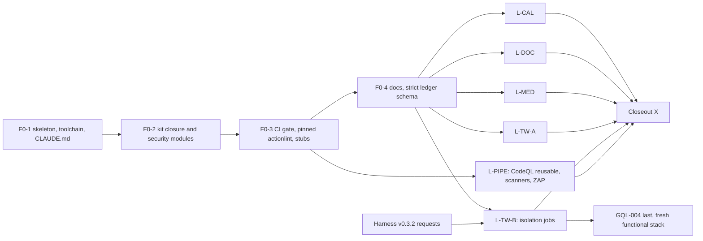

# P5 AppSec and DevSecOps master plan (revision r2)

Status: PLAN ONLY. This revision is docs-only. No package, source, workflow, config, test, harness, fork, account or PR-body change is made by it.
Date: 2026-11-08 (Asia/Colombo). Revises the plan reviewed at PR #1 head `cd4f9675287c2e2dc5040b646f93ba9ee1df61ca`.
Companion: `docs/probes/2026-11-08-p5-code-reads.md` (every fact below, with repo, ref, file:line, read method and status).
Builders: a smaller model or junior engineer, PR by PR. Owner reviews and merges every PR.

## 0. Header

| Item | Value |
|---|---|
| Base commit | `06ac98808964854b62e2e7699783bc86c9b23e20` (`origin/main`, "Initial project structure") |
| Plan branch | `plan/2026-11-08-p5-master-plan` (PR #1, to `main`) |
| Lane branches | `feat/<YYYY-MM-DD>-p5-<lane>-<topic>`, dated with the build day in Asia/Colombo (`date +%F`). Foundation: `feat/<date>-p5-f0-<n>-<topic>`. |
| Who merges | The owner only, by merge commit. Builders never merge. |
| PR #1 body | The live PR body ends with a generated-attribution/session footer (found by the review). Removal needs an explicitly authorized PR-body correction. This revision does not claim the footer is absent and does not edit the body. |
| Attribution policy | Documented setting `{"attribution": {"commit": "", "pr": "", "sessionUrl": false}}` in `.claude/settings.json`. `includeCoAuthoredBy` is deprecated and is NOT the substitute. Effective settings are verified at F0-1 (section 7.1, step 9). |
| Planning now vs implementation later | Planning (this PR) changes no environment. Implementation starts after this plan merges and the owner's settings steps (section 12) are done. Section 10 separates the two setup phases. |

## 1. Goal and scope

**What P5 proves.** Security behaviour of four pinned product forks (Cal, Documenso, Medusa starter with core `@medusajs/medusa` 2.21.2, Twenty) on local harness stacks, plus this repository's own pipeline security. Each proof is a test with an independent valid control, before/after state where state changes, a named budget, and a verdict: PASS, PRODUCT BUG (SUSPECTED), deployment finding, design verdict, gated, or not run. P5 also owns the findings ledger, threat-model one-pagers, the scanner gate, and the evidence release.

**What P5 does not prove.** Anything on a third-party or production target; load or capacity (P6); a complete product audit; payload-level detail for private-first items; authority, reach or liveness the harness does not expose.

**Repository rules** that apply to every PR: section 16 and `AGENTS.md` (F0-1).

## 2. Facts used

Status comes from the code-read record. "Pinned" means the ref named in the record; "review" means re-read by the review, not by this revision.

| # | Fact | Evidence | Status |
|---|---|---|---|
| 1 | Documenso bypass forwarded only when `DANGEROUS_BYPASS_RATE_LIMITS` is the string `"true"`; default ON; P2 roadmap line "v0.3.0 turns limits off" is stale | harness `v0.3.1` `src/adapters/documenso-env.ts:297-298`; P2 `docs/plans/2026-10-20-p2-phase1-roadmap.md:211` | CONFIRMED |
| 2 | P6 route contract: ten routes measured; seven Documenso auth/upload/AI values cited | P6 `0533e61` `src/load/spike/limiter-contract.ts:14-58` (routes), `:19` upload 20, `:20` ai 3, `:21-28` authorize 10, `:29-35` forgot 3, `:36-42` resend 3, `:43-49` verify 5, `:50-57` reset 5 | CONFIRMED (cited, not re-run) |
| 3 | Documenso e2e covers reset invalidating all sessions and password update invalidating others | Documenso `f4105e4` `fork ref held by the owner`, `:171` | CONFIRMED |
| 4 | P6 race 002 sends one token ten times; all 200; one SIGNED, nine ALREADY_SIGNED, one seal | P6 `0533e61` `tests/documenso/races/doc-race-002-double-submit.spec.ts:40-48` | CONFIRMED |
| 5 | Twenty harness passes only listed env names and six limiter names; `LOGIC_FUNCTION_TYPE` NOT passed | harness `v0.3.1` `src/adapters/twenty-passthrough.ts:5-12`; `src/adapters/twenty-rate-limits.ts:7-14`; grep: no `LOGIC_FUNCTION_TYPE` in `src/` | CONFIRMED |
| 6 | Twenty captcha returns success with no driver; harness sets none | Twenty `7cbdfec6` `fork ref held by the owner`; harness grep: no `CAPTCHA` | CONFIRMED on source; image `v2.44.0` UNPROBED |
| 7 | Twenty logic functions: default timeout 300 s; per-function 1..900 s; driver default `timeoutMs = 900_000` | Twenty `7cbdfec6` `fork ref held by the owner`, `:64-65`; `fork ref held by the owner`; `fork ref held by the owner` (default parameter) | CONFIRMED; termination behaviour UNPROBED |
| 8 | API key cannot create or activate a workflow version (P2 probe B-P21) | P2 `99a2fde` `docs/probes/2026-11-03-p2-lane-tw-probes.md:42` | CONFIRMED (doc evidence) |
| 9 | Cal `createClient` is admin-only; INACTIVE_ADMIN rule in production; seed creates an OAuth client only from env, with `enablePkce: false` | Cal `c2b7ac44` `fork ref held by the owner` (`createClient`, `authedAdminProcedure`), `:32` (contrast: `generateAuthCode` on `authedProcedure`, not admin); `fork ref held by the owner`, `:264`, `:270`; `scripts/seed.ts:1015-1026` | CONFIRMED |
| 10 | Cal members CSV is a client-side download in the organisation members table | Cal `c2b7ac44` `fork ref held by the owner` (CSV generation), `:759` (download handler); `fork ref held by the owner`, `:33`, `:40`, `:49` | CONFIRMED |
| 11 | Cal API v2 throttle default 120 per 60 s per API key; helper for public booking is a no-op without `UNKEY_ROOT_KEY` | Cal `fork ref held by the owner` and default TTL; Cal `fork ref held by the owner`; booking call-path reach UNREAD | CONFIRMED for throttler and helper no-op; call-path UNREAD |
| 12 | Medusa RBAC flag default false, env `MEDUSA_FF_RBAC`; harness backend env is its `.env` plus fixed switches | Medusa core `v2.21.2` `fork ref held by the owner`; harness `v0.3.1` `fork ref held by the owner` | CONFIRMED; `medusa-env.ts` UNREAD |
| 13 | Medusa `GET /store/orders/:id` has no authenticate step; the route documents the order id as the authentication mechanism | Medusa core `v2.21.2` `fork ref held by the owner`; `:19-21` (list route authenticated); `fork ref held by the owner` header comment | CONFIRMED (design choice; MI-5 capability verdict) |
| 14 | Stripe libraries default tolerance 5 minutes; stripe-node 300 s | docs.stripe.com/webhooks text; stripe-node `v23.0.1` `src/Webhooks.ts:142` | CONFIRMED (Stripe only; Daily tolerance UNVERIFIED) |
| 15 | P2 reusable kit: Daily signer/verifier, receiver reach, roles | P2 `99a2fde` `src/webhooks/sign.ts:87`, `:105`; `verify.ts:102`; `reach.ts:25`, `:29`; `src/db/roles.ts:12-13` | CONFIRMED |
| 16 | This repo: public rulesets API returns `[]`; secret scanning and push protection stated on; code scanning default setup and Actions permissions not readable without auth | `GET /repos/Jayami123/appsec-devsecops-pipeline/rulesets` returned `[]` | Rulesets CONFIRMED; others UNREAD (owner steps, section 12) |
| 17 | P2 CAL-DLY tests at `99a2fde`: `:23-40` negative (tampered body with the old signature returns 403 `Signature does not match`); `:42-60` valid signature accepted by the signature check, downstream 400 `Invalid Payload`; `:63-79` unknown type with valid signature returns 200 | P2 `tests/webhooks/cal/cal-dly.spec.ts:23-40, 42-60, 63-79` | CONFIRMED. Uncovered residual: random or forged signature values not derived from the secret or body (plan section 4.2, CAL-WH-004). |
| 18 | Medusa cart middlewares at the pin: `GET /store/carts/:id` has only query validation; `POST /store/carts/:id/customer` is the only cart matcher with `authenticate("customer", …)` (line 63); line-item, promotion, tax, shipping and complete routes have no authenticate. Ownership checks inside handlers are not shown by middleware. | Medusa core `v2.21.2` `fork ref held by the owner` (grep of matchers and `authenticate`, this revision) | CONFIRMED for middleware; handler ownership checks UNPROBED (plan P-10, P-14) |
| 19 | Cal normal seed inherits the harness process env: harness runs `yarn db-seed` with env merged over `process.env` | harness `v0.3.1` `fork ref held by the owner`; `src/internal/run.ts:100-102` | CONFIRMED (no pass-through needed for seed vars; whether the harness sets `SEED_OAUTH2_*` is UNPROBED) |
| 20 | Twenty fork source: three speed layers bound to spender types `apiKey` (short and long windows) and `application`, `spenderId` empty, counted by a token-bucket try-consume script. Fork defaults (`fork ref held by the owner`): short 100/1000 ms, long 100/60000 ms, application 500/60000 ms. P6 functional profile (`fork ref held by the owner`): short 100/1000 ms, long 3600/60000 ms, application 500/60000 ms. | Twenty `7cbdfec6` `fork ref held by the owner` (speed layers, spender types, `spenderId: ''`); `fork ref held by the owner`; `fork ref held by the owner` (fork defaults); P6 `0533e61` `fork ref held by the owner` (binding claim) and `:10-17` (functional profile values) | CONFIRMED (source structure and fork defaults). Image v2.44.0 values UNPROBED. Unit of counting UNPROBED. |
| 21 | Harness has only a whole-stack volume reset (`down -v` / `TWENTY_DOWN_VOLUMES=1`); no product-scoped limiter reset | harness `v0.3.1` `src/adapters/twenty-env.ts:137`, `:218`, `:251` | CONFIRMED (no scoped reset exists) |
| 22 | P2 bootstrap writes Cal's ignored `.env` with generated secrets from `.env.example` | P2 `99a2fde` `scripts/bootstrap.sh:139-149` (`prepare_cal_env`) | CONFIRMED (reconciled in section 7.2) |
| 23 | P2 Documenso CI is dual runtime: Node 22 from `.nvmrc` with `NODE22` captured, Node 24 set up and `NODE24` captured as absolute paths | P2 `99a2fde` `.github/workflows/p2-doc.yml:57-96` | CONFIRMED |
| 24 | P2 bootstrap requires a usable Node 24 before Documenso `npm ci` | P2 `99a2fde` `scripts/bootstrap.sh:117-128` | CONFIRMED |
| 25 | P2 Cursor start calls `ensure-receiver-hostname.sh` and `npm run qa:passwords` with warning fallbacks | P2 `99a2fde` `fork ref held by the owner` | CONFIRMED (adapted, section 7.1) |
| 26 | Official Claude Code docs document `attribution` with `commit`, `pr` and `sessionUrl`; `sessionUrl: false` requires Claude Code v2.1.281 or later; the official text says to set `commit` and `pr` to empty strings and `sessionUrl` to false instead of `includeCoAuthoredBy` | `https://code.claude.com/docs/en/settings-reference` (fetched by this revision; the attribution text quoted by the review) | CONFIRMED (documented setting); effective behaviour UNPROBED until F0-1 |
| 27 | CodeQL default setup blocks uploads from advanced setup; public repositories may upload SARIF without a paid private-repo entitlement; public uploads need contents read and security-events write | GitHub documentation cited by the review (advanced-setup and SARIF pages) | CONFIRMED by review; not re-read here |
| 28 | Reusable workflows cannot elevate token permissions above the caller | GitHub documentation cited by the review (reuse-workflow page) | CONFIRMED by review; not re-read here |

Dropped as a fact: "harness `v0.3.0` turns limits off" (stale; fact 1).

## 3. Decisions

### 3.1 Taken decisions (D1-D14, unchanged)

| ID | Decision |
|---|---|
| D1 | Product lanes (L-CAL, L-DOC, L-MED, L-TW-A, L-TW-B), one DevSecOps lane (L-PIPE), serial foundation F0, closeout X. |
| D2 | Selective vendoring into `src/kit/` with provenance and an explicit relocation/adaptation contract (section 7.2). No shared package extraction now. |
| D3 | Private-first: ID and status only (section 4.7). Enforced by a PR checklist and by strict runtime schema validation. No keyword CI check. |
| D4 | Scanner gate scope: BLOCK only on (a) leaked secrets in this repo, (b) NEW High/Critical alerts that are in P5-owned code and have a fix available, (c) workflow-hardening errors. Product images and forks report-only. Accepted risks need owner, reason and expiry (sections 7.4 and 9.3). |
| D5 | OSV-Scanner and `npm audit`. Not Snyk. |
| D6 | Satisfied IDs stay as ALIAS rows with a stated scope and residual. |
| D7 | P5-CAL-RL-001 is a documented deployment note. Scope: the helper is a no-op without `UNKEY_ROOT_KEY` (fact 11); the booking call path is not traced, so the note says exactly that. |
| D8 | Twenty sandbox rows wait for the harness `LOGIC_FUNCTION_TYPE` pass-through; disposable stack; no repository secrets; gated skips with named blockers. |
| D9 | Documenso OIDC rows: second wave, gated on a mock IdP reachable through normal harness routes. |
| D10 | Non-security items from the P2 charter go back to the owner's filing track. |
| D11 | ZAP authenticated passive baseline nightly; active scan only by manual dispatch on a throwaway stack. Never a PR gate. |
| D12 | One deterministic header row per product; ZAP adds breadth. |
| D13 | `docs/SECURITY-SCOPE.md` (F0-4): local forks and pinned images only; payloads at test-design level. |
| D14 | P5-MED-RBAC-001 gated until a harness opt-in `MEDUSA_FF_RBAC` switch ships. Never edit the fork `.env`. |

### 3.2 Resolved open decisions (OD-1..OD-16)

These replace the earlier open list. Each is a recommended decision settled here. Owner-only actions (settings, merge, disclosure, publication, PR-body correction) are NOT design decisions; they are in section 12.

| OD | Resolution | Basis |
|---|---|---|
| OD-1 | MI-6 is the canonical ID P2-TW-BUG-004, status held-private. | Canonical mapping supplied by the review. No invented alias. |
| OD-2 | MI-18 stays status-only with no identity. MI-19 is the coverage link for the DOC-RL aliases via P6-DOC-LOAD-009, with the slow-window-reset edge explicitly uncovered. MI-23 is the coverage link for DOC-TOK-001 via P6-DOC-RACE-002. "Same product" is not an equivalence rule. | Review decision; ALIAS scopes in section 4.2. |
| OD-3 | Seven Documenso values are cited, including `ai` 3. No P6 suite is re-run. | Fact 2. |
| OD-4 | Read Medusa core `@medusajs/medusa` 2.21.2 at commit `020565398e436a2bc65777a3b1ad347b4735d6df` (the starter pins this version). | Fact 12 and section 2. |
| OD-5 | CI sets `PRODUCTS_ROOT` workspace-relative (P2 precedent). Cloud environments set an explicit writable path in setup. Never the `node_modules` default. | Harness default resolves inside the installed package (`fork ref held by the owner`). |
| OD-6 | `.claude/settings.json` uses `"attribution": {"commit": "", "pr": "", "sessionUrl": false}`. No `includeCoAuthoredBy`. The F0-1 probe verifies the effective setting and the actual output. | Fact 26. |
| OD-7 | Cal OAuth: the normal harness seed (fact 19) may provide an OAuth client for OAUTH-001 once a live probe confirms that seeding works with normal routes. OAUTH-002 cannot use the PKCE-off seed client (fact 9). It is gated unless a normal product route can create or enable a PKCE client; the probe decides. No DB insert, no seed-credential copy, no E2E bypass. NOT a universal "seed solves both" claim. | Facts 9 and 19; no new pass-through needed for seed variables. |
| OD-8 | Keep the accepted Node 22 repository runtime (`.nvmrc` = 22, engines `>=22.22.0`) and an explicit Node 24.22.0 product runtime. No dependency-pin churn. | P2 precedent. |
| OD-9 | Simple rubric: impact, exploitability, confidence. Severity is separate from priority. A CVSS score is recorded only when its inputs are justified. No compulsory fabricated score. | Review decision. |
| OD-10 | Node 24 in CI follows the P2 dual-runtime precedent (section 9.5): absolute `NODE22` and `NODE24` paths captured after setup-node. | Facts 23-24. |
| OD-11 | CodeQL in L-PIPE with advanced setup only. Default setup stays OFF. Threshold evaluation is part of the scanner result that reaches the gate (section 9.3). | Fact 27. |
| OD-12 | PN and MI labels are kept. Builders assign no new P5 numbers. The owner numbers genuinely new cases later. | Charter. |
| OD-13 | No disclosure expansion. Existing tests and history unchanged. External sends are separately authorized. | Charter section 4. |
| OD-14 | Only the evidence-release job gets `contents: write`. Scanner upload jobs get `security-events: write`. Ordinary jobs read-only. Release or tag publication is owner-initiated. | Least privilege; owner-only action (section 12). |
| OD-15 | Chromium only in `cal-ui`, and in closeout UI jobs only if their probed export path is UI. No global browser install. | Actual UI need. |
| OD-16 | Gated rows keep named gates. A gated row is never counted as built. | Charter. |

## 4. Inventory

Legend: KEEP = build in this plan. ALIAS = satisfied elsewhere with a stated scope and residual. DROP = kept with a reason. Priority in brackets. Private rows follow section 4.7 (ID and status only).

### 4.1 KEEP rows (64; original IDs)

Reframes and dispositions are named in the Note column. A "reframe" keeps the ID and changes its oracle or scope; it is never a claimed defect.

| ID | Pri | Title | Lane | Note |
|---|---|---|---|---|
| P5-CAL-AUTHZ-001 | P0 | Other user cannot GET/PUT/DELETE owner booking | L-CAL | Complete actor × verb control (section 6) |
| P5-CAL-AUTHZ-002 | P1 | Anonymous cannot mutate; UID read fields documented | L-CAL | |
| P5-CAL-CAP-001 | P1 | Anonymous UID response field allowlist | L-CAL | Capability verdict with MI-5 |
| P5-CAL-TEAM-001 | P1 | Team A member cannot edit team B event type | L-CAL | |
| P5-CAL-WH-002 | P0 | Replay of a captured valid signed request | L-CAL | Needs a business-positive control: the first delivery must change state, then the replay must not |
| P5-CAL-WH-003 | P0 | Stale timestamp with recomputed signature | L-CAL | Investigative age (section 8), not Stripe's rule |
| P5-CAL-CRON-001 | P1 | Cron without key rejected, one row per cron route | L-CAL | Absorbs MI-9 |
| P5-CAL-OAUTH-001 | P1 | Authorization code single-use | L-CAL | OD-7: gated behind the normal-route seed probe |
| P5-CAL-OAUTH-002 | P1 | PKCE: wrong code_verifier rejected | L-CAL | OD-7: gated unless a normal route creates a PKCE client |
| P5-CAL-2FA-001 | P1 | Burst of wrong TOTP codes | L-CAL | Investigative `TOTP_BURST` (section 8) |
| P5-CAL-TOK-001 | P1 | Reset token concurrent redemption | L-CAL | Investigative `RESET_CONCURRENT_N` (section 8) |
| P5-CAL-RL-002 | P2 | API key over quota returns 429 | L-CAL | Source-backed `CAL_V2_KEY_LIMIT`; effective limit read from stack config first |
| P5-CAL-XSS-001 | P0 | Script in event description not executed | L-CAL | UI |
| P5-CAL-XSS-002 | P2 | Description in confirmation email sanitised | L-CAL | UI; mail catcher probe |
| P5-CAL-RED-001 | P1 | External successRedirectUrl rejected or warned | L-CAL | UI |
| P5-CAL-CSV-001 | P0 | Export prefixes formula-like cells (organisation members table) | L-CAL | Needs an organisation (probe) |
| P5-CAL-HDR-001 | P2 | Booker response security headers | L-CAL | |
| P5-DOC-AUTHZ-001 | P0 | Other user GET/DELETE envelope denied | L-DOC | Complete actor × verb control |
| P5-DOC-AUTHZ-002 | P1 | Cross-organisation template access denied | L-DOC | |
| P5-DOC-RBAC-001 | P2 | EVERYONE role visibility sample cells | L-DOC | |
| P5-DOC-HDR-001 | P2 | Signing page headers | L-DOC | |
| P5-DOC-OIDC-001 | P1 | OAuth state replay rejected | L-DOC | Gated (D9) |
| P5-DOC-OIDC-002 | P1 | `email_verified=false` not auto-linked | L-DOC | Gated (D9) |
| P5-MED-WH-001 | P0 | Missing signature: payment unchanged | L-MED | Independent valid control on a fresh order |
| P5-MED-WH-002 | P0 | Invalid signature: payment unchanged | L-MED | Independent valid control on a fresh order |
| P5-MED-AUTHZ-001 | P0 | Customer B cannot take over or mutate customer A's cart through a customer-authenticated route | L-MED | REFRAMED, no fallback oracle. Protected candidate: `POST /store/carts/:id/customer` (customer-authenticated at the pin, fact 18). Probe P-10/P-14 decides: B's session targeting A's cart is refused only if the handler checks ownership; if accepted, PRODUCT BUG (SUSPECTED) after a valid control and before/after state. Line-item and GET routes have no customer authentication: capability-by-ID, recorded as a design verdict (MI-5); no defect is assumed. |
| P5-MED-AUTHZ-002 | P0 | Publishable key alone cannot act as admin | L-MED | |
| P5-MED-AUTHZ-003 | P1 | Customer B cannot update customer A address | L-MED | Probe confirms the address route is protected first |
| P5-MED-RBAC-001 | P2 | Role without order write cannot cancel | L-MED | Gated (D14) |
| P5-MED-FIELD-001 | P1 | `fields=` rejects restricted customer PII on store | L-MED | Order-by-id row is a capability verdict (fact 13) |
| P5-MED-RL-001 | P0 | Admin login wrong-password burst | L-MED | `BRUTE_FORCE_ATTEMPTS`; a missing 429 is a deployment finding, not proof of no lockout |
| P5-MED-CORS-001 | P2 | Disallowed origin gets no ACAO | L-MED | |
| P5-MED-FUZZ-001 | P2 | Schemathesis store API valid extras never 5xx | L-MED | `FUZZ_*` bounds (section 8) |
| P5-MED-HDR-001 | P3 | Admin `/app` and store API headers | L-MED | |
| P5-TW-MT-001 | P0 | Apple user cannot read YC company | L-TW-A | Second-workspace helper and multi-workspace job shape |
| P5-TW-MT-002 | P1 | Signed file URL from one workspace not readable in another | L-TW-A | |
| P5-TW-RBAC-001 | P1 | Guest cannot create webhook | L-TW-A | |
| P5-TW-RLS-001 | P0 | Hidden record absent from search | L-TW-A | Includes the soft-deleted variant (MI-17) |
| P5-TW-RLS-002 | P1 | Hidden record absent from CSV export | L-TW-A | |
| P5-TW-RLS-003 | P1 | Hidden field absent from GraphQL selection | L-TW-A | |
| P5-TW-MASS-001 | P0 | Client-supplied id, createdBy, deletedAt ignored | L-TW-A | |
| P5-TW-SSRF-001 | P1 | Logic/workflow HTTP to owner canary blocked | L-TW-A | Requires reachable owner-controlled canary, attributable guard evidence and an allowed-network control (section 8, section 15.4) |
| P5-TW-INJ-001 | P1 | Filter corpus does not 500 or leak SQL | L-TW-A | |
| P5-TW-RL-001 | P0 | Wrong-password burst on one throwaway account | L-TW-A | `BRUTE_FORCE_ATTEMPTS`; separate lockout check after the burst |
| P5-TW-RL-002 | P1 | One-attempt-per-account spray across throwaway accounts | L-TW-A | RESTORED: one attempt per throwaway account, not 101 per user. Response-enumeration analysis is a separate evidence item in the same row group (section 15.4). |
| P5-TW-SEC-001 | P2 | API key secret not stored in plaintext | L-TW-A | Read-only `qa_ro` |
| P5-TW-FUZZ-001 | P2 | Schemathesis `/rest/open-api/core` | L-TW-A | `FUZZ_*` bounds |
| P5-TW-HDR-001 | P2 | Frontend CSP and frame-ancestors | L-TW-A | |
| P5-TW-SND-001 | P0 | Sandbox cannot read `process.env` secrets | L-TW-B | Synthetic canary, presence proven first (section 15.5) |
| P5-TW-SND-002 | P0 | Sandbox egress to owner internal canary blocked | L-TW-B | Owner-controlled canary, attributable no-hit evidence, allowed control |
| P5-TW-SND-003 | P1 | Infinite loop terminated | L-TW-B | Configured function timeout; driver termination UNPROBED |
| P5-TW-SND-004 | P2 | Bounded memory allocation at the verified configured limit | L-TW-B | Gated unless the configured limit is verified |
| P5-TW-GQL-001 | P1 | Deeply nested query rejected | L-TW-B | `GQL_DEPTH_PROBE` |
| P5-TW-GQL-002 | P1 | Query cost or complexity limit | L-TW-B | |
| P5-TW-GQL-003 | P1 | Alias flooding bounded | L-TW-B | `GQL_ALIAS_PROBE` |
| P5-TW-GQL-004 | P2 | Batched operations and limiter layers | L-TW-B | Runs LAST on a fresh functional-profile stack (section 5, section 9.6). Layer and unit semantics in section 8. |
| P5-TW-GQL-005 | P1 | Introspection exposure | L-TW-B | |
| P5-TW-GQL-006 | P2 | Field suggestions leak schema | L-TW-B | |
| P5-SCAN-001 | P0 | Trivy filesystem and product image scan | L-PIPE | D4 gate; product images report-only |
| P5-SCAN-002 | P0 | gitleaks on this repo blocking; forks report-only | L-PIPE | |
| P5-SCAN-003 | P1 | OSV-Scanner and npm audit | L-PIPE | D5 |
| P5-SCAN-004 | P1 | ZAP authenticated passive baseline nightly | L-PIPE | D11 |
| P5-SCAN-005 | P2 | Summary markdown on every scan job | L-PIPE | |
| P5-CAL-CSV-002 | P2 | Medusa and Twenty export control with the same corpus | X | Wired in section 9.7 |

Counts: L-CAL 17, L-DOC 6, L-MED 11, L-TW-A 14, L-TW-B 10, L-PIPE 5, X 1 = 64.

### 4.2 ALIAS rows (10; scopes and residuals)

An ALIAS row claims only the scope stated. Anything outside it is a residual, which the lane must build or explicitly defer.

| ID | Covered by (repo, ref, file) | Scope covered | Residual (uncovered) | Disposition |
|---|---|---|---|---|
| P5-CAL-WH-001 | P2-CAL-DLY-002: `api-webhook-db-test-suite` `99a2fde` `tests/webhooks/cal/cal-dly.spec.ts:38-80` (fact 17) | Signature acceptance and the observed 400/200 contract for an authenticated Daily-shaped request | Successful business processing (the original 2xx property). A new business-positive control in P5-CAL-WH-002 supplies it. | ALIAS-PARTIAL (authenticity only) |
| P5-CAL-WH-004 | P2 `tests/webhooks/cal/cal-dly.spec.ts:23-40` (negative signature validation: tampered body with the old signature returns 403) | Negative signature validation for a tampered body | Random or forged signature values not derived from the secret or body (not covered by that test); business processing | ALIAS-PARTIAL (negative validation for tampered body only) |
| P5-CAL-CRON-002 | P2 framework check FC-1: `tests/integration/cal/cal-framework.spec.ts` (review-reported scope; not re-read in this revision) | The two routes FC-1 checks, as reported by the review | Every other cron route. P5-CAL-CRON-001 builds one row per route. | ALIAS-PARTIAL (two routes) |
| P5-DOC-TOK-001 | P6-DOC-RACE-002: `k6-load-concurrency-suite` `0533e61` `tests/documenso/races/doc-race-002-double-submit.spec.ts:40-48` | Same-token ten-way race: one SIGNED, nine ALREADY_SIGNED, all 200, one seal (supported by fact 4) | None within the race property | ALIAS (supported) |
| P5-DOC-RL-001 | P6-DOC-LOAD-009 `fork ref held by the owner` (authorize max 10 with max+1 probe) | Max+1 behaviour for its route | The slow 15-minute window-reset edge is UNCOVERED and DEFERRED to a later row | ALIAS-PARTIAL (max+1 only) |
| P5-DOC-RL-002 | P6-DOC-LOAD-009 (forgot-password max 3 at `fork ref held by the owner`; reset-password max 5 at `:50-57`) | Max+1 behaviour for those routes | Window-reset edge (as above) | ALIAS-PARTIAL |
| P5-DOC-RL-003 | P6-DOC-LOAD-009 (file upload max 20 at `fork ref held by the owner`) | Max+1 behaviour for the upload route | Window-reset edge (as above) | ALIAS-PARTIAL |
| P5-DOC-TOK-002 | held-private (section 4.7) | — | — | held-private (status only) |
| P5-MED-WH-003 | P2-MED-WH-001: `tests/webhooks/med/signed-event.spec.ts` (supported by the inspected source) | Medusa signed-event handling for its covered case | Missing or invalid signatures (P5-MED-WH-001/002) | ALIAS (supported) |
| P5-TW-TOK-001 | held-private (section 4.7) | — | — | held-private (status only) |

Counts: 10. ALIAS-PARTIAL rows: CAL-WH-001, CAL-WH-004, CAL-CRON-002, DOC-RL-001, DOC-RL-002, DOC-RL-003 (6). Fully supported aliases: DOC-TOK-001, MED-WH-003 (2). Held-private: DOC-TOK-002, TW-TOK-001 (2).

### 4.3 DROP rows (2)

| ID | Reason |
|---|---|
| P5-CAL-RL-001 | D7: documented deployment note. The helper is a no-op without `UNKEY_ROOT_KEY` (fact 11). The booking call path is not traced, so the note does not claim "no limiter anywhere". |
| P5-DOC-SESS-001 | Fact 3: Documenso's own e2e covers reset and password-update session behaviour. Reuse is sound. |

### 4.4 Moved-in rows (MI-1..MI-24)

Canonical identities come from the review. Where an identity is not established, the row stays status-only and the identity is NOT guessed.

| MI | Content (non-private rows only) | Lane | Type |
|---|---|---|---|
| MI-1 | Deletion verdict for P5-DOC-DEL-001 (no test until a deterministic trigger exists) | L-DOC | verdict |
| MI-2 | Error-code verdict for P5-DOC-CONV-001 (test lives in P2) | L-DOC | verdict |
| MI-3 | held-private (identity not established; status only) | — | held-private |
| MI-4 | = P2-MED-WH-006 (held-private; section 4.7) | — | held-private |
| MI-5 | Guest-cart and UID capability verdict (`docs/capabilities/guest-cart-and-uid.md`), covering P5-CAL-CAP-001, P5-MED-AUTHZ-001 reframe and fact 13 | L-MED | verdict |
| MI-6 | = P2-TW-BUG-004 (held-private; section 4.7) | — | held-private |
| MI-7 | P2-TW-BUG-003 security verdict | L-TW-A | verdict |
| MI-8 | P2-TW-WH-009 cited as tenant-isolation evidence | L-TW-A | evidence link |
| MI-9 | Cron-secret handling, inside P5-CAL-CRON-001 | L-CAL | inside KEEP row |
| MI-10 | Cal Daily test-request path. Reuse P2-CAL-DLY-003 for the behaviour it states; add a new test only for a named residual edge (none established yet) | L-CAL | evidence reuse (TEST only if a residual is named) |
| MI-11 | Webhook authenticity design note (`docs/design/webhook-authenticity.md`) | X | verdict |
| MI-12 | Error-code verdicts for P2-DOC-STR-001 and P2-DOC-SM-001 | L-DOC | verdict |
| MI-13 | P2 zero-byte upload marker verdict | L-DOC | verdict |
| MI-14 | P5-TW-2FA-001 (identity recorded by the review; not re-read in this revision). Burst test with `TOTP_BURST`; not counted in the 64. | L-TW-A | TEST |
| MI-15 | Documenso 2FA burst (proposed; `TOTP_BURST`) | L-DOC | TEST |
| MI-16 | Twenty API-key revocation and expiry rows (proposed) | L-TW-A | TEST |
| MI-17 | Soft-deleted variant, inside P5-TW-RLS-001 | L-TW-A | inside KEEP row |
| MI-18 | held-private (identity not established; status only) | — | held-private |
| MI-19 | Coverage link for P5-DOC-RL-001..003 via P6-DOC-LOAD-009; residual slow-window-reset edge explicit | L-DOC | coverage link |
| MI-20 | = P6-OBS-DOC-003 (held-private; section 4.7) | — | held-private |
| MI-21 | = P6-OBS-TW-001 (held-private; section 4.7) | — | held-private |
| MI-22 | Fuzzing ownership: Schemathesis rows belong to their lane | all | verdict |
| MI-23 | Coverage link for P5-DOC-TOK-001 via P6-DOC-RACE-002 | L-DOC | coverage link |
| MI-24 | The six GQL rows P5-TW-GQL-001..006 | L-TW-B | inside KEEP rows |

Counts: 24. TEST-type rows: MI-14, MI-15, MI-16 (own tests); MI-10 only if a residual is named. Held-private: MI-3, MI-4, MI-6, MI-18, MI-20, MI-21.

### 4.5 Proposed rows (PN-1..PN-7; unnumbered labels)

| PN | Content | Lane | File | Notes |
|---|---|---|---|---|
| PN-1 | Webhook URL guard corpus (loopback, private, link-local encodings refused at create) | L-DOC | `tests/webhooks/doc/url-guard-corpus.spec.ts` | Owner-controlled canary for allowed control; attributable refusal |
| PN-2 | Schemathesis over Cal API v2 committed OAS | L-CAL | `tests/contracts/cal/schemathesis.spec.ts` | OAS copied from P2 `contracts/cal/openapi-v2.json` |
| PN-3 | Schemathesis over Documenso v2 OAS | L-DOC | `tests/contracts/doc/schemathesis.spec.ts` | OAS from P2 `contracts/doc/openapi.json` |
| PN-4 | CodeQL advanced setup, reusable, threshold result to the gate (section 9.3) | L-PIPE | `.github/workflows/codeql-reusable.yml`, `.github/workflows/p5-scans.yml` (job `codeql`) | OD-11 |
| PN-5 | SBOM (CycloneDX via Syft) per pinned product image, report-only | L-PIPE | `scripts/scan/sbom.sh` | |
| PN-6 | actionlint (pinned binary, F0-3) and zizmor; blocking on errors | L-PIPE and F0-3 | `scripts/lint-workflows.sh`, `.github/workflows/p5-scans.yml` (job `zizmor`) | |
| PN-7 | Artefact secret scan: vendored P6 `scripts/evidence-token-scan.mjs` | L-PIPE and X | `scripts/evidence-token-scan.mjs` | Prints file and line, never the match |

Count: 7.

### 4.6 Count check

| Check | Result |
|---|---|
| Mapped IDs = KEEP + ALIAS + DROP | 64 + 10 + 2 = 76 (matches; IDs unchanged) |
| Dispositions | ALIAS: 6 partial, 2 supported, 2 held-private. KEEP with reframes: MED-AUTHZ-001 (pending probe), CAL-OAUTH-001/002 and MED-FIELD-001 with gates or verdict types. None was dropped. Counts do not change because no ID changed disposition class. |
| KEEP by lane | L-CAL 17, L-DOC 6, L-MED 11, L-TW-A 14, L-TW-B 10, L-PIPE 5, X 1 = 64 |
| ALIAS by lane | L-CAL 3, L-DOC 5, L-MED 1, L-TW 1 = 10 |
| DROP by lane | L-CAL 1, L-DOC 1 = 2 |
| MI rows | 24 |
| PN rows | 7 |

Semantic result: IDs and counts match the charter; several aliases are narrower than the charter stated (section 4.2), and that narrowing is recorded rather than forced to equivalence.

### 4.7 Private entries (strict: ID and status only)

Schema rule (section 7.4): a private entry is exactly `{ "id": string, "status": "held-private" }`. No title, product, note, owner, reason, lane, route, payload, literal, test name, fixture, corpus or commit text is permitted in any private entry, in any file. Unresolved identities stay as the MI label.

| id | status |
|---|---|
| P5-DOC-TOK-002 | held-private |
| P5-TW-TOK-001 | held-private |
| P2-TW-BUG-004 | held-private |
| P2-MED-WH-006 | held-private |
| P6-OBS-DOC-003 | held-private |
| P6-OBS-TW-001 | held-private |
| MI-3 | held-private |
| MI-18 | held-private |

Canonical distinct private IDs: 6 known identities plus 2 unresolved MI labels = 8. MI-4, MI-6, MI-20, MI-21 are aliases of canonical private IDs and are not separate entries.

### 4.8 Ledger derivation (no forced total)

Distinct ledger entries are derived after deduplication, not forced to a total:

| Ledger section | Entries | Rule |
|---|---|---|
| `cases` (planned cases) | 64 KEEP with status `planned` + 8 public ALIAS with status `alias` + 2 DROP with status `dropped` = 74 | Dedupe by ID; no private ID here |
| `private` | 8 (section 4.7) | `{id,status}` only |
| `findings` | 0 | No finding exists; none is manufactured |
| `accepted_risks` | 0 | No risk is accepted; none is fabricated |
| Total entries | 82 | Derived; checked by the ledger unit test |

If a disposition changes later, the total is re-derived from the table, never adjusted to match a number.

## 5. Order and dependencies



| Step | Waits on | May start without | Gated rows |
|---|---|---|---|
| F0-1 | this plan merged | nothing | none |
| F0-2 | F0-1 merged | nothing | none |
| F0-3 | F0-2 merged; owner step 1 before merge | nothing | none |
| F0-4 | F0-3 merged | nothing | none |
| L-CAL | F0-4 | L-DOC, L-MED, L-TW-A, L-PIPE | OAUTH-002 unless normal-route PKCE client probe passes; OAUTH-001 after normal-seed probe; CSV-001 needs an organisation (probe) |
| L-DOC | F0-4 | L-CAL, L-MED, L-TW-A, L-PIPE | OIDC-001/002 (D9); MI-15 probe |
| L-MED | F0-4 | L-CAL, L-DOC, L-TW-A, L-PIPE | RBAC-001 (D14); cart semantics probe gates the AUTHZ-001 oracle |
| L-TW-A | F0-4 | L-CAL, L-DOC, L-MED, L-PIPE | none (probes first) |
| L-PIPE | F0-3 | all product lanes | ZAP authenticated switch as login helpers merge |
| L-TW-B | F0-4 AND harness `v0.3.2` items 1 and 2 | L-PIPE | SND-001..004 need `LOGIC_FUNCTION_TYPE` (D8); SND-004 needs a verified configured memory limit; GQL rows wait for the harness release |
| GQL-004 | L-TW-B `tw-iso` complete AND a fresh functional-profile stack | nothing else | Runs LAST, in its own job (section 9.6) |
| X | all lanes merged; `p5-x` wiring from F0-3 | nothing | CSV-002 needs L-CAL's corpus module merged |

## 6. Parallel safety

| Rule | Detail |
|---|---|
| File ownership | Lanes own `src/lanes/<code>/`, `tests/<kind>/<code>/` (kinds: `contracts`, `webhooks`, `integration`, `serial`, `ui`), `tests/unit/lanes/<code>/`, `.github/workflows/p5-<code>.yml`. L-TW-B owns `src/lanes/tw-iso/`, `tests/iso/tw/`, `tests/limiter-last/tw/`, `.github/workflows/p5-tw-iso.yml`. L-PIPE owns `scripts/scan/`, `config/scan/` (except `config/scan/implementation-status.json`, which is foundation-owned and flipped by each implementing PR), `.github/workflows/p5-scans.yml`, `.github/workflows/p5-zap-nightly.yml`, `.github/workflows/codeql-reusable.yml`. X owns `docs/` closeout files, `src/lanes/x/`, `tests/closeout/medusa/`, `tests/closeout/twenty/`, `.github/workflows/p5-x.yml`. |
| Foundation owns | `src/kit/`, `src/security/`, `scripts/` (except `scripts/scan/`), `package.json`, `package-lock.json`, `tsconfig.json`, `playwright.config.ts`, `eslint.config.mjs`, `.github/workflows/ci.yml`, `.github/workflows/foundation.yml`, `docs/SECURITY-SCOPE.md`, `docs/SEVERITY.md`, `docs/lane-ownership.md`, `docs/findings/`, `.github/pull_request_template.md`, `AGENTS.md`, `CLAUDE.md`. Changes go through a foundation PR. |
| One product per job | A job starts at most one product stack. Stacks always end with `down`, in a `finally` step. |
| Independent controls | Every negative mutation uses its own fixtures. A positive control never changes the state a negative check reads from an earlier step. Before/after state is captured for each mutation. |
| Brute force | Throwaway users only, created per run with the run prefix. Never a seed user. |
| SSRF and egress | Run in a profile with an EMPTY outbound allowlist, plus the owner-controlled canary and allowed control (section 8). |
| Sandbox | `tw-iso` has no `secrets:` key and no repository secrets. |
| Limiter-changing rows | Only GQL-004, and only on its own fresh functional-profile stack that runs last. |
| Cleanup and leaks | Every test cleans in `finally`. A sweep runs after each test and a leak check runs before the job ends. Auth tokens and API keys created by the run are revoked before `down`. |

## 7. Foundation PRs (F0-1..F0-4)

Rules for every F0 PR: branch from `main` after the previous PR merged; commit with lowercase Conventional Commits and explicit paths; run the build steps in order; stop on the first failure (section 15).

### 7.0 Provenance and adaptation rule (replaces the single-header rule)

| File type | Provenance placement | Rule |
|---|---|---|
| Shell (`.sh`) | Line 1 is the shebang if present; provenance on line 2 as `# Vendored from ...` | Shell comment `#` only |
| TypeScript and JS (`.ts`, `.mjs`) | Line 1 as `// Vendored from ... commit 99a2fde <path>. Change here only with a reason in the PR.` | `//` only. Never `#` (invalid TypeScript). |
| YAML | Line 1 `# Vendored ...` | `#` only |
| JSON and config without comments | No header; the manifest in the PR body records source, sha and any change | Recorded in `docs/lane-ownership.md` vendoring table |

Adaptations are allowed only from the list in section 7.2 (the relocation contract). Every other difference is a stop. The PR body lists each adapted file with the exact change. Shebangs are preserved.

### 7.1 F0-1: skeleton, toolchain, cloud configuration

**Branch:** `feat/<build-date>-p5-f0-1-skeleton`. **Base:** `main`.

**Files**

| Path | How | Responsibility |
|---|---|---|
| `package.json` | new (below) | Scripts and pins. Harness pin `github:Jayami123/qa-portfolio-harness#v0.3.1`. |
| `package-lock.json` | generated by `npm install` | Lock |
| `tsconfig.json`, `eslint.config.mjs`, `.prettierrc.json`, `.prettierignore`, `.gitattributes` | verbatim P2 `99a2fde` | Config |
| `.nvmrc` | verbatim P2 (`22`) | Repository runtime (OD-8) |
| `.gitignore` | verbatim P2 `99a2fde`, plus `.env` already present | Ignores |
| `.env.example` | new | Names only: `PRODUCTS_ROOT`, `P5_RUN_ID` (empty) and the P2 names the closure needs (section 7.2), empty |
| `playwright.config.ts` | new (below) | Projects, workers, timeouts |
| `AGENTS.md` | new (section 16 rules) | Agent and human rules; no personal name |
| `CLAUDE.md` | new | One paragraph: "Project rules are in AGENTS.md; this file adds only Claude Code settings notes: see `.claude/settings.json`." |
| `scripts/bootstrap.sh` | adapted from P2 `99a2fde` (section 7.1 adaptations) | Clones the four forks at pinned SHAs; Node 24 absolute path; Cal `.env` handling reconciled (section 10.4) |
| `scripts/cloud-install.sh` | new (section 10.2) | Setup-phase toolchain provisioning, then bootstrap |
| `fork ref held by the owner` | new (section 10.3) | Adapted Cursor config (not verbatim) |
| `.cursor/Dockerfile` | verbatim P2 | Base image (Node 22.23.3, Node 24.22.0 at `/opt/node24`, pnpm 10.11.1) |
| `.claude/settings.json` | new (below) | SessionStart hook and documented attribution |
| `.claude/hooks/session-start.sh` | new (section 10.5) | Post-setup exports only |
| `docs/cloud-environments.md` | new | The owner's manual steps (section 10) |
| `tests/unit/foundation.test.ts` | new (below) | Pins the foundation; updated in the same PR as any harness upgrade (section 7.5) |

**`package.json` (exact):** scripts `format`, `format:check`, `lint`, `typecheck`, `unit`, `unit:ci`, `check:static`, `check`, `list:lanes`, `test:api` as in P2 `99a2fde` (`unit` glob `tests/unit/*fork ref held by the owner`); `"engines": {"node": ">=22.22.0"}`; `"dependencies": {"qa-portfolio-harness": "github:Jayami123/qa-portfolio-harness#v0.3.1"}`; devDependencies identical to P2 `package.json` at `99a2fde` (`@apidevtools/swagger-parser` 13.1.0, `@eslint/js` 10.0.1, `@noble/ciphers` 0.6.0, `@noble/hashes` 1.8.0, `@playwright/test` 1.64.0, `@types/node` 22.20.5, `@types/pg` 8.23.1, `ajv` 8.20.0, `ajv-formats` 3.0.1, `eslint` 10.12.0, `eslint-config-prettier` 10.1.8, `globals` 17.13.0, `openapi-types` 12.1.3, `pg` 8.23.1, `prettier` 3.9.10, `stripe` 23.0.1, `typescript` 6.0.3, `typescript-eslint` 8.71.2, `zod` 4.6.7). The F0-2 closure adds nothing new to devDependencies. The `qa:passwords` script is NOT present.

**`playwright.config.ts` (projects; values and basis):**

```ts
// Projects: cal, cal-ui, doc, med, tw, tw-iso, plus serial twins and the closeout projects.
// workers 1, retries 0, timeout 60_000 and expect 10_000: same values as P2 playwright.config.ts (exact counts; no retry hides a flaky oracle).
// trace "off": raw authenticated traces are never produced by CI (section 9.8).
```

Projects: `cal` (`{contracts,webhooks,integration}/cal/**`), `cal-ui` (`ui/cal/**`, `use.browserName: "chromium"`), `doc` (`{contracts,webhooks,integration}/doc/**`), `med` (`{contracts,webhooks,integration}/med/**`), `tw` (`{contracts,webhooks,integration}/tw/**`), `tw-iso` (`iso/tw/**`, no serial dependency), `tw-limiter-last` (`limiter-last/tw/**`, depends on nothing in this config; its job is ordered by the workflow, section 9.6), `medusa-closeout` (`closeout/medusa/**`), `twenty-closeout` (`closeout/twenty/**`), and serial twins `cal-serial`, `doc-serial`, `med-serial`, `tw-serial` (`serial/<code>/**`, `dependencies: [<code>]`). UI projects other than `cal-ui` are added only by a later PR with probe evidence (OD-15).

**`.claude/settings.json` (exact):**

```json
{
  "hooks": {
    "SessionStart": [
      { "hooks": [ { "type": "command", "command": "bash \"$fork ref held by the owner\"" } ] }
    ]
  },
  "attribution": { "commit": "", "pr": "", "sessionUrl": false }
}
```

No `includeCoAuthoredBy` key.

**`tests/unit/foundation.test.ts` (exactly two tests):**
1. "package.json pins qa-portfolio-harness to v0.3.1"
2. "scripts/bootstrap.sh pins the four product refs to the P2 values" (asserts the four `*_REF` assignments)

**Build steps**
1. `git checkout -b feat/$(TZ=Asia/Colombo date +%F)-p5-f0-1-skeleton origin/main`.
2. Create files; verbatim copies: `git -C <p2-clone> show 99a2fde:<path> > <path>`, then apply the provenance rule (section 7.0) and the listed adaptations only.
3. `npm install` exit 0 (creates the lock).
4. `npm ci` exit 0.
5. `npm run check:static` exit 0 (`prettier --check` prints `All matched files use Prettier code style!`).
6. `npm run unit` exit 0 with `# tests 2`, `# pass 2`, `# fail 0`.
7. `npx playwright test --list --project=__list_projects__ 2>&1 || true` contains `Available projects:` listing the thirteen names `cal`, `cal-ui`, `doc`, `med`, `tw`, `tw-iso`, `tw-limiter-last`, `medusa-closeout`, `twenty-closeout`, `cal-serial`, `doc-serial`, `med-serial`, `tw-serial`. The thirteen count is what the command prints; it is not assumed.
8. Toolchain check (run under the setup-phase procedure, section 10.2): `/opt/node24/bin/node --version` prints `v24.22.0`; `node --version` is 22.x.
9. Attribution probe (required, record output): run `claude --version` and confirm it is at least `2.1.281`. In a fresh session in this repository, ask for a one-line commit to a scratch branch of this repo's docs only, then inspect the created commit message and any PR text for trailers, and confirm no session URL appears. Record exact output in the PR body. If the probe cannot run in this environment, the result is UNPROBED, not PASS.
10. `git diff --name-only origin/main` equals the file table above.

**Done criteria:** steps 3-7 and 10 pass; step 8 prints the expected versions; step 9 is recorded as PASS or UNPROBED with its reason.

**Commit plan:** (1) `chore(f0): add package and lockfile with the harness pin`; (2) `chore(f0): add vendored p2 config files`; (3) `chore(f0): add playwright projects and env names`; (4) `docs(f0): add agent and claude guidance`; (5) `chore(f0): add setup and bootstrap scripts`; (6) `chore(f0): add cloud and claude configuration`; (7) `docs(f0): add cloud environment steps`; (8) `test(f0): pin the harness and the p2 product refs`.

**Will NOT do:** no `src/`; no CI; no harness, fork or `node_modules` edit; no `qa-passwords.sh`; no receiver-hostname script (L-DOC adds it with its own probe).

### 7.2 F0-2: kit closure, relocation contract and security modules

**Branch:** `feat/<build-date>-p5-f0-2-kit`. **Base:** `main` after F0-1.

**Closure (dependencies checked from the pinned P2 imports; each file's transitive imports are included or replaced by the trimmed `src/kit/env.ts`).**

| Vendored file (dest) | P2 source (99a2fde) | Direct imports after relocation | Needed by |
|---|---|---|---|
| `src/kit/webhooks/sign.ts` | `src/webhooks/sign.ts` | `node:crypto`, `stripe` | P5-CAL-WH-002/003, MI-10 |
| `src/kit/webhooks/verify.ts` | `src/webhooks/verify.ts` | `sign.ts`, `stripe` | P5-CAL-WH-002/003 |
| `src/kit/webhooks/receiver.ts` | `src/webhooks/receiver.ts` | `fork ref held by the owner`, `fork ref held by the owner` | P5-CAL-WH-002 |
| `src/kit/webhooks/redact.ts` | `src/webhooks/redact.ts` | none | receiver, artefacts |
| `src/kit/webhooks/reach.ts` | `src/webhooks/reach.ts` | `fork ref held by the owner` (ProductId type), `fork ref held by the owner` | receiver reach |
| `src/kit/webhooks/docker-net.ts` | `src/webhooks/docker-net.ts` | `node:child_process`, `node:net` | reach |
| `src/kit/db/pg.ts` | `src/db/pg.ts` | `pg`, `fork ref held by the owner` (`dbStatementTimeoutMs`, `roleDbUrl`, `ProductId`), `fork ref held by the owner` | all read-only checks |
| `src/kit/db/select-guard.ts` | `src/db/select-guard.ts` | none | pg |
| `src/kit/db/roles.ts` | `src/db/roles.ts` | `fork ref held by the owner` (type) | P5-TW-SEC-001 |
| `src/kit/db/fixture-allowlist.ts` | `src/db/fixture-allowlist.ts` | `fork ref held by the owner` (`ProductId` type) | roles |
| `src/kit/db/roles-admin.ts` | `src/db/roles-admin.ts` | `pg`, `fork ref held by the owner` (`dbUrl`, `loadEnv`, `ProductId`), `fork ref held by the owner`, `fork ref held by the owner` | role provisioning via `scripts/db-roles.ts` |
| `src/kit/run/prefix.ts` | `src/run/prefix.ts` | `node:crypto` | every run |
| `src/kit/shared/cleanup.ts` | `src/shared/cleanup.ts` | none | every lane's `finally` |
| `src/kit/ci/known-defect.ts` | `src/ci/known-defect.ts` | `@playwright/test` | `test.fail` helper |
| `src/kit/ci/known-defect-guard.ts` | `src/ci/known-defect-guard.ts` | `typescript`, `node:fs`, `node:path` | guard (exemption path updated) |
| `src/kit/ci/playwright-json-summary.ts` | `src/ci/playwright-json-summary.ts` | none | summaries |
| `src/kit/readiness/checks.ts` | `src/readiness/checks.ts` | `fork ref held by the owner`, `fork ref held by the owner` (`ProductId`), `node:crypto`, `node:path` | readiness |
| `src/kit/readiness/canary.ts` | `src/readiness/canary.ts` | none | canary precondition |
| `src/kit/auth/secret.ts` | `src/auth/secret.ts` | `node:util` | artefact scrubbing |
| `src/kit/auth/reaper.ts` | `src/auth/reaper.ts` | none | leak sweep |
| `src/kit/invariants/engine.ts` | `src/invariants/engine.ts` | `fork ref held by the owner`, `fork ref held by the owner`, `fork ref held by the owner` (type) | sweeps |
| `src/kit/invariants/after-test.ts` | `src/invariants/after-test.ts` | `fork ref held by the owner` (type), `fork ref held by the owner` | sweep after each test |
| `src/kit/env.ts` | NEW, trimmed from P2 `src/env.ts` (section 7.2.1) | `node:net`, `zod` | all |
| `scripts/db-roles.ts` | `scripts/db-roles.ts` | `../src/kit/env.ts` (`PRODUCT_IDS`, `ProductId`; P2 import was `../src/env.ts`, line 3), `../src/kit/db/roles-admin.ts` (`provisionProduct`, `teardownRoles`, `withAdmin`; P2 import was `../src/db/roles-admin.ts`, line 4) | vendored, not wired (no npm script; owner-approved script change required) |
| `scripts/write-ci-job-summary.ts` | `scripts/write-ci-job-summary.ts` | `fork ref held by the owner` (path adapted) | job summary |
| `tests/unit/webhooks/vectors.ts` | same | none | sign and verify tests |

Not vendored, with reason: P2 lane-specific code under `src/lanes/`, `src/clients/`, `src/contracts/`, `src/slo/`, `src/fixtures/`, `src/db/fixture.ts`, `src/auth/reaper-run.ts`, `src/auth/reaper-revoke.ts` (they revoke P2 keys; P5's revocation rows are separate), `src/auth/lifecycle.ts`, `src/auth/*` product clients.

**7.2.1 Trimmed `src/kit/env.ts` (exported contract).** It keeps P2's variable names for the vendored contract (documented in the PR). Exports: `type ProductId = "cal" | "documenso" | "medusa" | "twenty"`; `PRODUCT_IDS`; `type DbRole = "qa_ro" | "qa_fixture"`; `loadEnv(env?)` (zod schema with only: `CAL_BASE_URL`, `CAL_API_BASE_URL`, `DOCUMENSO_BASE_URL`, `MEDUSA_BASE_URL`, `TWENTY_BASE_URL`, `CAL_DB_URL`, `DOCUMENSO_DB_URL`, `MEDUSA_DB_URL`, `TWENTY_DB_URL`, `P2_RECEIVER_HOSTS`, `P2_RECEIVER_PORT`, `P2_QA_RO_PASSWORD`, `P2_QA_FIXTURE_PASSWORD`, `P2_DB_STATEMENT_TIMEOUT_MS`, plus `P5_RUN_ID`); `dbUrl(product, env?)`; `dbStatementTimeoutMs(env?)`; `roleDbUrl(product, role, env?)` (errors never contain a URL or password); `receiverConfig(env?)`; `apiBaseUrl(product, env?)`. Errors: `ENV_MISSING: <NAME>` and `ENV_INVALID: <NAME>`; values are never echoed. `P5_RUN_ID` is new; the P2 names are kept deliberately so the vendored closure reads the same contract.

**7.2.2 Relocation and adaptation contract (the only allowed differences)**

| Item | Required change |
|---|---|
| Provenance header | Per section 7.0 (`//` in TS, `#` in shell) |
| Import paths | Recomputed for the new location: `src/webhooks/*` → `src/kit/webhooks/*`, `src/db/*` → `src/kit/db/*`, `src/run/*` → `src/kit/run/*`, `src/shared/*` → `src/kit/shared/*`, `src/ci/*` → `src/kit/ci/*`, `src/readiness/*` → `src/kit/readiness/*`, `src/auth/*` → `src/kit/auth/*`, `src/invariants/*` → `src/kit/invariants/*`, `src/env.ts` → `src/kit/env.ts`. Every relative import in `src/kit/**` and `scripts/` resolves. |
| Guard exemption | `EXEMPT_FILE` becomes `"src/kit/ci/known-defect.ts"` (P2 value `src/ci/known-defect.ts`, `known-defect-guard.ts:9`). Recorded as an adaptation. |
| Tests | Relocated to `tests/unit/kit/<same subpath>/` with imports recomputed. Expected-defect test strings that contain fixture import text are string literals, not imports; they are left as is and documented. `tests/unit/ci/known-defect.test.ts` imports become `../../../../src/kit/ci/known-defect.ts` and `../../../../src/kit/ci/known-defect-guard.ts`. |
| `P5_RUN_ID` and run prefix | `RUN_PREFIX_PATTERN` becomes `/^p5-qa-\d{8}t\d{6}z-[0-9a-f]{8}$/` and `RUN_ID_ENV` becomes `P5_RUN_ID`. Recorded change. |
| Env | Only `src/kit/env.ts` (section 7.2.1). Other P2 env keys are not vendored. |
| Typecheck | `tsc -p tsconfig.json` passes with `src/kit/**` and the listed tests. |
| Known-defect migration audit (P2 K6) | **Approved exclusion (F0-2, owner decision).** K6 asserted exactly 16 `expectedDefect` call sites in P2's product-test corpus. That corpus is not imported, so K6 is excluded from F0-2: not passed, not skipped, not rewritten to a count. K1-K5 and the portable guard and parser tests are kept. **Tracked as K6-P5:** before the first real `expectedDefect` usage merges, add a P5 corpus-policy audit that checks actual calls for resolvable arguments and required ID and evidence descriptions, with valid and invalid fixture controls. Do not restore an arbitrary fixed count. Evidence and setup assertions still need review. |

| Run-prefix consumers | `makeRunPrefix` emits `p5-qa-`; the reaper's `PREFIX_IN_NAME` (`src/kit/auth/reaper.ts:5`) and the sweep engine's run-start parser (`src/kit/invariants/engine.ts:92`) match `p5-qa-`, the same shape as `RUN_PREFIX_PATTERN`. Checked by `tests/unit/kit/run/prefix-consistency.test.ts` (pattern, reaper and engine agree on every prefix-shaped name; the reaper's run-scoped names are the documented exception). |
| Label renames | `application_name` `p5-qa-oracle-*` (was `p2-qa-oracle-*`, `src/kit/db/pg.ts:105`) and `p5-qa-roles-*` (was `p2-qa-roles-*`, `src/kit/db/roles-admin.ts:119`); documenso receiver hostname `p5-receiver.test` (was `p2-receiver.test`, `src/kit/webhooks/reach.ts:26`); oracle message `P5 oracle: ...` (was `P2 oracle:`, `src/kit/db/pg.ts:35`); run-summary titles `## P5 <label>: run summary` (`src/kit/ci/playwright-json-summary.ts:205`; `scripts/write-ci-job-summary.ts:2,31`). |
| Kept P2 literals | `P2_*` environment names (section 7.2.1); `P2-…` case IDs in `src/kit/db/fixture-allowlist.ts` (data for P2 cases, not imported here); rule-ID comments `P2-X-DB-001` (`src/kit/invariants/after-test.ts:12`, `src/kit/invariants/engine.ts:7`); `P2` provenance paths and comments in headers. |
| `loadEnv` requires `P5_RUN_ID` | Every accessor (`loadEnv`, `apiBaseUrl`, `dbUrl`, `roleDbUrl`, `receiverConfig`, `dbStatementTimeoutMs`) requires `P5_RUN_ID`. Consequence: `scripts/db-roles.ts` fails with `ENV_MISSING: P5_RUN_ID` outside a run. `ENV_INVALID: <NAME>` names only the first invalid variable; values are never echoed. |
| Test-side adaptations | Carried P2 tests (`tests/unit/kit/**`) use: `p5-qa-` and `xp5-qa-` for `p2-qa-`/`xp2-qa-` run names; `P5_RUN_ID` for `P2_RUN_ID` (fixture environment and assertions); `p5-receiver.test`; `p5-qa-oracle-medusa` and `P5 oracle:`; `## P5 cal: run summary` and `P5 job summary`; `p5-summary-` and `p5-receiver-` temp-directory prefixes; `roleDbUrl` expectations moved from `P2_QA_RO_PASSWORD is missing or malformed` to `^Error: ENV_INVALID: P2_QA_RO_PASSWORD$` (the recorded ENV_INVALID change), with the bad-value non-echo check kept; the roles fixture environment adds `P5_RUN_ID`; the `TEST BUG` test name is renamed to `ENV_INVALID`. No assertion was weakened. Fixture `tests/unit/ci/fixtures/playwright-contract.json` is kept at its path. |
| F0-2 test exclusions | Not carried, with reasons: `tests/unit/auth/secret.test.ts` `revokeAndVerify` block (3 tests; needs `src/auth/lifecycle.ts` and `src/auth/http.ts`, not vendored); `tests/unit/invariants/engine.test.ts` `rules:` and `twenty leak rules` blocks (7 tests; need the P2 rule catalog `src/invariants/rules.ts` and `src/invariants/lane-kit.ts`, not vendored); `tests/unit/readiness/checks.test.ts` `SLO budgets` block (2 tests; needs `src/slo.ts`, not vendored). Carried portable parts: secret 5, engine 12, checks 2. |
| `scripts/db-roles.ts` | Vendored, not wired: there is no `db:roles:*` npm script (F0-1 excluded those scripts). Wiring needs an owner-approved script change. |
| Summary cell escape (F0-5a) | `src/kit/ci/playwright-json-summary.ts` `escapeCell` escapes a backslash before the pipe escape (CodeQL `js/incomplete-sanitization`, L-PIPE probe 2c). Recorded adaptation. |

Anything not in this table is a STOP.

**7.2.3 P5 security modules (new, unit-tested)**

`src/security/budgets.ts`: exports `BUDGETS` (section 8, with a basis comment on every constant) and `type BudgetName`. Every constant is imported by name; tests may not use bare numbers for a budget.

`src/security/burst.ts`: `type BurstBudget = "BRUTE_FORCE_ATTEMPTS" | "TOTP_BURST" | "CAL_V2_KEY_LIMIT"`; `class BudgetNotNamedError extends Error` (message `BUDGET_NOT_NAMED: <value>`); `burstCount(name: unknown): number` (throws unless named); `runBurst(opts: { budget: BurstBudget; attempt: (index: number) => Promise<number> }): Promise<{ attempts: number; statuses: readonly number[] }>` calls `attempt(0..count-1)` in order and never waits.

`src/security/matrix.ts`: `type Verb = "GET" | "PUT" | "POST" | "PATCH" | "DELETE"`; `type Expected = "allow" | "deny-401" | "deny-403" | "deny-404" | "deny-4xx"`; `interface MatrixRow { actor; resource; verb; expected; caseId }`; `class MatrixCoverageError` (message `MATRIX_UNCOVERED: <actor> <verb> <resource>`); `assertCovered(rows, actors, resources, verbs)` (every actor × resource × verb has a row, and at least one control row with `expected: "allow"` exists per actor and resource); `toCsv(rows)` (header `actor,resource,verb,expected,caseId`).

`src/security/findings.ts`: `type CaseStatus = "planned" | "alias" | "dropped" | "gated"`; `type PrivateEntry = { readonly id: string; readonly status: "held-private" }`; `isPrivateEntry(x: unknown): x is PrivateEntry` (true only for exactly those two keys); `assertNoPrivateExtras(x: unknown): void` (throws `PRIVATE_FIELD_REJECTED: <key>` for any extra key). Runtime validation, not a TypeScript-only type.

`src/security/redact.ts`: `redactArtefact(text)` (Bearer tokens, `api_` keys, GitHub token prefixes, JWT-shaped strings, values after `password=`, `secret=`, `token=`, and `Authorization:` / `Set-Cookie` header values) and `redactTraceJson(value)` (deep copy redacting values under keys `authorization`, `cookie`, `set-cookie`, `password`, `secret`, `token`, `api_key`, `apiKey`). Patterns mirror P6 `scripts/evidence-token-scan.mjs` lines 14-27.

**Exact unit tests (new)**
- `tests/unit/security/budgets.test.ts`: 7 tests: "every budget is a number or a named object with a basis"; "BRUTE_FORCE_ATTEMPTS is 101"; "TOTP_BURST is 20"; "CAL_V2_KEY_LIMIT is 121"; "WEBHOOK_STALE_AGE_S is 3600"; "CAL_RESET_CONCURRENT_N is 5"; "TW_SPRAY_ACCOUNTS is 20".
- `tests/unit/security/burst.test.ts`: 5 tests: "burstCount returns the named value"; "burstCount refuses a raw number with BUDGET_NOT_NAMED"; "burstCount refuses an unknown name with BUDGET_NOT_NAMED"; "runBurst calls attempt exactly BRUTE_FORCE_ATTEMPTS times"; "runBurst returns statuses in call order".
- `tests/unit/security/matrix.test.ts`: 4 tests: "assertCovered passes for a complete matrix"; "assertCovered names the first uncovered cell"; "assertCovered requires a control row per actor and resource"; "toCsv writes the header and quotes commas".
- `tests/unit/security/findings.test.ts`: 4 tests: "isPrivateEntry accepts exactly id and status"; "isPrivateEntry rejects any extra key"; "assertNoPrivateExtras throws PRIVATE_FIELD_REJECTED for title"; "assertNoPrivateExtras throws for note".
- `tests/unit/security/redact.test.ts`: 7 tests (Bearer, api_ key, GitHub token, password=, ordinary text unchanged, redactTraceJson redacts authorization, redactTraceJson does not mutate input).
- `tests/unit/kit/env.test.ts`: 2 tests: "loadEnv throws ENV_MISSING for unset P5_RUN_ID"; "loadEnv throws ENV_INVALID for a malformed run id".
- `tests/unit/kit/import-closure.test.ts`: 2 tests: "every relative import in src/kit resolves to a file"; "no file in src/kit or scripts imports from src/ci, src/db, src/webhooks, src/run, src/readiness, src/auth, src/invariants, src/shared, or src/env.ts".

**Build steps**
1. Branch after F0-1 merged.
2. Vendor each closure row with `git -C <p2> show 99a2fde:<src>`; apply section 7.0 provenance and only the section 7.2.2 changes.
3. Write `src/kit/env.ts` and the `src/security/*` modules and tests.
4. `npm ci` exit 0; `npm run typecheck` exit 0 with no errors (`tsc -p tsconfig.json` prints nothing and exits 0).
5. `npm run check:static` exit 0.
6. `npm run unit` exit 0 with `# fail 0`. Expected `# pass` = carried-over kit tests + 31 new tests (7 budgets + 5 burst + 4 matrix + 4 findings + 7 redact + 2 env + 2 import-closure) + 2 F0-1 tests. The builder records the measured count and checks it equals this sum plus the carried-over count. No count is assumed.
7. Re-check every plan-section-2 fact at its pinned ref using the commands in the code-read record (CONFIRMED or CONTRADICTS, with file:line). STOP on CONTRADICTS.

**Done criteria:** typecheck clean; unit `# fail 0`; import-closure test passes; every vendored file has its provenance line; the PR body lists every adaptation from section 7.2.2 and nothing else.

**Commit plan:** (1) `feat(f0): vendor the p2 webhook kit with the relocation contract`; (2) `feat(f0): vendor the p2 read-only database kit`; (3) `feat(f0): vendor run prefix, cleanup and defect helpers`; (4) `feat(f0): vendor readiness, secret, reaper and sweep helpers`; (5) `feat(f0): add the trimmed env contract and p5 security modules`; (6) `chore(f0): add import closure test`.

**Will NOT do:** no lane code; no product client; no CI; no shared package; no fixture writer.

### 7.3 F0-3: CI gate, local and external action checks, pinned actionlint, lane stubs

**Branch:** `feat/<build-date>-p5-f0-3-ci`. **Base:** `main` after F0-2.

**Owner step before merge:** section 12 step 1.

**Files**

| Path | How | Responsibility |
|---|---|---|
| `.github/workflows/ci.yml` | new (section 9.1) | The one caller on `pull_request`, `push` to `main`, `workflow_dispatch`; required `gate` |
| `.github/workflows/foundation.yml` | new (section 9.2) | `workflow_call`, `workflow_dispatch`: `check`, `unit`, `workflow-lint` |
| `.github/workflows/p5-cal.yml`, `p5-doc.yml`, `p5-med.yml`, `p5-tw.yml`, `p5-tw-iso.yml`, `p5-scans.yml`, `p5-x.yml` | stubs (section 9.9) | Lane stubs with the stub marker |
| `.github/workflows/security.yml` | DELETE | Empty file, 0 bytes, verified at planning |
| `scripts/ci-changes.sh` | new (section 9.5) | Flags: cal, doc, med, tw, tw_iso, x, codeql, scans |
| `config/scan/implementation-status.json` | new (foundation-owned, section 9.13) | Scanner stub or implemented registry |
| `scripts/lint-workflows.sh` | new (section 9.4) | Pinned actionlint, checksum-verified |
| `tests/unit/ci/workflow.test.ts`, `tests/unit/ci/ci-changes.test.ts`, `tests/unit/ci/gate.test.ts`, `tests/unit/ci/lint-workflows.test.ts` | new | Shape, classifier, gate and lint tests (counts in the test lists below) |
| `scripts/ci-gate.mjs` | new (correction a) | Gate evaluator. `ci.yml` job `gate` runs it; `tests/unit/ci/gate.test.ts` tests it. |
| `results/.gitkeep` | new (correction b) | Keeps `results/` so `npm run unit:ci` can write its JUnit file (it exits 7 at `298ae29` without it). `.gitignore` already has `!results/.gitkeep`. |

**Recorded corrections (F0-3).** Each is listed in the F0-3 PR body.
- a. Gate evaluator `scripts/ci-gate.mjs` added (row above).
- b. `results/.gitkeep` added (row above).
- c. `foundation.yml` uses the pinned `actions/setup-node` (9.4) with `node-version-file: .nvmrc`. No Node 24 and no `/opt/node24`.
- d. `p5-scans.yml` stub exposes `codeql_verdict=not-implemented` and `scanner_status` (every 9.13 scanner `not-implemented`). It never emits `pass`.
- e. Workflow test 11 lane-to-test-directory map: `scripts/scan/` (p5-scans), `tests/closeout/` (x), `tests/iso/` and `tests/limiter-last/` (tw-iso), and `tests/{contracts,webhooks,integration,serial,ui}/<code>/` for cal, doc, med and tw (per 9.5).
- f. The classifier "... only" tests also assert `p5_scans=true` on push and pull_request (9.5).
- g. actionlint pin: version `1.7.12` (latest tag). SHA-256 `8aca8db96f1b94770f1b0d72b6dddcb1ebb8123cb3712530b08cc387b349a3d8` for `actionlint_1.7.12_linux_amd64.tar.gz`, from the linux_amd64 line of `https://github.com/rhysd/actionlint/releases/download/v1.7.12/actionlint_1.7.12_checksums.txt`. The value was verified outside the agent proxy from that file and by hashing the tarball.
- h. OD-10 cites "section 9.5", which is the classifier and not a dual-runtime section. Noted only; OD-10 is not changed.
- i. Classifier scope (9.5 left these open). `config/scan/` and the `p5-scans`, `codeql-reusable` and `p5-zap-nightly` workflow files are classified CodeQL-only. Literal 9.5 would treat them as unknown and run every lane. `workflow_dispatch` sets `p5_scans=true`, and dispatch runs every lane and CodeQL. `docs/`, `README.md`, `AGENTS.md` and `CLAUDE.md` stay neutral (9.5).
- j. `scripts/ci-changes.sh` is fed by `git diff --name-only --no-renames` in `ci.yml` (both events). Without `--no-renames`, a rename lists only the new path: the deletion of `.github/workflows/security.yml` would be hidden, and a move between lanes would flag only the destination lane.

**Build steps**
1. Branch after F0-2.
2. Create files; `git rm .github/workflows/security.yml` after `git show origin/main:.github/workflows/security.yml | wc -c` prints `0`.
3. `npm ci`, `npm run check:static`, `npm run unit` as in F0-2 (all exit 0; `# fail 0`).
4. `bash scripts/lint-workflows.sh` exit 0, printing `actionlint <version> OK` and the checksum verified. The script fails closed if the checksum constant is empty or the download cannot be verified.
5. Classifier by hand (both must match exactly): `printf 'docs/x.md\n' | EVENT_NAME=pull_request bash scripts/ci-changes.sh` prints `p5_cal=false`, `p5_doc=false`, `p5_med=false`, `p5_tw=false`, `p5_tw_iso=false`, `p5_x=false`, `p5_codeql=false`, `p5_scans=true`. `printf 'src/kit/x.ts\n' | EVENT_NAME=pull_request bash scripts/ci-changes.sh` prints `p5_cal=true` through `p5_codeql=true` and `p5_scans=true`.

**Done criteria:** all unit tests and lint pass locally; the expected count is 42 new tests (16 workflow + 16 classifier + 7 gate + 3 lint); the two classifier outputs match step 5; `git diff --name-only origin/main` equals the file table; `gate` `needs:` names exactly `changes`, `foundation`, `p5-cal`, `p5-doc`, `p5-med`, `p5-tw`, `p5-tw-iso`, `p5-scans`, `p5-x`. A live Actions run is UNPROBED until it runs.

**Commit plan:** (1) `ci(f0): add foundation and workflow lint jobs`; (2) `ci(f0): add lane and closeout stub workflows`; (3) `ci(f0): add change classifier with the x flag`; (4) `ci(f0): add the caller workflow and the required gate`; (5) `ci(f0): remove the empty security workflow`.

**Will NOT do:** no scanners (L-PIPE); no SARIF upload; no schedule except as listed in section 9.10; no product stack; no ruleset change (owner step).

### 7.4 F0-4: docs, strict ledger schema, PR template

**Branch:** `feat/<build-date>-p5-f0-4-docs`. **Base:** `main` after F0-3.

**Files**

| Path | Responsibility |
|---|---|
| `docs/SECURITY-SCOPE.md` | D13 scope; private-first summary (IDs and status only) |
| `docs/SEVERITY.md` | OD-9 rubric; severity separate from priority; CVSS only when inputs are justified |
| `docs/threat-models/TEMPLATE.md` | One-pager template: assets, actors, boundaries, abuse-case IDs, controls, covering rows; no payloads |
| `docs/lane-ownership.md` | Section 6 ownership map, the vendoring table (section 7.2), and the gate rules |
| `docs/findings/ledger.schema.json` | Schema (below) |
| `docs/findings/ledger.json` | Ledger: `cases` (74 entries), `private` (8 entries), `findings` (0), `accepted_risks` (0) |
| `.github/pull_request_template.md` | Checklist (below) |
| `tests/unit/docs/ledger.test.ts` | Schema and derivation tests |

**Ledger schema (draft-07, runtime-validated with `ajv` default export).** Top level: `{ "schema": 1, "cases": [], "private": [], "findings": [], "accepted_risks": [] }`, `additionalProperties: false`.

- `cases[]` (planned cases): `{ id, product, status, title, lane, severity: null, alias?, blocker?, reason? }`. `id` pattern `^(P5|PN|MI)-`; `product` enum `cal|documenso|medusa|twenty|repo|cross`. `status` enum `planned|gated|alias|dropped`. Conditional: `status=alias` requires `alias: { canonicalId, repo, ref, file, scopeCovered, residual, disposition }` (disposition enum `ALIAS|ALIAS-PARTIAL|ALIAS-supported`); `status=gated` requires `blocker`; `status=dropped` requires `reason`. `additionalProperties: false`.
- `findings[]` (proven findings or run outcomes): `{ id, product, status, title, severity, evidence: { runId, artifact, file, line }, bugId? }`. `status` enum `open|product-bug-suspected|confirmed-product-bug|fixed`. `severity` enum `Critical|High|Medium|Low|Info`. `evidence` required. `test.fail` annotations require `bugId` and `confirmed-product-bug`. `additionalProperties: false`.
- `accepted_risks[]`: `{ id, product, status: "accepted-risk", title, severity, owner, reason, acceptedOn, expires }`. Required: `owner` (non-empty), `reason` (non-empty), `expires` (ISO date, at most `ACCEPTED_RISK_TTL_DAYS` = 90 days after `acceptedOn`). Expired entries fail the gate.
- `private[]`: `{ id, status }` only. `status` const `held-private`. `additionalProperties: false`. Any extra key is rejected at runtime by `assertNoPrivateExtras`.

**`.github/pull_request_template.md` (checklist; verbatim items):**
- [ ] No private-first detail added (IDs and status only)
- [ ] No personal name in any text (use "the owner" or "the maintainer")
- [ ] No commit trailers and no PR footers (no Co-Authored-By, no Claude-Session, no "Generated with" or "Generated by"); the PR body was checked after creation
- [ ] Every negative check has an independent valid control and before/after state where state changes
- [ ] No timeout raised, no assertion weakened, no retry or skip added
- [ ] No secret, token or credential printed, logged or committed; artefacts redacted
- [ ] Shared files changed only in a foundation PR
- [ ] git add used explicit paths
- [ ] Harness down ran in a finally step for every stack

**`tests/unit/docs/ledger.test.ts` (exact names):**
1. "the ledger validates against the schema"
2. "every private entry has exactly id and status"
3. "a private entry with an extra key is rejected with PRIVATE_FIELD_REJECTED"
4. "cases holds 74 entries: 64 planned, 8 alias, 2 dropped"
5. "private holds 8 entries and no id appears twice"
6. "every alias case has canonicalId, repo, ref, file, scopeCovered, residual and disposition"
7. "accepted_risks is empty (no risk is fabricated)"
8. "findings is empty until a run produces evidence"

**Build steps:** write the files; `npm ci`, `npm run check:static`, `npm run unit` (exit 0; `# fail 0`); the ledger test counts above must match section 4.8 exactly (74 and 8).

**Done criteria:** the ledger validates; counts match section 4.8; the template lists the checklist; the `private` section contains no other key anywhere.

**Commit plan:** (1) `docs(f0): add security scope and severity rubric`; (2) `docs(f0): add threat model template and lane ownership map`; (3) `feat(f0): add strict findings ledger schema and derived rows`; (4) `docs(f0): add pull request template with private-first checklist`.

**Will NOT do:** no README landing (X); no public drafts index (X); no ruleset change (owner); no keyword check for private IDs (D3).

### 7.5 Future harness upgrade rule

A harness upgrade is one foundation PR that changes `package.json` (the pinned `qa-portfolio-harness` tag), `package-lock.json`, and the `foundation.test.ts` assertion together. It is never split. Until it lands, the v0.3.1 pin stays and any row needing a newer harness is gated (section 11).

## 8. Named budgets, timeouts and bounds

Classes: **CITED** = a source-backed value (the source is named); **INVESTIGATIVE** = a bounded value chosen by P5 to make a question testable, not a rule or a standard; **OPERATIONAL** = a timeout or CI bound. No budget is raised to make a test pass. A test that cannot prove its property at its budget reports the outcome as a deployment finding or gated, not as PASS.

| Name | Value | Class | Basis and limits of the claim | Used by |
|---|---|---|---|---|
| BRUTE_FORCE_ATTEMPTS | 101 | INVESTIGATIVE (cited ceiling 100) | NIST SP 800-63B-4 is cited in the plan's source note for a ceiling on consecutive failed attempts against one account. The builder verifies the section number and wording against the published text before the row runs (UNVERIFIED in this revision). 101 is the first attempt past the cited ceiling. Outcomes: a 429 or lockout at or before attempt 101 is evidence of a limit; no 429 is NOT proof of no lockout, so the row also checks account state after the burst and records a deployment finding for investigation rather than a defect. | P5-MED-RL-001, P5-TW-RL-001 |
| TOTP_BURST | 20 wrong codes | INVESTIGATIVE | RFC 6238 defines a 30-second default time step. It does not define an attempt limit. 20 is P5's bounded probe inside one step, not an RFC threshold. A lockout or throttle within 20 is evidence; none is a deployment finding. | P5-CAL-2FA-001, MI-14, MI-15 |
| CAL_V2_KEY_LIMIT | 121 requests in the window | CITED + verified | Source: Cal `fork ref held by the owner` (default 120) and the default 60 s TTL. The test first reads the effective `RATE_LIMIT_DEFAULT_LIMIT_API_KEY` and TTL from the running stack configuration; if they differ from the defaults, N = effective limit + 1 and the row records the override. The constant is the default-case value only. | P5-CAL-RL-002 |
| DOC_ROUTE_LIMITS | authorize 10, forgot-password 3, resend-verify-email 3, verify-email 5, reset-password 5, upload 20, ai 3 | CITED only | P6 `fork ref held by the owner` (seven of its ten routes). Cited for alias scope; no P5 run repeats them. The slow window-reset edge is not covered by these values. | P5-DOC-RL-001..003 aliases; MI-19 |
| TW_LIMITER_LAYERS | functional profile: API-key short 100 per 1000 ms; API-key long 3600 per 60000 ms; application 500 per 60000 ms | CITED (functional profile values) | P6 `0533e61` `fork ref held by the owner` (functional profile). Fork source defaults, not used as this budget (`fork ref held by the owner` at `7cbdfec6`): short 100/1000 ms, long 100/60000 ms, application 500/60000 ms. Twenty spender types `apiKey` and `application` (fact 20). Image-default values (v2.44.0) are UNPROBED. | P5-TW-GQL-004 |
| TW_SPRAY_ACCOUNTS | 20 throwaway accounts, one attempt each (provisional) | INVESTIGATIVE (provisional) | Enumeration and spray analysis: one attempt per account, recorded per account. Not a per-user brute-force count. | P5-TW-RL-002 |
| CAL_RESET_CONCURRENT_N | 5 parallel redemptions (provisional) | INVESTIGATIVE (provisional) | One reset token redeemed by 5 parallel requests; exactly one success is the property. | P5-CAL-TOK-001 |
| WEBHOOK_STALE_AGE_S | 3600 | INVESTIGATIVE | An age for the stale-timestamp probe. It is NOT Stripe's rule (Stripe's default tolerance is 300 s, fact 14). Daily's tolerance is UNVERIFIED. | P5-CAL-WH-003 |
| SND_FN_TIMEOUT_S | 5 | INVESTIGATIVE (configured function timeout) | The configured per-function timeout set in the test. It is not proof of driver termination (the driver default 900000 ms is a default parameter, fact 7). | P5-TW-SND-003 |
| SND_TIMEOUT_MARGIN_S | max(10, ceil(1.5 × observed spawn overhead)) (provisional until probed) | OPERATIONAL | Set after the first probe; the probed value is recorded. | P5-TW-SND-003 |
| GQL_DEPTH_PROBE | 64 (provisional) | INVESTIGATIVE (provisional) | A probe nesting depth. The configured product limit is read or measured first; the row records observed behaviour. | P5-TW-GQL-001 |
| GQL_ALIAS_PROBE | 200 (provisional) | INVESTIGATIVE (provisional) | A probe alias count. Same rule as above. | P5-TW-GQL-003 |
| GQL_BATCH_PROBE | 100 (provisional) | INVESTIGATIVE (provisional) | Batched operations per request, counted as operations and as requests separately (fact 20; counting unit UNPROBED). | P5-TW-GQL-004 |
| FUZZ_MAX_EXAMPLES | 200 per product run | INVESTIGATIVE (provisional) | Schemathesis example budget per run; the CLI option name is confirmed at the pinned version before use (UNVERIFIED here). | P5-MED-FUZZ-001, P5-TW-FUZZ-001, PN-2, PN-3 |
| FUZZ_WALL_MIN | 10 per product | OPERATIONAL (provisional) | Wall-clock cap for a fuzz job; revisit after the first run. | same |
| MEM_ALLOC_FRACTION | 1.5 × verified configured limit; cap MEM_MAX_ALLOC_MB = 512 (provisional) | INVESTIGATIVE | Only when the sandbox's configured memory limit is verified. If not verified, SND-004 is gated with its blocker. A test is never assumed to have a limit. | P5-TW-SND-004 |
| LANE_JOB_TIMEOUT_MIN | cal 30, doc 60 (provisional), med 30, tw 30, tw_iso 30, tw_limiter_last 30, closeout 30, scans 20 (provisional) | OPERATIONAL. The 30 values are the P2 lane value (`fork ref held by the owner`, `p2-tw.yml` tw-api). The 60 and 20 values are UNMEASURED provisional estimates. After three measured runs: 2 × p95. Never raised to get green. | every job |
| ZAP_NIGHTLY_TIMEOUT_MIN | 30 (provisional; unmeasured estimate) | OPERATIONAL | Estimate: 4 products × passive baseline plus stack start. Revisit after the first measured run. | P5-SCAN-004 |
| ACCEPTED_RISK_TTL_DAYS | 90 | POLICY | Review interval for accepted scanner risks; not a disclosure deadline | ledger, gate |
| Async waits | `expect.poll` with a named deadline; no sleeps | rule | P2 rule | every lane |

## 9. CI gate design

### 9.1 `ci.yml` (caller)
- Triggers: `pull_request`, `push` (branch `main`), `workflow_dispatch`.
- Top-level `permissions: contents: read`. No top-level grant of `security-events`.
- Jobs: `changes` (`timeout-minutes: 5`). Changed paths: on `pull_request`, `base.sha...head.sha`; on `push`, `github.event.before...github.sha`; an all-zero `before` (new branch) means every lane and CodeQL run. Outputs: `p5_cal`, `p5_doc`, `p5_med`, `p5_tw`, `p5_tw_iso`, `p5_x`, `p5_codeql`, `p5_scans` (section 9.5). `foundation` (calls `fork ref held by the owner`); lane jobs `p5-cal`, `p5-doc`, `p5-med`, `p5-tw`, `p5-tw-iso`, `p5-x` (each `needs: [changes]`, `if:` its flag AND the same-repo check, `uses: ./.github/workflows/p5-<code>.yml`, `secrets: inherit` EXCEPT `p5-tw-iso`, which has no secrets key); `p5-scans` (`if:` `p5_scans` AND the same-repo check; outputs `codeql_verdict` and `scanner_status`, section 9.13).
- **`p5-scans` job grants**: `permissions: { contents: read, security-events: write }` at THIS job only. This is the one caller grant that reaches the scanner reusable workflow (a reusable workflow cannot elevate beyond its caller's grant, fact 28). It is the only job in `ci.yml` with `security-events: write`.
- `gate`: `needs: [changes, foundation, p5-cal, p5-doc, p5-med, p5-tw, p5-tw-iso, p5-scans, p5-x]`, `if: always()`, `timeout-minutes: 5`. Rules: (1) `changes` and `foundation` succeed; (2) every lane whose flag is true succeeds, and a skipped lane is allowed only when its flag is false; (3) when `p5_scans` is true, `p5-scans` succeeds and each scanner reports `pass`, `fail` or `not-implemented` under section 9.13; (4) when `p5_codeql` is true, `codeql_verdict` is `pass`, or `not-implemented` while CodeQL is a stub; `fail` blocks; (5) `p5-x` follows its flag. Tests: section 9.11.

### 9.2 `foundation.yml`
Jobs `check` (`npm ci`, `npm run check:static`), `unit` (`npm run unit:ci`), `workflow-lint` (`bash scripts/lint-workflows.sh`). Each `timeout-minutes: 10`, `permissions: contents: read`. Actions pins: section 9.4.

### 9.3 CodeQL call chain and threshold (advanced setup; default setup OFF)

Call chain: `ci.yml` job `p5-scans` (grants read + security-events write) → `fork ref held by the owner` (`workflow_call`, top-level read; job `codeql` with `permissions: { contents: read, security-events: write }`) → `fork ref held by the owner` (`workflow_call`, outputs `verdict`). The reusable workflow:
1. Runs `github/codeql-action/init` and `analyze` (external action, full SHA pin, section 9.4) producing SARIF in `$RUNNER_TEMP`.
2. Uploads SARIF with `github/codeql-action/upload-sarif` (public repository: contents read and security-events write suffice; actions read is a private-repository requirement, not needed here).
3. Runs `scripts/scan/codeql-threshold.ts` (run with `node --experimental-strip-types`) on the SARIF in the same job and writes `verdict` = `pass` or `fail` as a job output.

Threshold semantics (D4 scope):
- **Newness:** an alert is NEW when its fingerprint (`ruleId` + `location.uri` + `partialFingerprints` primary line hash) is not in `config/scan/codeql-baseline.json`. The baseline is committed; the owner does not edit it by hand except through a foundation PR.
- **Severity:** `security-severity` from the rule properties, normalised: ≥ 9.0 Critical, ≥ 7.0 High. Warnings and notes without security-severity never block.
- **Ownership:** only alerts whose path is in P5-owned code (`src/`, `scripts/`, `tests/`, `.github/`) can block. Upstream product code is not scanned by this job.
- **Fix availability:** for P5-owned code, a fix is available by definition; the alert blocks if NEW and High/Critical in owned code.
- **Accepted risks:** an alert may be suppressed only by an `accepted_risks` ledger entry with owner, reason and an unexpired `expires` date (section 7.4). Expired entries block.
- **Result:** `verdict = fail` if any NEW, owned, High/Critical alert is unsuppressed. Upload success alone is never the gate.

### 9.4 Action pins, local versus external, actionlint
- `uses: ./.github/...` is a LOCAL reusable workflow: no SHA pin, but its path must exist. Tests enforce the path.
- `uses: owner/repo@<40-hex> # v<version>` is EXTERNAL: a full SHA and a version comment are required.
- `uses: docker://...` is forbidden in F0.
- Reused P2 pins: `actions/checkout@3d3c42e5aac5ba805825da76410c181273ba90b1 # v7.0.1`; `actions/setup-node@949feb2413d6458794dcd2491c4babbbce0c15c1 # v7.1.0`.
- Other external SHAs (CodeQL action, SARIF upload, gitleaks, OSV, Trivy, Syft, ZAP, zizmor) are resolved at build time from the release tags and recorded in the PR body. UNPROBED until resolved.
- `scripts/lint-workflows.sh`: downloads the pinned actionlint release archive for the version constant, verifies the SHA-256 against a checksum constant in the script, and fails closed if the constant is empty or the checksum does not match. The builder fills the constant from the release's published checksum file in F0-3 and records the source line in the PR body. Until it is filled the script exits non-zero (this is intended).

### 9.5 Classifier (`scripts/ci-changes.sh`)
Inputs: changed paths (one per line) and `EVENT_NAME`. Outputs: `p5_cal`, `p5_doc`, `p5_med`, `p5_tw`, `p5_tw_iso`, `p5_x`, `p5_codeql`, `p5_scans` (true or false). Lane regexes: cal `^(src/lanes/cal/|tests/unit/lanes/cal/|tests/(contracts|webhooks|integration|serial|ui)/cal/|\.github/workflows/p5-cal\.yml$)`; doc, med and tw likewise; tw_iso `^(src/lanes/tw-iso/|tests/iso/|tests/limiter-last/|\.github/workflows/p5-tw-iso\.yml$)`; x `^(src/lanes/cal/csv-corpus\.ts$|src/lanes/x/|tests/closeout/medusa/|tests/closeout/twenty/|\.github/workflows/p5-x\.yml$)`. `p5_codeql` is true when a path matches `^(src/|scripts/|tests/|config/scan/|\.github/)` or the shared list (`package.json`, `package-lock.json`, `tsconfig.json`, `playwright.config.ts`, `eslint.config.mjs`); it is false for `docs/`, `README.md`, `AGENTS.md`, `CLAUDE.md` only. Shared paths (`src/kit/`, `src/security/`, `scripts/` except `scripts/scan/`, `package*.json`, `tsconfig.json`, `playwright.config.ts`, `eslint.config.mjs`, `.github/workflows/ci.yml`, `.github/workflows/foundation.yml`) run every lane. Unknown paths: fail-safe, every lane and CodeQL. `p5_scans` is true for `pull_request` and `push` regardless of paths (no product stack needed). Event rules: `pull_request` with an empty list: every lane and CodeQL. `workflow_dispatch`: every lane and CodeQL. `push` with an empty diff: no lane and no CodeQL. `push` with an all-zero `before`: every lane and CodeQL. Unrelated product paths on `push` do not start a product stack. Test names: section 9.11.

### 9.6 GQL-004 last (`tw-limiter-last`)
- A second job `tw-limiter-last` in `p5-tw-iso.yml` with `needs: [tw-iso]`, so it starts only after `tw-iso` completes. It starts its own FRESH Twenty stack with the functional limiter profile variables set, uses no reset capability, and runs only `limiter-last/tw/**` (GQL-004). `timeout-minutes: 30`. It has no `secrets:` key.
- Stack teardown in `finally`; the job ends with harness down.
- A reset capability (harness item 3) is NOT used by any row in this plan until it ships and is accepted (section 11). "First non-429" is not a reset proof.

### 9.7 CSV-002 wiring (closeout X)
- `p5-x.yml` (stub in F0-3) gets two jobs when X is built: `x-medusa` (Medusa stack, `closeout/medusa/**`, `medusa-closeout` project) and `x-twenty` (Twenty stack, `closeout/twenty/**`, `twenty-closeout` project). One product per job; each job `timeout-minutes: 30`; `permissions: contents: read`; no `secrets:` key.
- Chromium is installed in a job only if that job's probed export path is UI (OD-15); otherwise both jobs are API-only.
- The corpus is the committed pure module `src/lanes/cal/csv-corpus.ts` (L-CAL). A change to it flags `x` (section 9.5).
- Gate: `p5-x` must be `success` when its flag is true; skipped only when false.

### 9.8 Artefacts and redaction
- Traces: `trace: "off"` in CI. A private local trace may be recorded only on a developer machine into a git-ignored directory and is never uploaded or attached.
- UI diagnostics: scrubbed screenshots and a scrubbed network summary (headers and bodies with credentials redacted by `redactArtefact`) are uploaded as artefacts when a UI row fails. Raw authenticated traces are never uploaded.
- Every artefact passes the P6-derived secret scan (PN-7) before upload.

### 9.9 Lane stubs
Each stub is `workflow_call` and `workflow_dispatch` only, contains the marker line `# P5-STUB: remove this line when the first real job lands`, and has one job `stub` (`timeout-minutes: 5`). The job writes `status=not-implemented` and a summary row `NOT IMPLEMENTED`. It never writes `pass`, never uploads results and never runs a scanner. Section 9.13 defines the status rules.

### 9.10 Schedules
Only `p5-zap-nightly.yml` may declare `schedule`. `ci.yml` never calls it. Manual ZAP active scan is `workflow_dispatch` only, on a throwaway stack (D11). CodeQL has no schedule: it runs through `ci.yml` on `pull_request` and on `push` to `main`, gated by `p5_codeql` (section 9.5).

### 9.11 Workflow tests (`tests/unit/ci/workflow.test.ts`, exact names)
1. "ci.yml triggers are exactly pull_request, push to main and workflow_dispatch"
2. "ci.yml top-level permissions are contents: read"
3. "security-events: write appears only on the allowed scan jobs and always on the p5-scans caller job in ci.yml"
4. "gate needs every job and runs always()"
5. "every lane job's if: requires the same-repo check"
6. "no workflow uses pull_request_target, workflow_run or continue-on-error"
7. "every external uses: is a full 40-hex SHA with a version comment"
8. "every local uses: starts with ./.github/workflows/ and the file exists"
9. "no docker:// uses in F0 workflows"
10. "each lane workflow is workflow_call and workflow_dispatch with no pull_request or push trigger"
11. "stub marker is present exactly when the lane test directory is absent"
12. "no workflow sets DANGEROUS_BYPASS_RATE_LIMITS anywhere in .github or src/lanes"
13. "p5-tw-iso.yml has no secrets key and no secrets: inherit"
14. "schedule appears only in p5-zap-nightly.yml"
15. "every timeout-minutes is at most 120"
16. "p5-x.yml has no secrets key"
17. "p5-zap-nightly.yml triggers are exactly schedule and workflow_dispatch"

Test 7 accepts `owner/repo/subpath@<40-hex sha> # vX.Y.Z`; a subpath still needs a full SHA and a version comment. Test 10 excludes `p5-zap-nightly.yml`, which test 17 covers.

`tests/unit/ci/ci-changes.test.ts` (17 tests, exact names): "a cal lane path flags cal only"; "a doc lane path flags doc only"; "a tw-iso path flags tw_iso only and not tw"; "a cal csv-corpus change flags cal and x"; "a tests/closeout/medusa path flags x only"; "a tests/closeout/twenty path flags x only"; "a docs-only pull_request flags no lane and no codeql and keeps scans"; "a shared src/kit path flags every lane and codeql"; "an unknown path flags every lane and codeql"; "an empty pull_request list flags every lane and codeql"; "workflow_dispatch flags every lane and codeql"; "a push touching only a cal lane path flags cal and codeql only"; "a push touching src/security flags every lane and codeql"; "a push with an empty diff flags no lane and no codeql and keeps scans"; "a push with an all-zero before flags every lane and codeql"; "a docs-only push flags no lane, no codeql and keeps scans"; "a tests/unit/scan path flags codeql only".

`tests/unit/ci/lint-workflows.test.ts` (3 tests): "the actionlint checksum constant is 64 lowercase hex characters"; "the script fails closed on an empty checksum"; "the script reads the version constant".

`tests/unit/ci/gate.test.ts` (11 tests, exact names): "a lane skipped with its flag false passes the gate"; "a lane skipped with its flag true fails the gate"; "a stub scanner reporting not-implemented passes with a NOT IMPLEMENTED row"; "an implemented scanner reporting not-implemented fails the gate"; "a stub entry reporting pass is rejected"; "codeql not-implemented passes only while codeql is a stub"; "a codeql fail verdict blocks the gate"; "skipped is accepted only for report-only keys"; "skipped for gitleaks fails"; "a missing syft key fails"; "skipped on a stub key fails".

### 9.12 Ruleset
The required status check is `gate` only (owner step, section 12).

### 9.13 Scanner status, stubs and enforcement

Verdict set for every scanner: `pass`, `fail`, `not-implemented`, and `skipped` for the report-only keys `syft` and `zap` only (O-15). A stub never emits `pass`.

`config/scan/implementation-status.json` (created by F0-3; foundation-owned; each implementing PR flips its own entry in that same PR) maps each scanner name to `stub` or `implemented`. Initial content at F0-3: `codeql`, `gitleaks`, `osv-npm`, `trivy`, `zap`, `syft`, `zizmor` = `stub`. (`actionlint` is not a scanner in this map; it runs in `foundation.yml` as a real check.)

Rules:
- `stub` + `not-implemented`: accepted; the summary shows `NOT IMPLEMENTED` for that scanner.
- `implemented` + `not-implemented`: the gate fails.
- `stub` + `pass` or `fail`: the registry test fails (no fabricated results).
- `implemented` + `pass`: accepted. `implemented` + `fail`: the gate fails.
- `implemented` + `skipped`: accepted only for `syft` and `zap` (report-only); `skipped` for any other key, or for a stub, fails the gate. Every key still appears exactly once.
- A stub-marker workflow and its registry entry must agree (tests in section 9.11).

Consequence, stated plainly: until L-PIPE implements CodeQL, CodeQL does not enforce anything. The gate reports `not-implemented` for CodeQL when P5-owned source changes, and that is not a pass. The owner sees it in the summary and in the gate reason.


## 10. Cloud environments: planning now, implementation later, saved-environment limits

### 10.1 Planning now (this PR)
Nothing in this PR changes any environment. No setup script is saved. No secret is set.

### 10.2 Claude Code cloud setup (implementation later)
- **Setup script** (pasted in the saved environment settings, runs before session hooks): `bash scripts/cloud-install.sh`. Official docs (reviewer-checked): setup runs before session variables and hooks, so the setup script must not rely on them.
- `scripts/cloud-install.sh` (new, F0-1), in order:
  1. Set `PRODUCTS_ROOT="${PRODUCTS_ROOT:-/home/user/products}"` explicitly and `mkdir -p` it; fail if not writable.
  2. Node 22: verify `node --version` matches `.nvmrc` family 22.x; record `NODE22="$(command -v node)"`.
  3. Node 24: if `/opt/node24/bin/node` is absent or not 24.x, fetch the official Node 24.22.0 tarball from nodejs.org, verify the published SHASUMS256 entry, and extract to `/opt/node24`. If the host is blocked, STOP with an ENV finding (no workaround). Record `NODE24=/opt/node24/bin/node`.
  4. `npm ci` (repository runtime, Node 22).
  5. `NODE24=/opt/node24/bin/node PRODUCTS_ROOT="$PRODUCTS_ROOT" bash scripts/bootstrap.sh` (absolute path; bootstrap refuses a missing or non-24 Node before Documenso `npm ci`, fact 24).
  6. Fail loudly on any step (`set -euo pipefail`); no warning-only fallbacks.
- **SessionStart hook** (`.claude/hooks/session-start.sh`, runs after setup and cannot repair setup): exports `PATH` with Node 22 first, and `NODE22`, `NODE24`, `PRODUCTS_ROOT` as absolute values through `$CLAUDE_ENV_FILE`. Checks Docker (`docker info`) and prints a clear failure if unusable. It does not call missing scripts.
- `claude --version` must be at least 2.1.281 for `sessionUrl: false` (fact 26). The hook prints a clear warning if older.
- Manual (owner) items: set `PRODUCTS_ROOT` in the environment variables for later sessions (the setup script already sets its own default); paste the setup script; choose the saved environment that uses this repository.

### 10.3 Cursor cloud (implementation later)
- `fork ref held by the owner` is ADAPTED, not verbatim (fact 25): `"install": "bash scripts/cloud-install.sh"`; `"start": "sudo service docker start && docker info >/dev/null"`. No receiver-hostname script and no `qa:passwords` call. A failed start fails loudly.
- A committed config is NOT an unconditional activation guarantee: the saved Cursor environment must select this file and its Dockerfile. The owner verifies the selection in settings (section 12).
- `.cursor/Dockerfile`: verbatim P2 base image (Node 22.23.3, Node 24.22.0 at `/opt/node24`, pnpm 10.11.1, Docker).

### 10.4 Cal ignored `.env` (reconciled, no silent exception)
- P2 `bootstrap.sh:139-149` (`prepare_cal_env`) writes the Cal fork's ignored `.env` with generated secrets (fact 22). The fork is never edited by P5 by hand.
- Rule: fork `.env` provisioning is HARNESS-OWNED. P5's `bootstrap.sh` does NOT call `prepare_cal_env`. The harness, through its normal route, is the only writer of the fork's ignored `.env`. If the harness does not write it, the Cal rows are gated with the blocker "harness must provision Cal .env" and the owner decides on a harness change. No manual edit, no copy of a seed secret, no committed secret.
- This is the explicit reconciliation of "no manual fork env edit": the only permitted provisioning is the harness's own, and P5 never performs a manual edit. The P2 function is NOT vendored.

### 10.5 Single repository versus attached multiple repositories
- Single repository: the hook, settings and `CLAUDE.md` of this repository apply.
- Attached multiple repositories: other attached repositories' settings and hooks may load. The official ordering is UNVERIFIED in this revision. P5's setup and hook therefore use only absolute, idempotent steps and depend on no other repository. F0-1 records the observed behaviour as a probe result (UNPROBED if not run).

### 10.6 Source-access prerequisites (preserved)
- Use normal authorized access. Clone only when the provider allows it. Public raw files may be read at the documented URL form for known paths when permitted. Complete authorized tree inventory is required for every wildcard; raw files do not establish a full inventory.
- On any denial or unavailable inventory: STOP and report the repository, ref, path, method and error. No credential creation, no internal API, no transport or host change to get around a denial.
- Scratch clones live outside this repository and are never committed from.

## 11. Harness requests (to the harness owner; P5 never edits the harness)

1. **Opt-in `LOGIC_FUNCTION_TYPE` pass-through** (Twenty). Acceptance: with the caller setting `LOGIC_FUNCTION_TYPE=local`, the Twenty server environment carries it; unset passes nothing. Upstream default is `LOCAL` only when `NODE_ENV` is development, else `DISABLED` (`fork ref held by the owner`). Blocks SND-001..004.
2. **Opt-in `MEDUSA_FF_RBAC` pass-through** to the backend environment (`fork ref held by the owner`). Acceptance: with `MEDUSA_FF_RBAC=true` the flag reads on. Blocks MED-RBAC-001.
3. **Product-scoped fresh-state contract for limiters** (tagged). Scope: one named product's limiter state only. Acceptance, per adapter, with the actual backing store identified: (a) the limiter is exhausted on a named route with a disposable key; (b) the reset affects only that product's store and only the disposable target; (c) a known healthy same-route, same-key control succeeds after reset, and the expected new-window behaviour is observed; (d) another product's control is unaffected. A first non-429 is insufficient (it could be a 500). The current harness has only a whole-stack volume reset (fact 21); it is NOT an acceptable substitute, and no unscoped flush or manual lifecycle workaround is used by P5.
4. **`PRODUCTS_ROOT` default** outside `node_modules` or documented as required. Acceptance: the default resolves outside the installed package. Removes the manual step when shipped.

Gated rows name their blocker: `BLOCKED: <item> not in harness <version>`. A later foundation PR updates the harness pin, lock and unit assertion together (section 7.5).

## 12. Owner-only actions (separate from design decisions)

These are owner actions. A builder never performs them, and this plan does not infer permission for them.

| # | When | Action | Notes |
|---|---|---|---|
| 1 | Before F0-3 merge | Settings: code scanning default setup stays OFF; advanced CodeQL upload is the path. Confirm Actions default `GITHUB_TOKEN` is read-only. Confirm secret scanning and push protection. | Current state unverified (fact 16) |
| 2 | After F0-3 merge | Rulesets: a branch ruleset on the default branch requiring only the `gate` check | |
| 3 | Before the first lane run | Saved cloud environments: select this repository's files; set `PRODUCTS_ROOT` for later sessions; paste the setup script; verify the selection | Section 10 |
| 4 | Every PR | Merge with a merge commit only. Allowed-method settings (currently squash and rebase also appear enabled) are switched off by the owner if desired; that is a separate settings action | Fact-level observation only |
| 5 | Now | Authorize (or not) an explicit PR-body correction to remove the live generated-attribution/session footer from PR #1 | Not performed by this revision |
| 6 | When a gated row becomes relevant | Disclosure or publication of any finding or report | Separately authorized; never inferred |
| 7 | Release | Evidence-release or tag publication | Owner-initiated (OD-14) |

## 13. Probe-first list (each owned by a named F0 task or lane)

Each result is recorded in that task's record. Anything unprobed is written as UNPROBED with the reason.

| # | Probe | Owner | Stop or gate |
|---|---|---|---|
| P-1 | Re-check every section-2 fact at its pinned ref | F0-2 step 7 | CONTRADICTS: stop |
| P-2 | Attribution settings: effective values and actual commit and PR output with Claude Code ≥ 2.1.281 | F0-1 step 9 | Required record |
| P-3 | Setup-phase Node 24 provisioning from the approved host; absolute `NODE24` path | F0-1 step 8 (and setup) | ENV finding if blocked |
| P-4 | Twenty `v2.44.0`: captcha, layers, workspace sign-up for throwaway users | L-TW-A | Rows wait |
| P-5 | Cal: normal-seed OAuth client (OAUTH-001); PKCE-client creation through normal routes (OAUTH-002); organisation for CSV-001; `NEXT_PUBLIC_IS_E2E` not set | L-CAL first step | OAUTH-002 gated unless passed |
| P-6 | Cal booking call path for the Unkey helper (reach, not just helper behaviour) | L-CAL | Limitation text stays precise |
| P-7 | Twenty per-function termination with the harness opt-in | L-TW-B | SND-003 resolves or stays gated |
| P-8 | Documenso OIDC mock IdP reachable through normal harness routes | L-DOC | D9 gate |
| P-9 | Limiter counts per layer and request-versus-operation counting unit under GraphQL batching; setup consumption per key; window rollover | L-TW-A, then GQL-004 | Required before any GQL-004 claim |
| P-10 | Medusa admin and customer creation paths; cart capability versus protected-operation semantics (fact 18) | L-MED first step | AUTHZ-001 oracle chosen after this |
| P-11 | Harness `medusa-env.ts` backend environment contents | L-MED | D14 |
| P-12 | Canary presence proof for the sandbox environment check (parent environment) | L-TW-B | SND-001 cannot run without it |
| P-13 | Cal mail catcher | L-CAL (XSS-002) | Gated until shown |
| P-14 | Medusa cart and address routes' protection before choosing AUTHZ oracles | L-MED | Section 4.1 reframes |
| P-15 | Harness Cal `.env` provisioning path (section 10.4) | L-CAL | Gated if not harness-written |

## 14. Risks

| Risk | Level | Mitigation |
|---|---|---|
| Harness pass-through and reset missing | High | Gated rows, requests (section 11), fresh-stack GQL-004 |
| Cal OAuth setup unclear | High | Normal-seed probe; OAUTH-002 gated unless normal PKCE client; no DB insert |
| Private detail leaks | High | ID/status only; strict runtime schema; PR checklist; no keyword scanner |
| Limiter state carries across rows | High | GQL-004 last on a fresh stack; no reset assumed |
| Fork `.env` silently edited | High | Harness-owned provisioning only; bootstrap does not call the P2 function (section 10.4) |
| CodeQL gate misread as upload success | High | Verdict from threshold evaluation (section 9.3) |
| Live PR footer | Medium | Owner-authorized removal (section 12, item 5) |
| Node 24 absent at setup | High | Setup provisions and verifies it before bootstrap (section 10.2) |
| Timeouts too short | Medium | P2 base; 2 × p95 rule; never raised to get green |
| Actions pins drift | Medium | Full SHA with version comment; tests in section 9.11 |
| Browser install slows UI | Medium | Only `cal-ui` (and probed closeout UI jobs) |
| Release grants write too broadly | Medium | OD-14 |
| Harness pin lags | Low | Upgrade rule (section 7.5) |

## 15. Builder STOP conditions

Copied from the charter and extended by this revision. Stop and report; never improvise.

1. A done criterion still fails after one root-caused fix attempt.
2. Any need to edit a product fork, `node_modules` or the harness, or to use an untagged harness.
3. A needed secret is missing, or a secret would be printed or committed.
4. A build-time fact contradicts the plan (route, header, env name, flag, version): report expected vs observed with file:line.
5. Any need to weaken an assertion, add a sleep or retry, skip a check, cut scope or raise a timeout.
6. Anything would add detail about a private-first item.
7. A security step is refused by the agent's own safety checks: stop and report.
8. Blocked host, Docker unavailable, a required inventory or source read denied, or a stack that will not start after one root-caused retry.
9. A gated row's blocker is reached: record the gate; do not build around it.
10. Any relocation or adaptation not listed in section 7.2.2.
11. Any need for a manual fork `.env` edit, a DB insert into a product, an E2E bypass flag, or an unscoped reset.

## 16. Repository rules (restated; also in AGENTS.md)

- Root-cause every failure before changing anything. Label surprises PRODUCT BUG (SUSPECTED), TEST BUG, ENV or deployment finding, with evidence (status, body, file:line).
- Never weaken an assertion, widen a tolerance, add a retry or skip to get green, or raise a timeout.
- `test.fail` only for a proven public product defect: setup asserted first, the precise product assertion immediately after, a bug ID and attached scrubbed evidence. Framework, transport and cleanup failures are never expected product failures.
- Independent valid controls for every negative check; before/after state for every mutation; cleanup in `finally`; sweep and leak check; revocation of created auth tokens and API keys before `down`.
- Data isolation by run prefix; throwaway users for every abuse row.
- Lowercase Conventional Commits; explicit paths in `git add`; no force-push; no tags; merge commits only; only the owner merges.
- No commit trailers and no PR footers. No personal name in any repository text.
- Never print, log, commit or upload secrets. Redact artefacts; never upload raw authenticated traces.
- Never edit product forks, `node_modules` or the harness. Harness down always runs.
- Scope: local forks and pinned images only.
- Do not run CodeRabbit.
- Never use a GitHub account the owner has excluded (named in the owner's instructions, not in repository text).
- Open a PR only when the plan or the owner says so.

## 17. Will NOT do in P5

- No product fork, `node_modules` or harness edit; no fork `.env` edit by hand; no DB insert into a product; no E2E bypass.
- No tags, no force-push, no history rewrite, no merge by a builder, no PR-body edit without owner authorization.
- No CodeRabbit run. No personal name. No trailers or footers.
- No payloads, literals or test names for private-first items.
- No keyword-matching CI check for private IDs.
- No active DAST on PRs; no third-party or production target.
- No timeout raise, assertion weakening, retry or skip to get green.
- No seed-credential copy from any fork.
- No `git add -A`.
- No P5 numbers assigned to PN or MI rows by builders.
- No shared package extraction.
- No unscoped reset, no whole-stack volume reset as a P5 mechanism.

## 18. Junior-engineer standard

Every step is numbered or tabled, every path is exact, every command has an expected output or exit code. Where a choice was needed it is in section 3.2. If a step seems to need a judgement the plan does not make, stop (section 15).

## 19. Lane plans (plan depth)

Each lane is built later from its own plan after its probes. Verdict types: PASS; PRODUCT BUG (SUSPECTED) (with evidence); deployment finding; design verdict; gated; not run. Each negative row uses an independent valid control with the same actor and resource class, executed first, plus before/after state where state changes and cleanup in `finally`.

### 19.1 L-CAL (17 KEEP, 3 ALIAS-PARTIAL, 1 DROP)

Waits on F0-4. Probes P-5, P-6, P-13 first. Job shape `p5-cal.yml`: `cal-api` (30), `cal-ui` (30, Chromium only here, OD-15), `cal-serial` (30).

| ID | Technique and oracle (control first) | Actors and data | Budget | Automation | File | Verdict |
|---|---|---|---|---|---|---|
| P5-CAL-AUTHZ-001 | Other user GET, PUT, DELETE owner booking. Control: owner GET/PUT/DELETE succeed first. Complete actor × verb matrix; before/after booking state | owner and other user, throwaway | none | API | `tests/integration/cal/authz-owner-booking.spec.ts` | PASS or PRODUCT BUG (SUSPECTED) |
| P5-CAL-AUTHZ-002 | Anonymous POST/PATCH/DELETE. Control: keyed request succeeds. Before/after booking state | anonymous; one booking | none | API | `tests/contracts/cal/anon-mutation.spec.ts` | PASS or PRODUCT BUG (SUSPECTED) |
| P5-CAL-CAP-001 | UID response keys ⊆ allowlist in `docs/capabilities/guest-cart-and-uid.md`. Control: owner response contains the full key set | anonymous; booking | none | API | `tests/contracts/cal/uid-field-allowlist.spec.ts` | design verdict |
| P5-CAL-TEAM-001 | Team A member edits team B event type. Control: team A edits team A type | two teams, throwaway | none | API | `tests/integration/cal/team-edit-denied.spec.ts` | PASS or PRODUCT BUG (SUSPECTED) |
| P5-CAL-WH-002 | Replay a captured signed request (`signDaily`). Business-positive control: the first delivery changes the stated state; the replay leaves it unchanged (before/after). Authenticity alone is P2's alias scope only | receiver, throwaway booking | none | API webhook | `tests/webhooks/cal/replay.spec.ts` | PASS or PRODUCT BUG (SUSPECTED) |
| P5-CAL-WH-003 | Stale timestamp (`WEBHOOK_STALE_AGE_S`+1 s) with a valid recomputed signature. Control: a fresh timestamp and the same body change state | receiver | `WEBHOOK_STALE_AGE_S` | API webhook | `tests/webhooks/cal/stale-timestamp.spec.ts` | PASS or PRODUCT BUG (SUSPECTED) |
| P5-CAL-CRON-001 | Each cron route without key. Control: with key, a no-op run returns 2xx. One row per route (absorbs MI-9) | keys from env names | none | API | `tests/serial/cal/cron-no-key.spec.ts` | PASS or PRODUCT BUG (SUSPECTED) |
| P5-CAL-OAUTH-001 | Code redeemed twice. Control: first redemption succeeds. Normal-seed client if the probe passes (OD-7) | seeded client via normal harness seed | none | API | `tests/integration/cal/oauth-code-single-use.spec.ts` | gated until P-5 passes |
| P5-CAL-OAUTH-002 | Wrong `code_verifier`. Control: right verifier succeeds. Requires a PKCE-enabled client from a normal route; the PKCE-off seed client cannot satisfy it | PKCE client if P-5 finds a route | none | API | `tests/integration/cal/oauth-pkce-wrong-verifier.spec.ts` | gated unless P-5 passes |
| P5-CAL-2FA-001 | Wrong TOTP burst (`TOTP_BURST`). Control: correct code before the burst. Outcome categories per section 8 | throwaway admin | `TOTP_BURST` | API | `tests/integration/cal/totp-burst.spec.ts` | PASS or deployment finding |
| P5-CAL-TOK-001 | Parallel redemption (`CAL_RESET_CONCURRENT_N`). Control: a single redemption succeeds. Exactly one 2xx | throwaway user | `CAL_RESET_CONCURRENT_N` | API | `tests/integration/cal/reset-token-concurrent.spec.ts` | PASS or PRODUCT BUG (SUSPECTED) |
| P5-CAL-RL-002 | Over-quota key. Control: effective limit (read from stack config) requests succeed; the next one is 429 | one throwaway key | `CAL_V2_KEY_LIMIT` | API | `tests/contracts/cal/api-key-quota.spec.ts` | PASS |
| P5-CAL-XSS-001 | Script in event description. Control: plain description renders. Page flag stays unset | throwaway event type | none | UI | `tests/ui/cal/event-description-xss.spec.ts` | PASS or PRODUCT BUG (SUSPECTED) |
| P5-CAL-XSS-002 | Confirmation email body. Control: plain text in body. Mail catcher (P-13) | throwaway booking | none | UI and mail catcher | `tests/ui/cal/confirmation-email-sanitised.spec.ts` | gated until P-13 |
| P5-CAL-RED-001 | External `successRedirectUrl`. Control: internal URL accepted | throwaway event type | none | UI | `tests/ui/cal/success-redirect.spec.ts` | PASS or PRODUCT BUG (SUSPECTED) |
| P5-CAL-CSV-001 | Formula-like cell (fixed marker) in members export. Control: plain cell unchanged. Needs organisation (P-5) | throwaway org and members | none | UI download | `tests/ui/cal/members-csv-export.spec.ts` | PASS or PRODUCT BUG (SUSPECTED) |
| P5-CAL-HDR-001 | Booker response headers. Control: 200 response | throwaway booking | none | API | `tests/contracts/cal/booker-headers.spec.ts` | PASS or PRODUCT BUG (SUSPECTED) |
| P5-CAL-CRON-002 | ALIAS-PARTIAL: P2 FC-1 covers its two actual routes (section 4.2) | — | — | — | — | alias |
| P5-CAL-WH-001 | ALIAS-PARTIAL: P2-CAL-DLY-002 covers signature acceptance only (fact 17) | — | — | — | — | alias |
| P5-CAL-WH-004 | ALIAS-PARTIAL: negative validation for a tampered body (P2 `:23-40`). The random or forged signature residual is UNCOVERED; a forged-signature check is a named L-CAL build item (no new ID). | — | — | — | — | alias |
| P5-CAL-RL-001 | DROP: D7 documented note; helper no-op without `UNKEY_ROOT_KEY`; booking call path UNVERIFIED | — | — | — | — | dropped |

MI-10: reuse P2-CAL-DLY-003 for the behaviour it states; a new row only if P-6/P-15 names a residual (none is named now).

### 19.2 L-DOC (6 KEEP, 3 ALIAS-PARTIAL + 1 supported alias, 1 DROP)

Waits on F0-4. Job shape `p5-doc.yml`: `doc-api` (60), `doc-serial` (60). Node 24 via absolute path (section 9.2 and OD-10 in the job).

| ID | Technique and oracle | Actors and data | Budget | Automation | File | Verdict |
|---|---|---|---|---|---|---|
| P5-DOC-AUTHZ-001 | Other user GET/DELETE envelope. Control: owner GET succeeds. Complete actor × verb; before/after envelope state | throwaway users | none | API | `tests/integration/doc/envelope-other-user.spec.ts` | PASS or PRODUCT BUG (SUSPECTED) |
| P5-DOC-AUTHZ-002 | Cross-organisation template. Control: same-org access succeeds | two orgs | none | API | `tests/integration/doc/cross-org-template.spec.ts` | PASS or PRODUCT BUG (SUSPECTED) |
| P5-DOC-RBAC-001 | EVERYONE role visibility sample cells. Control: owner sees all cells | throwaway users | none | API | `tests/integration/doc/everyone-role-visibility.spec.ts` | PASS or design verdict |
| P5-DOC-HDR-001 | Signing page headers. Control: 200 page | one envelope | none | API | `tests/contracts/doc/signing-headers.spec.ts` | PASS or PRODUCT BUG (SUSPECTED) |
| P5-DOC-OIDC-001 | OAuth state replay. Control: first use succeeds | mock IdP (D9) | none | API | `tests/integration/doc/oidc-state-replay.spec.ts` | gated (D9) |
| P5-DOC-OIDC-002 | `email_verified=false` not linked. Control: verified email links | mock IdP (D9) | none | API | `tests/integration/doc/oidc-unverified-email.spec.ts` | gated (D9) |
| P5-DOC-TOK-001 | ALIAS (supported): P6-DOC-RACE-002 | — | — | — | — | alias |
| P5-DOC-RL-001..003 | ALIAS-PARTIAL: P6-DOC-LOAD-009 max+1 only; slow 15-minute window-reset edge UNCOVERED, DEFERRED | — | — | — | — | alias |
| P5-DOC-SESS-001 | DROP (fact 3) | — | — | — | — | dropped |

Also in this lane: MI-15 (`tests/integration/doc/totp-burst.spec.ts`, `TOTP_BURST`), PN-1 (`tests/webhooks/doc/url-guard-corpus.spec.ts`; owner canary; attributable refusal; allowed control), PN-3 (`tests/contracts/doc/schemathesis.spec.ts`; `FUZZ_*`), MI-1, MI-2, MI-12, MI-13 as verdict documents, MI-19 and MI-23 as coverage links. Documenso bypass is never set (F0-3 test).

### 19.3 L-MED (11 KEEP, 1 supported alias)

Waits on F0-4. Job shape `p5-med.yml`: `med-api` (30). No browser.

| ID | Technique and oracle | Actors and data | Budget | Automation | File | Verdict |
|---|---|---|---|---|---|---|
| P5-MED-WH-001 | Unsigned event. Control: a fresh order with a valid signature changes state. Before/after order state | fresh order | none | API webhook | `tests/webhooks/med/missing-signature.spec.ts` | PASS or PRODUCT BUG (SUSPECTED) |
| P5-MED-WH-002 | Invalid signature. Control: fresh order, valid signature changes state | fresh order | none | API webhook | `tests/webhooks/med/invalid-signature.spec.ts` | PASS or PRODUCT BUG (SUSPECTED) |
| P5-MED-AUTHZ-001 | REFRAMED (section 4.1): probe target `POST /store/carts/:id/customer` with B's session on A's cart (fact 18). Control: A's session on A's cart succeeds. Before/after: the cart's customer field. Refused: PASS. Accepted: PRODUCT BUG (SUSPECTED) with evidence. Line-item and GET routes: design verdict (MI-5) only. | two throwaway customers | none | API | `tests/integration/med/cart-other-customer.spec.ts` | PASS, PRODUCT BUG (SUSPECTED) or design verdict after P-10 |
| P5-MED-AUTHZ-002 | Publishable key alone on admin route. Control: admin token succeeds | key from env name | none | API | `tests/contracts/med/publishable-key-admin.spec.ts` | PASS or PRODUCT BUG (SUSPECTED) |
| P5-MED-AUTHZ-003 | Customer B updates A's address (protected route only after P-14). Control: A updates own address | two customers | none | API | `tests/integration/med/address-other-customer.spec.ts` | PASS or PRODUCT BUG (SUSPECTED) |
| P5-MED-RBAC-001 | Role without order write cancels. Control: role with write succeeds | throwaway roles | none | API | `tests/integration/med/rbac-order-cancel.spec.ts` | gated (D14) |
| P5-MED-FIELD-001 | `fields=` PII on store; order-by-id is a capability verdict (fact 13). Control: allowed fields present | throwaway order | none | API | `tests/contracts/med/fields-pii.spec.ts` | PASS or design verdict |
| P5-MED-RL-001 | Wrong-password burst on throwaway admin. Control: correct password first. Outcomes per section 8 | throwaway admin | `BRUTE_FORCE_ATTEMPTS` | API | `tests/integration/med/admin-login-burst.spec.ts` | PASS or deployment finding |
| P5-MED-CORS-001 | Disallowed origin: no ACAO. Control: allowed origin gets header | origins from test data | none | API | `tests/contracts/med/cors-origin.spec.ts` | PASS or PRODUCT BUG (SUSPECTED) |
| P5-MED-FUZZ-001 | Schemathesis valid extras never 5xx. Control: valid requests 2xx | run prefix; P2 `contracts/med/upstream/store.openapi.full.yaml` | `FUZZ_*` | API fuzz | `tests/contracts/med/schemathesis-store.spec.ts` | PASS or PRODUCT BUG (SUSPECTED) |
| P5-MED-HDR-001 | Admin and store headers. Control: 200 | none | none | API | `tests/contracts/med/admin-headers.spec.ts` | PASS or PRODUCT BUG (SUSPECTED) |
| P5-MED-WH-003 | ALIAS (supported): P2-MED-WH-001 covers its signed-event case | — | — | — | — | alias |

Held-private rows of this lane are listed only in section 4.7, status only. MI-5 write-up: `docs/capabilities/guest-cart-and-uid.md`.

### 19.4 L-TW-A (14 KEEP, plus MI-14 and MI-16 tests; 1 held-private alias)

Waits on F0-4. Probes P-4 and P-9 first. Job shape `p5-tw.yml`: `tw-api` (30; default stack), `tw-multiws` (30; `IS_MULTIWORKSPACE_ENABLED=true`), `tw-serial` (30). One stack per job.

| ID | Technique and oracle | Actors and data | Budget | Automation | File | Verdict |
|---|---|---|---|---|---|---|
| P5-TW-MT-001 | Apple user reads YC company. Control: YC user reads it | two workspaces | none | API | `tests/integration/tw/apple-cannot-read-yc.spec.ts` | PASS or PRODUCT BUG (SUSPECTED) |
| P5-TW-MT-002 | Signed file URL from workspace A used in B. Control: A reads it | two workspaces | none | API | `tests/integration/tw/signed-file-url-cross-session.spec.ts` | PASS or PRODUCT BUG (SUSPECTED) |
| P5-TW-RBAC-001 | Guest creates webhook. Control: admin creates | guest and admin | none | API | `tests/integration/tw/guest-webhook-create.spec.ts` | PASS or PRODUCT BUG (SUSPECTED) |
| P5-TW-RLS-001 | Hidden record absent from search (+ soft-deleted MI-17). Control: visible record present | throwaway records | none | API | `tests/integration/tw/hidden-record-search.spec.ts` | PASS or PRODUCT BUG (SUSPECTED) |
| P5-TW-RLS-002 | Hidden record absent from CSV. Control: visible present | as above | none | API | `tests/integration/tw/hidden-record-csv.spec.ts` | PASS or PRODUCT BUG (SUSPECTED) |
| P5-TW-RLS-003 | Hidden field absent from GraphQL. Control: visible field present | as above | none | API | `tests/integration/tw/hidden-field-graphql.spec.ts` | PASS or PRODUCT BUG (SUSPECTED) |
| P5-TW-MASS-001 | Client `id`, `createdBy`, `deletedAt` ignored. Control: normal create | throwaway | none | API | `tests/contracts/tw/mass-assignment.spec.ts` | PASS or PRODUCT BUG (SUSPECTED) |
| P5-TW-SSRF-001 | Workflow HTTP to owner canary. Requires: a reachable owner-controlled canary on a named network; an allowed-network control (the canary reachable when policy allows it); attributable guard evidence (refusal text or canary no-hit log for the attempt). Control inside the same profile: the workflow's non-HTTP step succeeds. Not accepted: generic refusal or timeout alone | user session; own profile with EMPTY allowlist; canary | none | API | `tests/integration/tw/workflow-link-local.spec.ts` | gated until canary and controls are provided; then PASS or PRODUCT BUG (SUSPECTED) |
| P5-TW-INJ-001 | Filter corpus. Control: valid filter 200. Responses: no 500, no SQL text | corpus values in `src/lanes/tw/filter-corpus.ts` | none | API | `tests/contracts/tw/filter-corpus.spec.ts` | PASS or PRODUCT BUG (SUSPECTED) |
| P5-TW-RL-001 | Wrong-password burst on one throwaway account. Control: correct password first. After the burst: account state checked. Outcomes per section 8 | throwaway | `BRUTE_FORCE_ATTEMPTS` | API | `tests/integration/tw/wrong-password-burst.spec.ts` | PASS or deployment finding |
| P5-TW-RL-002 | RESTORED: ONE attempt per throwaway account across `TW_SPRAY_ACCOUNTS`; per-account result recorded (lockout/throttle observed or not). Control: one correct login per account succeeds before its attempt. Separate evidence item: response-enumeration analysis comparing responses for existing and non-existing identifiers (a distinct analysis, not part of the attempt count) | throwaway accounts created per run; one invalid identifier | `TW_SPRAY_ACCOUNTS` | API | `tests/integration/tw/password-spray-throwaways.spec.ts` | PASS or deployment finding |
| P5-TW-SEC-001 | API key secret not plaintext via `qa_ro`. Control: the issued key's prefix form present | throwaway key | none | API and DB read-only | `tests/integration/tw/api-key-storage.spec.ts` | PASS or PRODUCT BUG (SUSPECTED) |
| P5-TW-FUZZ-001 | Schemathesis `/rest/open-api/core`. Control: valid requests 2xx | run prefix | `FUZZ_*` | API fuzz | `tests/contracts/tw/schemathesis-core.spec.ts` | PASS or PRODUCT BUG (SUSPECTED) |
| P5-TW-HDR-001 | Frontend CSP and frame-ancestors. Control: 200 page | none | none | API | `tests/contracts/tw/frontend-csp.spec.ts` | PASS or PRODUCT BUG (SUSPECTED) |
| MI-14 (P5-TW-2FA-001) | Wrong TOTP burst. Control: correct code first | throwaway user | `TOTP_BURST` | API | `tests/integration/tw/totp-burst.spec.ts` | PASS or deployment finding |
| MI-16 | API key revoked or expired refused. Control: live key 2xx before revocation; revocation evidenced before `down` | throwaway key | none | API | `tests/integration/tw/api-key-revoked.spec.ts` | PASS or PRODUCT BUG (SUSPECTED) |
| P5-TW-TOK-001 | held-private (section 4.7, status only) | — | — | — | — | held-private |

Verdict-only: MI-7, MI-8. Held-private rows: section 4.7 only.

### 19.5 L-TW-B (10 KEEP; `tw-iso` and `tw-limiter-last`)

Waits on F0-4 AND harness items 1 and 2. Job shape `p5-tw-iso.yml`: `tw-iso` (30; no secrets key), then `tw-limiter-last` (30, `needs: [tw-iso]`, section 9.6). Disposable stacks; each job ends with harness down in `finally`.

| ID | Technique and oracle | Actors and data | Budget | Automation | File | Verdict |
|---|---|---|---|---|---|---|
| P5-TW-SND-001 | Sandbox cannot read the parent environment's synthetic canary. Preconditions, in order: (a) the canary is present in the PARENT environment (checked by hash, value never printed); (b) the sandbox reads its own non-secret value. Then (c) the canary is absent from sandbox output. Gated by D8 and P-12 | synthetic `P5_CANARY_<run>` value set by the harness step | none | API logic function | `tests/iso/tw/sandbox-env.spec.ts` | PASS or PRODUCT BUG (SUSPECTED); gated |
| P5-TW-SND-002 | Sandbox egress to owner canary blocked. Preconditions: owner-controlled canary on a named private address; allowed control reaches it; attributable evidence (guard message or canary no-hit) for the blocked attempt. Generic refusal or timeout alone is not accepted | canary, allowed control | `SND_FN_TIMEOUT_S` | API | `tests/iso/tw/sandbox-egress.spec.ts` | gated until canary and controls provided |
| P5-TW-SND-003 | Infinite loop terminated. Control: short function returns. Driver termination UNPROBED (fact 7) | function fixture in `src/lanes/tw-iso/fixtures/` | `SND_FN_TIMEOUT_S`, `SND_TIMEOUT_MARGIN_S` | API | `tests/iso/tw/timeout.spec.ts` | gated by P-7 |
| P5-TW-SND-004 | Bounded allocation at 1.5 × verified configured limit (capped at 512 MB). Gated unless the configured limit is verified | fixture | `MEM_ALLOC_FRACTION`, `MEM_MAX_ALLOC_MB` | API | `tests/iso/tw/memory-bomb.spec.ts` | gated until a verified limit exists |
| P5-TW-GQL-001 | Nested query at `GQL_DEPTH_PROBE`. Control: shallow query 200. Observed configured limit recorded; no limit is a design verdict | throwaway session | `GQL_DEPTH_PROBE` | API | `tests/iso/tw/gql-depth.spec.ts` | PASS or design verdict |
| P5-TW-GQL-002 | Over-cost query. Control: cheap query 200 | throwaway session | none | API | `tests/iso/tw/gql-cost.spec.ts` | PASS or design verdict |
| P5-TW-GQL-003 | Alias flood at `GQL_ALIAS_PROBE`. Control: 3 aliases 200 | throwaway session | `GQL_ALIAS_PROBE` | API | `tests/iso/tw/gql-alias.spec.ts` | PASS or design verdict |
| P5-TW-GQL-004 | Batched operations. Counted both as operations (`GQL_BATCH_PROBE`) and as requests. A 429 from another layer (short, long or application) is NOT evidence of batch protection; an unsupported-batch 4xx is NOT a bypass. Spender scope: API key and application (fact 20). Setup spend on the key is measured first and subtracted. Window rollover is observed before each phase. Runs LAST on a fresh functional stack (section 9.6) | disposable API key created by the run, revoked before `down` | `TW_LIMITER_LAYERS`, `GQL_BATCH_PROBE` | API | `tests/limiter-last/tw/gql-batch-limit.spec.ts` | gated by P-9; then PASS or design verdict or PRODUCT BUG (SUSPECTED) |
| P5-TW-GQL-005 | Introspection for unauthenticated callers. Control: authenticated introspection 200 | none | none | API | `tests/iso/tw/gql-introspection.spec.ts` | design verdict or PASS |
| P5-TW-GQL-006 | Misspelt field suggestion. Control: correct field 200 | throwaway session | none | API | `tests/iso/tw/gql-suggestions.spec.ts` | design verdict or PASS |

### 19.6 L-PIPE (5 KEEP, plus PN-4..PN-7)

Waits on F0-3. Owns `scripts/scan/`, `config/scan/`, `.github/workflows/p5-scans.yml`, `.github/workflows/p5-zap-nightly.yml`, `.github/workflows/codeql-reusable.yml`.

| ID | Technique | Gate or outcome | File |
|---|---|---|---|
| P5-SCAN-001 | Trivy filesystem and product image | D4: block only on NEW High/Critical with fix in P5-owned code; product images report-only JSON (never uploaded as SARIF) | `p5-scans.yml` job `trivy` |
| P5-SCAN-002 | gitleaks on this repo blocking; forks report-only | Blocking on a secret in this repo; control: clean tree passes; a synthetic fixture secret in a fixture file fails | `p5-scans.yml` job `gitleaks`; `config/scan/gitleaks.toml` |
| P5-SCAN-003 | OSV-Scanner and `npm audit` | D4/D5 | `p5-scans.yml` job `osv-npm` |
| P5-SCAN-004 | ZAP passive baseline nightly per product; starts unauthenticated, switches to authenticated as login helpers merge | Outcome by alert threshold; no PR gate | `p5-zap-nightly.yml` |
| P5-SCAN-005 | Summary markdown per scan job | Summary exists and lists each job | `p5-scans.yml` job `summary` |
| PN-4 | CodeQL reusable with threshold (section 9.3) | `codeql_verdict` output reaches `gate` | `codeql-reusable.yml`, `p5-scans.yml` job `codeql` |
| PN-5 | SBOM per pinned product image, report-only | Attached to evidence release | `scripts/scan/sbom.sh` |
| PN-6 | actionlint (pinned) and zizmor | Blocking on errors | `scripts/lint-workflows.sh`; `p5-scans.yml` job `zizmor` |
| PN-7 | Artefact secret scan (P6 pattern, file and line only) | Blocking on match in an artefact | `scripts/evidence-token-scan.mjs` |

Scanner versions and action SHAs are resolved at build time and recorded (UNPROBED until resolved). Accepted-risk entries follow section 7.4 and are never fabricated.

### 19.7 Closeout X (1 KEEP)

Waits on all lanes; `p5-x` wiring from F0-3.

| ID | Technique | Data | Automation | File | Verdict |
|---|---|---|---|---|---|
| P5-CAL-CSV-002 | Medusa and Twenty exports with the same corpus (`src/lanes/cal/csv-corpus.ts`). Control: plain cell unchanged in each product. Oracle: formula-like cells prefixed or absent in each export. Runs in `x-medusa` and `x-twenty` jobs (section 9.7) | corpus module | API; UI only if probed | `tests/closeout/medusa/csv-corpus.spec.ts`, `tests/closeout/twenty/csv-corpus.spec.ts` | PASS or PRODUCT BUG (SUSPECTED) |

X also delivers: ledger status update; threat-model one-pagers (IDs only); README landing; public-drafts index (private rows status only); the P7 traceability alias list (scope and residual per alias); the evidence release (P6 workflow reused; OD-14 permissions); MI-11 note.

## 20. Consistency notes

- IDs and counts: 76 = 64 + 10 + 2 unchanged; MI 24; PN 7. Dispositions changed for several aliases and reframes, recorded in sections 4.1 and 4.2; no ID was added or removed.
- Ledger: 82 derived entries (section 4.8), with no forced total.
- Private entries: section 4.7 only, ID and status only.
- Supersession: this revision replaces every earlier statement of the open-decision list, the six-value budget, the RL-002 wording, the seven-field private table, the cart-GET 403/404 oracle as an assumed defect, the CodeQL-less scanner gate, the single-header provenance rule, the verbatim Cursor start, and the untransformed cloud setup.
